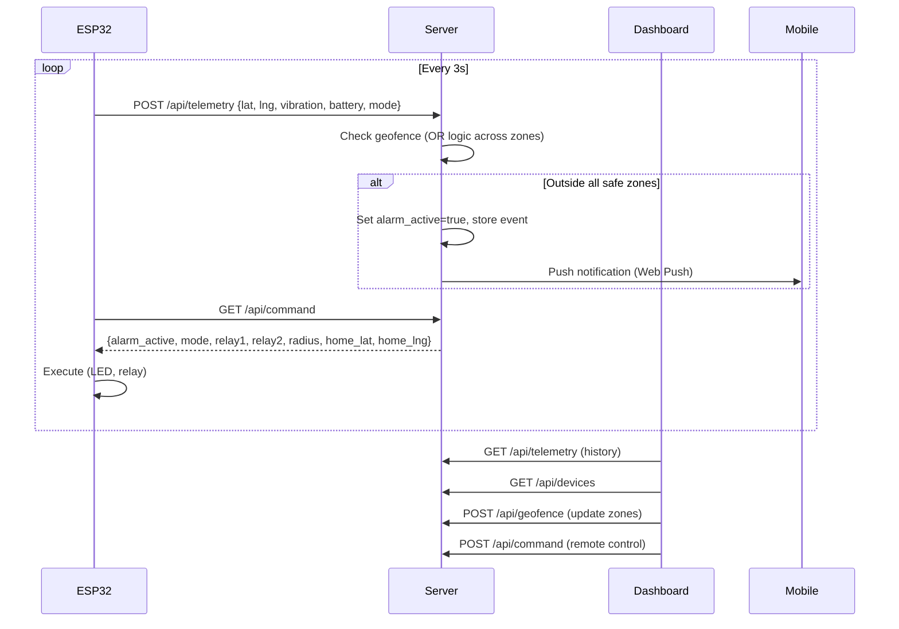

<!-- Improved compatibility of back to top link: See: https://github.com/othneildrew/Best-README-Template/pull/73 -->
<a id="readme-top"></a>

<!-- PROJECT SHIELDS -->
<!--
*** Using markdown "reference style" links for readability.
*** Reference links are enclosed in brackets [ ] instead of parentheses ( ).
*** See the bottom of this document for the declaration of the reference variables
*** for contributors-url, forks-url, etc. This is an optional, concise syntax you may use.
*** https://www.markdownguide.org/basic-syntax/#reference-style-links
-->
[![Contributors][contributors-shield]][contributors-url]
[![Forks][forks-shield]][forks-url]
[![Stargazers][stars-shield]][stars-url]
[![Issues][issues-shield]][issues-url]
[![MIT License][license-shield]][license-url]
[![LinkedIn][linkedin-shield]][linkedin-url]


<!-- PROJECT LOGO -->
<br />
<div align="center">
  <a href="https://github.com/your_username/Smart-Theft-IoT">
    
  </a>

  <h3 align="center">SMART — Smart Theft IoT</h3>
  <p align="center">
    <strong>Anti-Theft Vehicle Protection System</strong> — ESP32 + Web API + Dashboard
    <br />
    <em>Server-side intelligence. Device stays dumb.</em>
    <br />
    <br />
    <a href="https://github.com/your_username/Smart-Theft-IoT"><strong>Explore the docs »</strong></a>
    <br />
    <br />
    <a href="https://github.com/your_username/Smart-Theft-IoT/issues/new?labels=bug&template=bug-report.md">Report Bug</a>
    &middot;
    <a href="https://github.com/your_username/Smart-Theft-IoT/issues/new?labels=enhancement&template=feature-request.md">Request Feature</a>
    &middot;
    <a href="https://github.com/your_username/Smart-Theft-IoT/discussions">Discussions</a>
  </p>
</div>


<!-- TABLE OF CONTENTS -->
<details>
  <summary><strong>Table of Contents</strong></summary>
  <ol>
    <li>
      <a href="#about-the-project">About The Project</a>
      <ul>
        <li><a href="#key-features">Key Features</a></li>
        <li><a href="#built-with">Built With</a></li>
      </ul>
    </li>
    <li>
      <a href="#architecture">Architecture</a>
      <ul>
        <li><a href="#core-principles">Core Principles</a></li>
        <li><a href="#data-flow">Data Flow</a></li>
        <li><a href="#repo-structure">Repo Structure</a></li>
      </ul>
    </li>
    <li>
      <a href="#getting-started">Getting Started</a>
      <ul>
        <li><a href="#prerequisites">Prerequisites</a></li>
        <li><a href="#quick-start">Quick Start</a></li>
        <li><a href="#esp32-firmware">ESP32 Firmware</a></li>
      </ul>
    </li>
    <li>
      <a href="#connectivity-modes">Connectivity Modes</a>
      <ul>
        <li><a href="#mode-a--lan-local-development">Mode A — LAN (Local Development)</a></li>
        <li><a href="#mode-b--cloudflare-tunnel-internet-access">Mode B — Cloudflare Tunnel (Internet Access)</a></li>
      </ul>
    </li>
    <li><a href="#api-reference">API Reference</a></li>
    <li><a href="#dashboard">Dashboard</a></li>
    <li><a href="#documentation">Documentation</a></li>
    <li><a href="#roadmap">Roadmap</a></li>
    <li><a href="#contributing">Contributing</a></li>
    <li><a href="#license">License</a></li>
    <li><a href="#contact">Contact</a></li>
    <li><a href="#acknowledgments">Acknowledgments</a></li>
  </ol>
</details>


<!-- ABOUT THE PROJECT -->
## About The Project

<div align="center">
  
  <br />
  <em>System Architecture Overview</em>
</div>

<br />

**SMART (Smart Theft IoT)** is an anti-theft vehicle protection system built on a **server-centric architecture**. Unlike traditional IoT projects where the microcontroller handles business logic, SMART keeps the ESP32 as a **dumb device** — it only reads sensors and actuates outputs. All security decisions (geofencing, alarm triggers, mode transitions) are computed on the server.

### Why this approach?

| Traditional IoT | SMART Approach |
|----------------|----------------|
| Logic on device — hard to update | **Logic on server — instant updates** |
| Complex firmware, fragile OTA | **Simple firmware, reliable** |
| Each device needs config | **Centralized config, fleet-ready** |
| Debugging requires physical access | **Full observability from dashboard** |

### Key Features

- 🛰️ **Real-time GPS Tracking** — NEO-6M module, 3-second telemetry interval
- 📳 **Vibration Detection** — MPU6050 accelerometer for tamper alerts
- 🔋 **Battery Monitoring** — ADC voltage reading with low-battery warnings
- 🛡️ **Multi-Zone Geofencing** — OR-logic safe zones (home, office, garage)
- 🚨 **Server-Side Alarm Logic** — Instant alarm activation on boundary breach
- 📱 **Push Notifications** — Web Push API (VAPID) for mobile alerts
- 🌐 **Dual Backend Support** — SQLite (production) + In-memory (testing)
- 🔒 **Secure Tunneling** — Cloudflare Tunnel for zero-config internet access
- 🎨 **Modern Dashboard** — Liquid Glass UI with React + Tailwind CSS

<p align="right">(<a href="#readme-top">back to top</a>)</p>


### Built With

[![ESP32][ESP32-badge]][ESP32-url]
[![PlatformIO][PlatformIO-badge]][PlatformIO-url]
[![Node.js][Node.js-badge]][Node.js-url]
[![Express][Express-badge]][Express-url]
[![SQLite][SQLite-badge]][SQLite-url]
[![React][React-badge]][React-url]
[![Vite][Vite-badge]][Vite-url]
[![TailwindCSS][Tailwind-badge]][Tailwind-url]
[![TypeScript][TypeScript-badge]][TypeScript-url]
[![Cloudflare][Cloudflare-badge]][Cloudflare-url]

<p align="right">(<a href="#readme-top">back to top</a>)</p>


<!-- ARCHITECTURE -->
## Architecture

### Core Principles

```
┌─────────────────────────────────────────────────────────────────────┐
│                        SMART SYSTEM ARCHITECTURE                    │
├─────────────────────────────────────────────────────────────────────┤
│                                                                     │
│   ┌──────────────┐         HTTPS          ┌────────────────────┐   │
│   │   ESP32      │ ─────────────────────► │   SERVER           │   │
│   │  (Device)    │ ◄───────────────────── │  (Brain)           │   │
│   └──────────────┘   Poll Commands        └────────────────────┘   │
│        │                    │                      │                │
│        ▼                    ▼                      ▼                │
│   ┌─────────┐         ┌───────────┐         ┌───────────┐         │
│   │ Sensors │         │  SQLite   │         │ Dashboard │         │
│   │ GPS     │         │  Events   │         │  (React)  │         │
│   │ MPU6050 │         │  Config   │         │  + Push   │         │
│   │ Battery │         │  Devices  │         │             │         │
│   └─────────┘         └───────────┘         └───────────┘         │
│                                                                     │
└─────────────────────────────────────────────────────────────────────┘
```

1. **ESP32 sends raw telemetry** — GPS coordinates, vibration magnitude, battery voltage, current mode — every **3 seconds** via `POST /api/telemetry`
2. **Server evaluates geofence** — Checks if position is inside **any** safe zone (OR logic). If outside all zones → `alarm_active: true`
3. **ESP32 polls commands** — Every **3 seconds** `GET /api/command` returns `mode`, `relay1`, `relay2`, `alarm_active`, geofence radius, home coordinates
4. **ESP32 executes** — Drives LED (red blink = alarm), relay (immobilizer), status LED (green = armed)
5. **Dashboard consumes same API** — No direct browser↔ESP32 connection

### Data Flow



### Repo Structure

```
Smart-Theft-IoT/
├── README.md                        # ← You are here
├── docs/                            # Documentation
│   ├── README.md                    # Documentation index
│   ├── SMARTGUARD_Core_v5.1_Clean.md    # Full specification
│   ├── Web_Testing.md               # Dashboard & testing guide
│   ├── SMARTGUARD_Web_Development_Contract.md
│   ├── smartguard_alur_kerja.png    # Workflow diagram
│   └── assets/                      # Images, logos
├── hardprogramming/                 # ESP32 Firmware (PlatformIO)
│   └── Smart-Guard-Hardprog/
│       ├── src/
│       │   ├── main_1.cpp           # Main firmware
│       │   ├── config.h.example     # Config template
│       │   └── config.h             # Your config (gitignored)
│       ├── platformio.ini
│       └── README.md
├── Web/                             # Production Backend + Frontend
│   ├── Backend/                     # Node.js + Express + SQLite
│   │   ├── server.js                # Main server
│   │   ├── package.json
│   │   ├── smartguard.db            # SQLite database (gitignored)
│   │   └── README.md
│   └── Frontend/                    # Static HTML + Tailwind (served by Backend)
│       ├── index.html
│       ├── app.js
│       └── README.md
├── web-testing/                     # Development Environment
│   ├── server.js                    # Express + In-memory (port 3001)
│   ├── package.json
│   ├── frontend/                    # React + Vite + Tailwind (port 5173)
│   │   ├── src/
│   │   ├── index.html
│   │   └── package.json
│   ├── start-dev.ps1                # Start both servers (Windows)
│   └── README.md
├── TODO.md                          # Team task tracker
└── LICENSE                          # MIT License
```

<p align="right">(<a href="#readme-top">back to top</a>)</p>


<!-- GETTING STARTED -->
## Getting Started

### Prerequisites

| Tool | Version | Purpose |
|------|---------|---------|
| **Node.js** | ≥ 18.0.0 | Backend & Frontend |
| **npm** | ≥ 9.0.0 | Package manager |
| **PlatformIO** | Latest | ESP32 firmware build/upload |
| **VS Code** | Latest | Recommended IDE |
| **cloudflared** | Latest | Internet tunneling (optional) |
| **Git** | Latest | Version control |

<details>
<summary><strong>Install PlatformIO (VS Code Extension)</strong></summary>

1. Open VS Code → Extensions (Ctrl+Shift+X)
2. Search "PlatformIO IDE" → Install
3. Restart VS Code → PlatformIO Home opens automatically
4. Wait for initial setup to complete

</details>

<details>
<summary><strong>Install cloudflared (Windows)</strong></summary>

```powershell
# Option 1: Chocolatey
choco install cloudflared

# Option 2: Scoop
scoop install cloudflared

# Option 3: Manual
# Download from https://github.com/cloudflare/cloudflared/releases
# Extract to C:\Program Files (x86)\cloudflared\
# Add to PATH
```

Verify: `cloudflared --version`

</details>

### Quick Start

#### 1️⃣ Start Backend + Dashboard (Production)

```powershell
cd Web/Backend
npm install          # First time only
npm start            # Runs on http://127.0.0.1:8000
```

> Dashboard served at `http://127.0.0.1:8000`  
> API base: `http://127.0.0.1:8000/api`

#### 2️⃣ Start Development Environment (Testing)

```powershell
cd web-testing
.\start-dev.ps1      # Starts API (3001) + Vite (5173) simultaneously
```

> Dashboard: `http://localhost:5173`  
> API: `http://localhost:3001/api`

#### 3️⃣ Configure & Flash ESP32

```powershell
cd hardprogramming/Smart-Guard-Hardprog
copy src\config.h.example src\config.h
# Edit config.h with your WiFi credentials and API URL
notepad src\config.h

# Build & Upload
pio run -t upload

# Monitor Serial (baud 115200)
pio device monitor
```

**config.h example:**
```c
#ifndef CONFIG_H
#define CONFIG_H

// WiFi Credentials
#define WIFI_SSID "YOUR_WIFI_SSID"
#define WIFI_PASSWORD "YOUR_WIFI_PASSWORD"

// Server URL (choose one)
// Local LAN (Mode A):
#define WEB_API_URL "http://192.168.1.50:3001"
// Internet via Cloudflare (Mode B):
// #define WEB_API_URL "https://abc123.trycloudflare.com"

#define DEVICE_ID "SG-001"
#define TELEMETRY_INTERVAL_MS 3000
#define COMMAND_POLL_INTERVAL_MS 3000

#endif
```

<p align="right">(<a href="#readme-top">back to top</a>)</p>


### ESP32 Firmware Details

| Component | Pin | Purpose |
|-----------|-----|---------|
| GPS NEO-6M (TX/RX) | GPIO 16 / 17 | UART2 |
| MPU6050 (SDA/SCL) | GPIO 21 / 22 | I2C |
| Battery ADC | GPIO 34 | Voltage divider |
| Relay 1 (Immobilizer) | GPIO 26 | Active LOW |
| Relay 2 (Accessory) | GPIO 27 | Active LOW |
| LED Green (Armed) | GPIO 25 | Status |
| LED Red (Alarm) | GPIO 33 | Alarm indicator |
| Buzzer | GPIO 32 | Audio alert |

**Key firmware behaviors:**
- **WiFi auto-reconnect** with exponential backoff
- **HTTPS via `WiFiClientSecure::setInsecure()`** — works with Cloudflare Tunnel
- **NTP time sync** for timestamped telemetry
- **Watchdog timer** — auto-reboot on freeze
- **Preferences (NVS)** — persists `HOME` coordinates, mode, device ID

<p align="right">(<a href="#readme-top">back to top</a>)</p>


<!-- CONNECTIVITY MODES -->
## Connectivity Modes

### Mode A — LAN (Local Development)

**Use when:** ESP32 and server are on the same Wi-Fi network.

```
ESP32 (192.168.1.100) ────── Wi-Fi ────── Laptop (192.168.1.50)
                                                      │
                                                      ▼
                                              Server: 192.168.1.50:3001
```

**Setup:**
1. Find laptop IP: `ipconfig` (Windows) / `ifconfig` (Linux/macOS)
2. Set `WEB_API_URL` in `config.h`:
   ```c
   #define WEB_API_URL "http://192.168.1.50:3001"
   ```
3. Flash ESP32

**Pros:** Zero config, lowest latency, no internet needed  
**Cons:** Only works on local network

---

### Mode B — Cloudflare Tunnel (Internet Access)

**Use when:** ESP32 must send data from anywhere (cellular, different Wi-Fi), or dashboard needs public access.

```
ESP32 (anywhere) ──HTTPS──► https://xyz.trycloudflare.com
                                        │
                                        ▼ (encrypted tunnel)
                              Laptop: cloudflared → localhost:8000
```

**What is cloudflared?**  
Official Cloudflare CLI that creates an **outbound-only tunnel** from your machine to Cloudflare's edge. No port forwarding, no public IP, no firewall rules. Traffic flows through Cloudflare's global network with HTTPS termination at the edge.

**Setup:**

```powershell
# Terminal 1: Start your server (Backend or web-testing)
cd Web/Backend
npm start   # Runs on localhost:8000

# Terminal 2: Start tunnel
cloudflared tunnel --url http://localhost:8000
```

Output:
```
2024-01-15T10:30:00Z INF Starting tunnel...
2024-01-15T10:30:02Z INF Tunnel started at https://a1b2c3d4-e5f6-7890-abcd-ef1234567890.trycloudflare.com
```

4. Copy the `https://...trycloudflare.com` URL
5. Update `config.h`:
   ```c
   #define WEB_API_URL "https://a1b2c3d4-e5f6-7890-abcd-ef1234567890.trycloudflare.com"
   ```
6. Reflash ESP32

**Important Notes:**
- URL changes on every `cloudflared` restart (unless using Named Tunnels)
- Firmware uses `setInsecure()` — accepts Cloudflare's cert without CA bundle
- For permanent URL: `cloudflared tunnel create smartguard` + DNS config

<p align="right">(<a href="#readme-top">back to top</a>)</p>


<!-- API REFERENCE -->
## API Reference

Base URL: `http://localhost:3001/api` (testing) or `http://localhost:8000/api` (production)

### Device Endpoints

| Method | Endpoint | Description |
|--------|----------|-------------|
| `POST` | `/telemetry` | Receive device telemetry |
| `GET` | `/command` | Device polls for commands |
| `POST` | `/register` | Register new device |
| `GET` | `/devices` | List all registered devices |
| `GET` | `/devices/:id` | Get device details |
| `DELETE` | `/devices/:id` | Delete device |

### Telemetry Payload (POST /api/telemetry)

```json
{
  "device_id": "SG-001",
  "timestamp": 1705312800000,
  "gps": { "lat": -6.2088, "lng": 106.8456, "valid": true },
  "vibration": 0.12,
  "battery_voltage": 12.4,
  "mode": "armed",
  "alarm_active": false
}
```

### Command Response (GET /api/command)

```json
{
  "device_id": "SG-001",
  "mode": "armed",
  "relay1": true,
  "relay2": false,
  "alarm_active": false,
  "geofence_radius": 100,
  "home_lat": -6.2088,
  "home_lng": 106.8456,
  "safe_zones": [
    { "name": "Home", "lat": -6.2088, "lng": 106.8456, "radius": 100 },
    { "name": "Office", "lat": -6.2100, "lng": 106.8500, "radius": 50 }
  ]
}
```

### Geofence Management

| Method | Endpoint | Description |
|--------|----------|-------------|
| `GET` | `/geofence` | Get all safe zones |
| `POST` | `/geofence` | Create/update safe zone |
| `DELETE` | `/geofence/:id` | Delete safe zone |

### Events & History

| Method | Endpoint | Description |
|--------|----------|-------------|
| `GET` | `/events` | Alarm events (paginated) |
| `GET` | `/telemetry/history` | Telemetry history (paginated) |
| `GET` | `/stats` | System statistics |

### Push Notifications (VAPID)

| Method | Endpoint | Description |
|--------|----------|-------------|
| `GET` | `/vapid/public-key` | Get VAPID public key |
| `POST` | `/push/subscribe` | Subscribe to push |
| `POST` | `/push/unsubscribe` | Unsubscribe |

<details>
<summary><strong>Full API Documentation</strong></summary>

See [`Web/Backend/README.md`](Web/Backend/README.md#api-endpoints) and [`docs/Web_Testing.md`](docs/Web_Testing.md#api-endpoints) for complete request/response schemas, error codes, and examples.

</details>

<p align="right">(<a href="#readme-top">back to top</a>)</p>


<!-- DASHBOARD -->
## Dashboard

### Production Dashboard (`Web/Frontend`)
- **Static HTML + Tailwind CSS** — served directly by Backend
- **Zero build step** — edit and refresh
- **Liquid Glass UI** — modern glassmorphism design
- **Real-time updates** — 3-second polling + Server-Sent Events (planned)

### Development Dashboard (`web-testing/frontend`)
- **React 18 + TypeScript + Vite**
- **Tailwind CSS** with custom design system
- **Component library** — reusable UI components
- **Hot Module Replacement** — instant dev feedback

### Features

| Feature | Production | Development |
|---------|------------|-------------|
| Live Map (Leaflet) | ✅ | ✅ |
| Device List | ✅ | ✅ |
| Geofence Editor | ✅ | ✅ |
| Event Timeline | ✅ | ✅ |
| Push Notifications | ✅ | ✅ |
| Dark/Light Theme | ✅ | ✅ |
| PWA Support | Planned | ✅ |

### Screenshots

<div align="center">
  
  
  <br />
  <em>Live Tracking & Event Timeline</em>
</div>

<p align="right">(<a href="#readme-top">back to top</a>)</p>


<!-- DOCUMENTATION -->
## Documentation

| Document | Description |
|----------|-------------|
| [`docs/SMARTGUARD_Core_v5.1_Clean.md`](docs/SMARTGUARD_Core_v5.1_Clean.md) | **Complete specification** — Architecture, data contracts, API, BLE, battery, security |
| [`docs/Web_Testing.md`](docs/Web_Testing.md) | Dashboard guide, Liquid Glass design, `server.js` endpoints, testing procedures |
| [`docs/SMARTGUARD_Web_Development_Contract.md`](docs/SMARTGUARD_Web_Development_Contract.md) | Development contract & milestones |
| [`Web/Backend/README.md`](Web/Backend/README.md) | Backend setup, SQLite schema, API details |
| [`Web/Frontend/README.md`](Web/Frontend/README.md) | Production frontend structure |
| [`web-testing/README.md`](web-testing/README.md) | Dev environment, React components, Vite config |
| [`hardprogramming/Smart-Guard-Hardprog/README.md`](hardprogramming/Smart-Guard-Hardprog/README.md) | Firmware build, pinout, config, debugging |

<p align="right">(<a href="#readme-top">back to top</a>)</p>


<!-- ROADMAP -->
## Roadmap

- [x] Core server-side geofence logic (OR multi-zone)
- [x] ESP32 telemetry + command polling loop
- [x] SQLite persistence (production backend)
- [x] React + Tailwind development dashboard
- [x] Web Push notifications (VAPID)
- [x] Cloudflare Tunnel integration guide
- [ ] **Named Cloudflare Tunnel** — permanent custom domain
- [ ] **BLE Provisioning** — WiFi config via phone app
- [ ] **OTA Updates** — Firmware updates over HTTPS
- [ ] **Fleet Management** — Multi-device groups, bulk config
- [ ] **Historical Analytics** — Trip replay, heatmaps, statistics
- [ ] **Mobile App** — React Native / Flutter companion
- [ ] **Server-Sent Events** — Real-time dashboard updates
- [ ] **Unit & Integration Tests** — CI/CD pipeline
- [ ] **Docker Compose** — One-command production deploy

See [`TODO.md`](TODO.md) for detailed task breakdown.

<p align="right">(<a href="#readme-top">back to top</a>)</p>


<!-- CONTRIBUTING -->
## Contributing

Contributions are what make the open source community such an amazing place to learn, inspire, and create. Any contributions you make are **greatly appreciated**.

### How to Contribute

1. **Fork the Project**
2. **Create your Feature Branch**  
   `git checkout -b feature/AmazingFeature`
3. **Commit your Changes**  
   `git commit -m 'Add some AmazingFeature'`
4. **Push to the Branch**  
   `git push origin feature/AmazingFeature`
5. **Open a Pull Request**

### Development Guidelines

- **Code Style:** ESLint + Prettier (configured in each package)
- **Commits:** Conventional Commits (`feat:`, `fix:`, `docs:`, `refactor:`)
- **Branching:** `main` (stable), `develop` (integration), `feature/*`, `fix/*`
- **Testing:** Write tests for new features (Jest for JS, Unity for C++)
- **Documentation:** Update relevant docs with every change

### Top Contributors

<a href="https://github.com/your_username/Smart-Theft-IoT/graphs/contributors">
  
</a>

<p align="right">(<a href="#readme-top">back to top</a>)</p>


<!-- LICENSE -->
## License

Distributed under the **MIT License**. See [`LICENSE`](LICENSE) for more information.

<p align="right">(<a href="#readme-top">back to top</a>)</p>


<!-- CONTACT -->
## Contact

**Project Maintainer** — [@your_twitter](https://twitter.com/your_username) — email@example.com

**Project Link:** [https://github.com/your_username/Smart-Theft-IoT](https://github.com/your_username/Smart-Theft-IoT)

<p align="right">(<a href="#readme-top">back to top</a>)</p>


<!-- ACKNOWLEDGMENTS -->
## Acknowledgments

Resources and libraries that made this project possible:

- [ESP32 Arduino Core](https://github.com/espressif/arduino-esp32) — ESP32 framework
- [PlatformIO](https://platformio.org/) — Professional embedded development
- [TinyGPS++](https://github.com/mikalhart/TinyGPSPlus) — GPS parsing
- [MPU6050_tockn](https://github.com/tockn/MPU6050_tockn) — Accelerometer driver
- [Express.js](https://expressjs.com/) — Fast, unopinionated web framework
- [Better-SQLite3](https://github.com/WiseLibs/better-sqlite3) — Fast SQLite bindings
- [React](https://react.dev/) — UI library
- [Vite](https://vitejs.dev/) — Next-gen frontend tooling
- [Tailwind CSS](https://tailwindcss.com/) — Utility-first CSS
- [Leaflet](https://leafletjs.com/) — Interactive maps
- [Cloudflare Tunnel](https://developers.cloudflare.com/cloudflare-one/connections/connect-apps/) — Zero-trust connectivity
- [web-push](https://github.com/web-push-libs/web-push) — Web Push protocol
- [Best-README-Template](https://github.com/othneildrew/Best-README-Template) — README structure inspiration
- [Shields.io](https://shields.io/) — Badges
- [Contrib.rocks](https://contrib.rocks/) — Contributor avatars

<p align="right">(<a href="#readme-top">back to top</a>)</p>


<!-- MARKDOWN LINKS & IMAGES -->
<!-- https://www.markdownguide.org/basic-syntax/#reference-style-links -->

[contributors-shield]: https://img.shields.io/github/contributors/your_username/Smart-Theft-IoT.svg?style=for-the-badge
[contributors-url]: https://github.com/your_username/Smart-Theft-IoT/graphs/contributors
[forks-shield]: https://img.shields.io/github/forks/your_username/Smart-Theft-IoT.svg?style=for-the-badge
[forks-url]: https://github.com/your_username/Smart-Theft-IoT/network/members
[stars-shield]: https://img.shields.io/github/stars/your_username/Smart-Theft-IoT.svg?style=for-the-badge
[stars-url]: https://github.com/your_username/Smart-Theft-IoT/stargazers
[issues-shield]: https://img.shields.io/github/issues/your_username/Smart-Theft-IoT.svg?style=for-the-badge
[issues-url]: https://github.com/your_username/Smart-Theft-IoT/issues
[license-shield]: https://img.shields.io/github/license/your_username/Smart-Theft-IoT.svg?style=for-the-badge
[license-url]: https://github.com/your_username/Smart-Theft-IoT/blob/main/LICENSE
[linkedin-shield]: https://img.shields.io/badge/-LinkedIn-black.svg?style=for-the-badge&logo=linkedin&colorB=555
[linkedin-url]: https://linkedin.com/in/your_username

[ESP32-badge]: https://img.shields.io/badge/ESP32-E7352C?style=for-the-badge&logo=espressif&logoColor=white
[ESP32-url]: https://www.espressif.com/en/products/socs/esp32
[PlatformIO-badge]: https://img.shields.io/badge/PlatformIO-F58220?style=for-the-badge&logo=platformio&logoColor=white
[PlatformIO-url]: https://platformio.org/
[Node.js-badge]: https://img.shields.io/badge/Node.js-339933?style=for-the-badge&logo=nodedotjs&logoColor=white
[Node.js-url]: https://nodejs.org/
[Express-badge]: https://img.shields.io/badge/Express-000000?style=for-the-badge&logo=express&logoColor=white
[Express-url]: https://expressjs.com/
[SQLite-badge]: https://img.shields.io/badge/SQLite-003B57?style=for-the-badge&logo=sqlite&logoColor=white
[SQLite-url]: https://www.sqlite.org/
[React-badge]: https://img.shields.io/badge/React-61DAFB?style=for-the-badge&logo=react&logoColor=black
[React-url]: https://react.dev/
[Vite-badge]: https://img.shields.io/badge/Vite-646CFF?style=for-the-badge&logo=vite&logoColor=white
[Vite-url]: https://vitejs.dev/
[Tailwind-badge]: https://img.shields.io/badge/Tailwind_CSS-06B6D4?style=for-the-badge&logo=tailwindcss&logoColor=white
[Tailwind-url]: https://tailwindcss.com/
[TypeScript-badge]: https://img.shields.io/badge/TypeScript-3178C6?style=for-the-badge&logo=typescript&logoColor=white
[TypeScript-url]: https://www.typescriptlang.org/
[Cloudflare-badge]: https://img.shields.io/badge/Cloudflare-F38020?style=for-the-badge&logo=cloudflare&logoColor=white
[Cloudflare-url]: https://www.cloudflare.com/