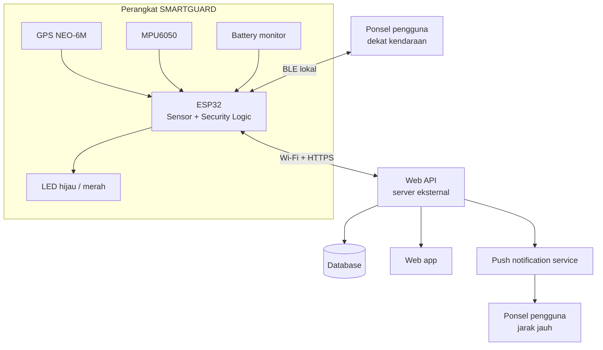
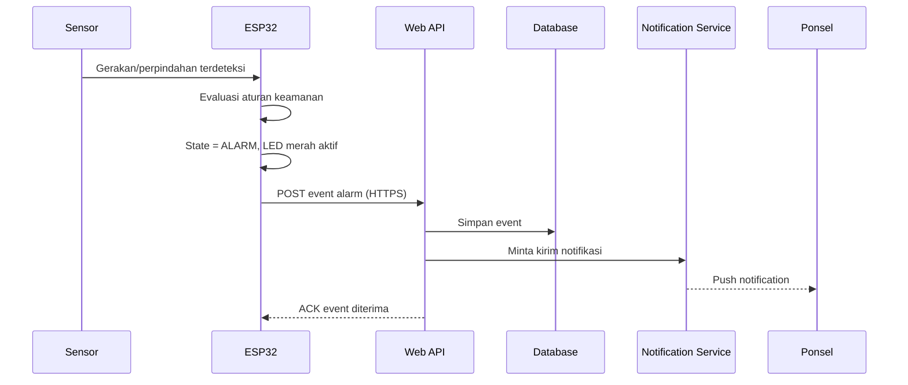
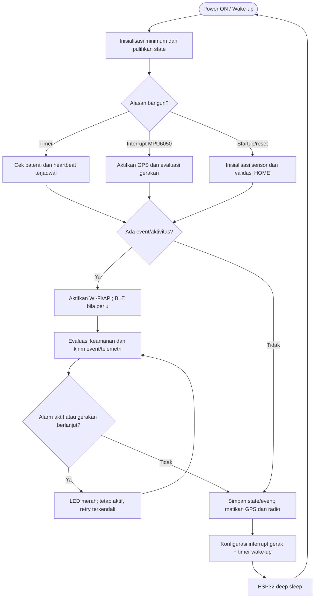
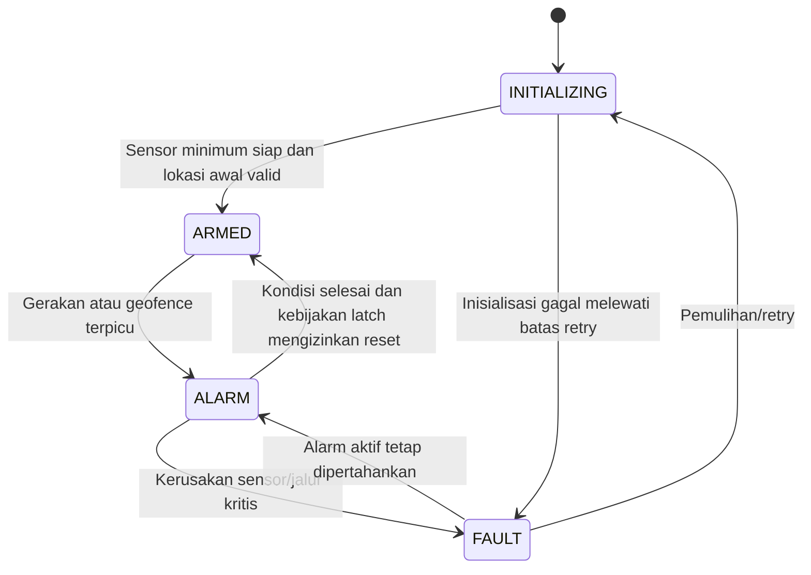
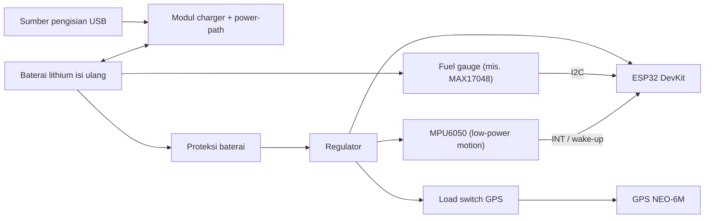

# 🛡️ SMARTGUARD — Master Development Document

**Smart Anti-Theft GPS Vehicle Tracker berbasis ESP32**

   

> [!IMPORTANT]
> Dokumen ini adalah **spesifikasi rancangan**, bukan bukti bahwa fitur sudah diimplementasikan atau lolos uji. Firmware v4 **tidak** kompatibel langsung dengan v5 (tombol, buzzer, dashboard lokal, Blynk, alur jaringan, payload, dan status baterai berubah). Rangkaian, firmware, API, BLE, notifikasi, dan pembacaan baterai wajib diuji di hardware nyata sebelum dipakai pada kendaraan.

## 📋 Spesifikasi Singkat

| Properti                | Spesifikasi                                                |
| ----------------------- | ---------------------------------------------------------- |
| Mikrokontroler          | ESP32 DevKit V1 (ESP32 klasik)                             |
| Sensor lokasi           | GPS NEO-6M                                                 |
| Sensor gerak            | MPU6050 / GY-521                                           |
| Indikator               | LED hijau + LED merah                                      |
| Alarm                   | Notifikasi ke ponsel (tanpa buzzer)                        |
| Kontrol fisik           | Tidak ada tombol; pemantauan mulai otomatis                |
| Konektivitas lokal      | Bluetooth Low Energy (BLE)                                 |
| Konektivitas jarak jauh | Wi-Fi/internet dari ESP32 → Web API eksternal              |
| Catu daya               | Baterai lithium isi ulang + charger, proteksi, regulator   |
| Monitoring baterai      | Tegangan + estimasi kapasitas                              |
| Manajemen daya          | Deep sleep saat idle; bangun lewat interrupt gerak & timer |

## 📑 Daftar Isi

1. [Ringkasan & Aturan Desain](#1--ringkasan--aturan-desain)
2. [Ruang Lingkup](#2--ruang-lingkup)
3. [Arsitektur](#3--arsitektur)
4. [Hardware](#4--hardware)
5. [Logika Sistem](#5--logika-sistem)
6. [Manajemen Daya Adaptif](#6--manajemen-daya-adaptif)
7. [Firmware ESP32](#7--firmware-esp32)
8. [Baterai](#8--baterai)
9. [Kontrak Data](#9--kontrak-data)
10. [Web API](#10--web-api)
11. [Bluetooth LE](#11--bluetooth-le)
12. [Web App & Notifikasi](#12--web-app--notifikasi)
13. [Keamanan & Mode Offline](#13--keamanan--mode-offline)
14. [Instalasi](#14--instalasi--konfigurasi)
15. [Rencana Pengujian](#15--rencana-pengujian)
16. [Troubleshooting](#16--troubleshooting)
17. [Roadmap](#17--roadmap-implementasi)
18. [Lampiran](#18--lampiran)

---

## 1. 🎯 Ringkasan & Aturan Desain

### 1.1 Cara kerja

ESP32 membaca GPS dan MPU6050, menentukan status keamanan, mengirim status/event ke Web API, dan menyediakan akses lokal lewat BLE.

Saat mendeteksi gerakan mencurigakan atau perpindahan melewati batas geofence, perangkat masuk ke `ALARM`, menyalakan LED merah, lalu mengirim event ke server. Server meneruskannya sebagai notifikasi ke ponsel.

Untuk hemat baterai, MPU6050 tetap aktif di mode deteksi gerak berdaya rendah, sedangkan ESP32 masuk **deep sleep** saat kendaraan diam. Wi-Fi, BLE, dan GPS hanya dinyalakan saat dibutuhkan.

> [!NOTE]
> Tanpa tombol bukan berarti perangkat tetap bekerja saat baterai habis, kabel putus, atau hardware rusak. Kondisi itu harus tampil sebagai **offline/fault** di web app.

### 1.2 Aturan desain utama

|   # | Aturan                                 | Dampak implementasi                                                               |
| --: | -------------------------------------- | --------------------------------------------------------------------------------- |
|   1 | ESP32 memutuskan keamanan secara lokal | Sensor dan logika alarm tetap jalan walau server tidak bisa diakses               |
|   2 | BLE ≠ internet                         | BLE untuk jarak dekat; Wi-Fi dari perangkat untuk kirim data jarak jauh           |
|   3 | Tidak ada data ≠ aman                  | Data lama, offline, baterai kritis, atau sensor gagal harus ditampilkan eksplisit |
|   4 | Tanpa buzzer & tombol                  | Alarm lewat LED + notifikasi digital                                              |
|   5 | Tidak ada `power_off`                  | API/BLE tidak boleh mematikan atau menonaktifkan pemantauan                       |
|   6 | Server eksternal = backend             | ESP32 kirim telemetri/event ke Web API; web app membaca lewat backend             |
|   7 | Kredensial tidak di browser            | Token/secret hanya di perangkat dan server                                        |
|   8 | Alarm tidak boleh hilang diam-diam     | Event disimpan lokal saat jaringan putus, dikirim ulang saat pulih                |
|   9 | Daya dihemat adaptif                   | Deep sleep saat idle; radio dan GPS tidak aktif terus-menerus                     |

### 1.3 Batas konektivitas

> [!WARNING]
> **Bluetooth saja tidak dapat mengirim alarm ke server saat ponsel jauh dari perangkat.**

Notifikasi jarak jauh butuh minimal satu jalur berikut:

1. ESP32 terhubung ke Wi-Fi beraksesi internet (hotspot ponsel atau jaringan di lokasi), atau
2. perangkat memakai modem seluler, atau
3. ponsel dekat perangkat, terhubung via BLE, dan menjalankan aplikasi relay ke internet.

**Desain utama v5.1:** `ESP32 → Wi-Fi/HTTPS → Web API`. BLE untuk status dan diagnostik lokal. Web Bluetooth tidak didukung merata di semua browser/OS; siapkan aplikasi pendamping bila dukungan lintas perangkat wajib.

---

## 2. 📦 Ruang Lingkup

### 2.1 Fitur v5.1

| Fitur                   | Status | Keterangan                                              |
| ----------------------- | :----: | ------------------------------------------------------- |
| Koordinat GPS           |   ✅   | Lat, lon, speed, jumlah satelit, status fix             |
| Deteksi gerak (MPU6050) |   ✅   | Ambang harus dikalibrasi di hardware                    |
| `HOME` otomatis         |   ✅   | Ditetapkan saat GPS fix valid                           |
| Geofence                |   ✅   | Awal 30 m; sesuaikan dengan hasil uji                   |
| Alarm lokal             |   ✅   | LED merah                                               |
| Notifikasi jarak jauh   |   ✅   | Event → Web API → push ke ponsel                        |
| BLE status/diagnostik   |   ✅   | Akses lokal jarak dekat                                 |
| Wi-Fi ke Web API        |   ✅   | Sinkronisasi jarak jauh tanpa relay ponsel              |
| Monitoring baterai      |   ✅   | Persentase = estimasi; fuel gauge lebih akurat          |
| Deep sleep adaptif      |   ✅   | MPU6050 membangunkan ESP32 saat ada gerakan             |
| Wi-Fi/BLE on-demand     |   ✅   | Radio mati saat deep sleep                              |
| GPS power gating        |   💡   | Disarankan; via load switch atau power-save yang teruji |

**Dihapus dari v4:** push button, buzzer, dashboard web lokal di ESP32, integrasi Blynk. **Tidak disediakan:** perintah `power_off`.

### 2.2 Di luar cakupan

- Relay untuk memutus/mengunci mesin kendaraan.
- Modem seluler/SIM di perangkat.
- Persentase baterai akurat dari tegangan saja tanpa kalibrasi.
- Jaminan anti-curi saat daya perangkat diputus fisik.
- Sertifikasi otomotif, proteksi daya automotive-grade, dan ketahanan cuaca (butuh enclosure + uji).

---

## 3. 🏗️ Arsitektur

### 3.1 Gambaran sistem



### 3.2 Tanggung jawab komponen

| Komponen            | Tanggung jawab                                                                                      |
| ------------------- | --------------------------------------------------------------------------------------------------- |
| **ESP32**           | Baca sensor, simpan state keamanan, deteksi gerak/perpindahan, kontrol LED, antre event, kirim data |
| **GPS NEO-6M**      | Koordinat dan status fix                                                                            |
| **MPU6050**         | Data percepatan/gerak untuk deteksi gangguan                                                        |
| **Battery monitor** | Ukur/estimasi tegangan dan kapasitas                                                                |
| **BLE**             | Status dan diagnostik lokal; bisa jadi jalur relay bila ada aplikasi pendamping                     |
| **Web API**         | Autentikasi perangkat, terima telemetri/event, simpan data, layani web app, picu notifikasi         |
| **Database**        | Status terakhir, riwayat lokasi, event keamanan, info perangkat                                     |
| **Web app**         | Dashboard, peta, online/offline, baterai, riwayat, preferensi notifikasi                            |
| **Push service**    | Kirim notifikasi ke ponsel setelah event diproses backend                                           |

### 3.3 Alur data alarm



Jika internet mati, ESP32 tetap masuk `ALARM` dan menyimpan event di antrean lokal. Event dikirim ulang saat jaringan pulih. Notifikasi jarak jauh tidak bisa dijamin selama tidak ada jalur internet.

### 3.4 Alur loop perangkat

Gunakan jadwal non-blocking berbasis `millis()`, hindari `delay()` panjang. Saat tidak ada gerakan, event, atau tugas jaringan, matikan radio dan GPS lalu masuk deep sleep. MPU6050 harus tetap diberi daya agar pin interrupt bisa membangunkan ESP32. Deep sleep mematikan Wi-Fi/Bluetooth, jadi koneksi harus dibangun ulang setelah bangun ([Espressif: Sleep Modes](https://docs.espressif.com/projects/esp-idf/en/latest/esp32/api-reference/system/sleep_modes.html)).



---

## 4. 🔧 Hardware

### 4.1 Daftar komponen

|  No | Komponen                       |   Qty | Catatan                                           |
| --: | ------------------------------ | ----: | ------------------------------------------------- |
|   1 | ESP32 DevKit V1                |     1 | Mikrokontroler utama                              |
|   2 | GPS NEO-6M                     |     1 | Pastikan kompatibilitas tegangan modul            |
|   3 | MPU6050 / GY-521               |     1 | Sensor gerak via I2C                              |
|   4 | LED hijau                      |     1 | Perangkat aktif / pemantauan normal               |
|   5 | LED merah                      |     1 | Alarm atau fault                                  |
|   6 | Resistor 220–330 Ω             |     2 | Pembatas arus LED                                 |
|   7 | Baterai lithium isi ulang      | 1 set | Shield double 18500; untuk prototyping dipakai 1 sel saja (1S) |
|   8 | Modul charger + proteksi       |     1 | Pengisian dan perlindungan baterai                |
|   9 | Regulator / boost converter    |     1 | Tegangan stabil sesuai input ESP32                |
|  10 | Fuel gauge (mis. MAX17048)     |     1 | Disarankan; estimasi SoC via I2C                  |
|  11 | Load switch / high-side MOSFET |     1 | Disarankan; memutus suplai GPS saat idle          |
|  12 | Kabel, konektor, PCB/enclosure | 1 set | Untuk pemakaian nyata                             |

> [!CAUTION]
> Jangan sambungkan sel Li-ion 1S langsung ke `VIN/5V` tanpa regulator yang sesuai. **Jangan pernah** sambungkan baterai langsung ke pin `3V3`. Pilih modul yang sanggup menangani lonjakan arus ESP32 saat Wi-Fi aktif. GPS tidak boleh diberi daya langsung dari GPIO.

### 4.2 Pin mapping

| Perangkat        | Sinyal             |  GPIO | Catatan                                                              |
| ---------------- | ------------------ | ----: | -------------------------------------------------------------------- |
| GPS NEO-6M       | TX GPS → RX ESP32  |    16 | UART2 RX                                                             |
| GPS NEO-6M       | RX GPS ← TX ESP32  |    17 | UART2 TX; sesuaikan level logika                                     |
| MPU6050          | SDA                |    21 | I2C                                                                  |
| MPU6050          | SCL                |    22 | I2C                                                                  |
| Relay 1          | IN relay (Active-LOW)|   32 | HIGH = mati, LOW = nyala; dikontrol via Blynk V3                     |
| Relay 2          | IN relay (Active-LOW)|   33 | HIGH = mati, LOW = nyala; blink 500 ms via Blynk V4                  |
| Battery ADC      | Pembagi tegangan   |    34 | Input-only, ADC1; wajib proteksi tegangan (opsional)                 |
| MAX17048         | SDA/SCL            | 21/22 | Berbagi I2C dengan MPU6050 jika alamat berbeda (opsional)            |

**Catatan verifikasi:**

- GPIO32 dan GPIO33 digunakan untuk Relay 1 dan Relay 2 (Active-LOW), bukan untuk LED/interrupt MPU6050.
- GPIO34 hanya input.
- Bila memakai MAX17048, pembagi tegangan di GPIO34 tidak wajib; pilih salah satu metode monitoring.

### 4.3 Wiring

```text
GPS NEO-6M                    ESP32 DevKit V1
  TX   ─────────────────────► GPIO16 (RX2)
  RX   ◄───────────────────── GPIO17 (TX2)
  GND  ─────────────────────► GND
  VCC  ─────────────────────► sesuai spesifikasi modul

MPU6050                       ESP32 DevKit V1
  VCC  ─────────────────────► 3V3 (umumnya untuk GY-521)
  GND  ─────────────────────► GND
  SDA  ─────────────────────► GPIO21
  SCL  ─────────────────────► GPIO22

Relay 1 (Active-LOW)          ESP32 DevKit V1
  IN  ─────────────────────► GPIO32   (HIGH = mati, LOW = nyala)
  VCC/GND ──► sesuai modul relay

Relay 2 (Active-LOW)          ESP32 DevKit V1
  IN  ─────────────────────► GPIO33   (HIGH = mati, LOW = nyala; blink 500 ms)
  VCC/GND ──► sesuai modul relay

Battery monitor ADC (opsional):
  Baterai + ──[R atas]──┬── GPIO34
                        └──[R bawah]── GND
  Baterai - ───────────────────────── GND ESP32
```

Untuk pembagi tegangan, hitung resistor dari tegangan baterai maksimum dan karakteristik ADC. Tegangan di GPIO tidak boleh melewati batas input ESP32. Pilih nilai yang hemat arus diam tapi tidak membuat pengukuran tidak stabil, lalu kalibrasi dengan multimeter.

### 4.4 Pola indikator (Relay)

| Pola                  | Arti                                                      |
| --------------------- | --------------------------------------------------------- |
| Relay 1 stabil        | ON/OFF via Blynk V3 (Active-LOW)                          |
| Relay 2 berkedip 500ms| Blink aktif via Blynk V4                                  |
| Relay 2 mati          | Tidak berkedip; sinyal HIGH (relay mati)                  |

Relay bukan bukti alarm sudah sampai ke ponsel. Status pengiriman event dibedakan menjadi `pending`, `sent`, dan `acknowledged`.

---

## 5. 🧠 Logika Sistem

### 5.1 State machine

| State          | Arti                                                                     |
| -------------- | ------------------------------------------------------------------------ |
| `INITIALIZING` | Perangkat baru menyala, menyiapkan sensor/jaringan                       |
| `ARMED`        | Pemantauan aktif                                                         |
| `ALARM`        | Aturan keamanan terpicu; LED merah aktif, event dibuat                   |
| `FAULT`        | Fungsi penting gagal (mis. sensor); tidak boleh ditampilkan sebagai aman |

> [!TIP]
> Idealnya status **kesehatan** dan status **keamanan** dipisah menjadi dua field agar kerusakan sensor tidak menimpa informasi alarm. `ARMED_SLEEP` adalah **mode daya**, bukan security state: keamanan tetap `ARMED` sementara ESP32 deep sleep.



### 5.2 Alur pemantauan otomatis

1. Daya tersedia → ESP32 inisialisasi tanpa menunggu tombol.
2. Baca GPS sampai fix valid. `HOME` tidak boleh dari nilai default atau koordinat nol.
3. `HOME` valid + sensor gerak siap → masuk `ARMED` otomatis.
4. Gerakan melewati ambang atau jarak melewati geofence → `ALARM`.
5. Saat alarm: perbarui LED, buat `event_id` unik, simpan ke antrean.
6. Internet tersedia → kirim ke Web API. Jika tidak, tahan di antrean dan retry dengan backoff.
7. Pemantauan terus berjalan selama alarm aktif; pengiriman berulang diberi rate limit.

### 5.3 Parameter awal (prototipe)

| Parameter                         | Nilai awal                         | Catatan                                                   |
| --------------------------------- | ---------------------------------- | --------------------------------------------------------- |
| Radius geofence                   | `30 m`                             | Sesuaikan dengan noise GPS & lingkungan                   |
| Masa tenang setelah `ARMED`       | `3 s`                              | Kurangi alarm akibat getaran awal                         |
| Status/telemetri saat aktif       | `15–60 s`                          | Hanya mode aktif, bukan polling konstan saat idle         |
| Heartbeat idle (deep sleep cycle) | `10–15 menit`                      | Bangun, kirim, tidur lagi                                 |
| Sampling baterai (aktif)          | `30–60 s`                          | Boleh beda dari interval kirim                            |
| Sampling baterai (idle)           | Saat timer wake / alert fuel gauge | Jangan bangunkan ESP32 hanya untuk telemetri non-esensial |
| Validasi gerak setelah wake       | `1–3 s` sampel                     | Atur dari data false positive                             |
| Timeout koneksi API               | `5–10 s`                           | Jangan tahan loop sensor                                  |
| Aktif setelah alarm               | `30–120 s`                         | Sesuaikan dengan strategi tracking & baterai              |
| BLE advertising window            | `20–30 s` setelah wake             | Opsional                                                  |
| Retry                             | Exponential backoff + jitter       | Tetapkan batas & strategi pemulihan                       |
| Batas antrean event               | Setelah estimasi storage           | Alarm diprioritaskan                                      |
| Batas kapasitas rendah            | Setelah pengujian                  | Kirim `battery_low` sebelum mati                          |
| LED normal saat idle              | `OFF`                              | Nyala hanya saat startup, status penting, alarm           |
| GPS saat idle                     | `OFF` / power-save teruji          | Pertimbangkan backup/retensi data modul                   |

> [!NOTE]
> Semua angka adalah nilai awal rancangan, **bukan hasil kalibrasi** dan bukan jaminan masa pakai baterai. Ambang MPU6050 dan persentase baterai belum akurat sebelum diuji pada perangkat terakit.

### 5.4 Jarak Haversine

```text
a = sin²(Δφ / 2) + cos(φ1) × cos(φ2) × sin²(Δλ / 2)
c = 2 × atan2(√a, √(1 − a))
d = R × c
```

`φ` = latitude (radian), `λ` = longitude (radian), `R ≈ 6.371.000 m`, `d` = jarak (meter). Pastikan GPS fix valid sebelum menghitung geofence.

### 5.5 Kebijakan alarm & reset

- Tidak ada tombol fisik atau perintah API untuk mematikan/menonaktifkan pemantauan.
- Setiap event alarm punya `event_id` unik agar retry tidak membuat duplikat.
- `acknowledge` hanya berarti pengguna sudah melihat event, **bukan** perangkat dimatikan.
- Walau alarm di-latch sampai diakui, sensor tetap membaca; kondisi mencurigakan yang berlanjut bisa menghasilkan event baru setelah cooldown.
- Reset `ALARM → ARMED` harus diimplementasikan eksplisit dan diuji. Event tidak dihapus hanya karena status kembali normal.

---

## 6. 🔋 Manajemen Daya Adaptif

> [!TIP]
> **Rekomendasi utama:** deep sleep berbasis interrupt gerak, bukan membiarkan ESP32, GPS, Wi-Fi, dan BLE aktif terus. MPU6050 tetap menyala di mode deteksi gerak berdaya rendah; pin `INT` membangunkan ESP32. ESP32 klasik mendukung wake-up deep sleep via RTC GPIO (GPIO33 pada DevKit V1 klasik). Pastikan chip dan pin board sebelum menerapkan ([Espressif](https://docs.espressif.com/projects/esp-idf/en/latest/esp32/api-reference/system/sleep_modes.html)).

### 6.1 Mode operasi

| Mode                | Komponen aktif                                                      | Kapan                                        | Kebijakan                                                                         |
| ------------------- | ------------------------------------------------------------------- | -------------------------------------------- | --------------------------------------------------------------------------------- |
| `BOOT/INITIALIZING` | ESP32, MPU6050, GPS sementara, battery monitor                      | Startup / wake yang butuh lokasi             | Init seperlunya; jangan reconnect Wi-Fi tanpa timeout                             |
| `ARMED_SLEEP`       | MPU6050 (motion interrupt), RTC/timer, fuel gauge; ESP32 deep sleep | Kendaraan diam, tak ada event pending        | Wi-Fi, BLE, GPS mati; LED normal mati                                             |
| `WAKE_CHECK`        | ESP32, MPU6050; GPS bila perlu                                      | Interrupt gerak atau timer                   | Ambil beberapa sampel untuk tapis getaran palsu sebelum radio dinyalakan          |
| `SYNC`              | ESP32 + Wi-Fi + HTTPS; BLE opsional                                 | Alarm, heartbeat terjadwal, antrean tertunda | Kirim data prioritas, putus radio setelah selesai/timeout                         |
| `ALARM_ACTIVE`      | Sensor gerak, GPS, ESP32, Wi-Fi saat retry, LED merah kedip         | Gerakan berlanjut / alarm masih aktif        | GPS update dan retry diberi interval/backoff                                      |
| `LOW_BATTERY`       | Sensor gerak + kontrol minimum; radio untuk alert penting           | Kapasitas rendah/kritis                      | Kurangi heartbeat & telemetri non-esensial; prioritaskan alarm dan baterai kritis |

### 6.2 Siklus tidur yang direkomendasikan

1. Setelah startup, dapatkan `HOME` valid dan simpan konfigurasi serta state alarm ke penyimpanan persisten. Jangan tulis flash di setiap sampel.
2. Konfigurasi MPU6050 untuk deteksi gerak berinterrupt. `INT` → GPIO33; cocokkan polaritas/level dengan wake-up firmware. Uji di kondisi nyata (getaran jalan, hujan, pemasangan sensor bisa memicu false positive).
3. Saat kendaraan stabil: hentikan Wi-Fi/BLE, matikan GPS (load switch atau power-save yang didukung modul), matikan LED hijau, jadwalkan timer, masuk deep sleep.
4. **Bangun karena gerakan:** validasi dengan beberapa sampel → bila berlanjut, aktifkan GPS, tunggu fix dengan timeout, buat event, nyalakan Wi-Fi, kirim ke API.
5. **Bangun karena timer:** cek baterai, kirim heartbeat (awal 10–15 menit, sesuaikan). **Alarm dikirim segera**, tidak menunggu heartbeat.
6. Setelah tenang, antrean terkirim/tersimpan aman, atau koneksi timeout → matikan radio/GPS, kembali tidur.
7. Jika jaringan tidak ada, simpan event persisten dan retry terjadwal dengan exponential backoff. Jangan nyalakan Wi-Fi tanpa batas.

### 6.3 Trade-off yang wajib dipahami

| Topik                                     | Penjelasan                                                                                                                                                                                                                                                                |
| ----------------------------------------- | ------------------------------------------------------------------------------------------------------------------------------------------------------------------------------------------------------------------------------------------------------------------------- |
| **Deep sleep memutus radio**              | Wi-Fi & BLE tidak bertahan saat tidur. Bila BLE harus selalu terdeteksi, pakai modem-sleep/automatic light sleep (konsumsi lebih tinggi)                                                                                                                                  |
| **BLE tidak bisa membangunkan ESP32**     | Gunakan _advertising window_ (20–30 s) setelah timer/event. Aplikasi tidak selalu bisa menemukan perangkat                                                                                                                                                                |
| **GPS tak perlu hidup terus**             | Matikan suplai saat diam. NEO-6 punya Power Save Mode di varian tertentu; periksa dukungan modul Anda ([datasheet](https://content.u-blox.com/sites/default/files/products/documents/NEO-6_DataSheet_%28GPS.G6-HW-09005%29.pdf)). Waktu fix setelah dinyalakan bervariasi |
| **Alarm tetap lokal**                     | ESP32 menandai alarm dulu, internet menyusul. Tanpa Wi-Fi dan tanpa ponsel di dekat, notifikasi jarak jauh tidak bisa sampai saat itu                                                                                                                                     |
| **DevKit V1 bukan board ultra-low-power** | Regulator, USB-serial bridge, dan power LED menaikkan arus tidur. Ukur di baterai; bila terlalu tinggi, pertimbangkan modul low-power atau PCB khusus                                                                                                                     |

---

## 7. 💻 Firmware ESP32

### 7.1 Modul

| Modul                | Tanggung jawab                                                |
| -------------------- | ------------------------------------------------------------- |
| `GpsService`         | Baca UART GPS, validasi fix, sediakan koordinat/speed/satelit |
| `MotionService`      | Baca MPU6050, hasilkan indikator gerak terfilter              |
| `BatteryService`     | Baca fuel gauge/tegangan, hasilkan estimasi dan status        |
| `SecurityManager`    | Kelola `HOME`, geofence, aturan gerak, state, pembuatan event |
| `LedController`      | Pola LED sesuai state keamanan & kesehatan                    |
| `BleService`         | Status dan diagnostik lokal                                   |
| `NetworkService`     | Wi-Fi, status koneksi, retry, matikan radio setelah selesai   |
| `PowerManager`       | Putuskan tetap aktif atau deep sleep; atur wake-up timer/GPIO |
| `GpsPowerController` | Kontrol load switch GPS (GPIO hanya ke EN)                    |
| `ApiClient`          | Kirim heartbeat, telemetri, event via HTTPS                   |
| `EventQueue`         | Simpan event belum terkirim, kirim ulang saat pulih           |

Nama modul hanyalah usulan pemisahan tanggung jawab; bisa berupa kelas C++ atau fungsi terpisah.

### 7.2 Urutan inisialisasi

1. Baca alasan wake-up; pulihkan state dari RTC memory/NVS/event queue.
2. Inisialisasi GPIO interrupt, I2C, MPU6050, battery monitor.
3. Baca konfigurasi (Device ID, Wi-Fi, API base URL, kredensial, parameter sleep).
4. Startup pertama / `HOME` belum valid → aktifkan GPS, tunggu fix **dengan timeout**; bila timeout laporkan `gps.fix = false`.
5. Simpan `HOME`/konfigurasi saat valid, mulai pemantauan otomatis.
6. Event gerak → nyalakan GPS bila perlu, validasi gerak, kirim alarm lewat Wi-Fi/API dengan timeout.
7. BLE hanya untuk kebutuhan lokal atau window terjadwal.
8. Saat idle: matikan LED normal, hentikan Wi-Fi/BLE, matikan GPS, atur wake-up MPU6050 + timer, deep sleep.

> [!NOTE]
> Jika GPS belum fix, perangkat tetap menyala dan melaporkan `gps.fix = false`. Jangan membuat `HOME` palsu. Minimal deteksi gerak MPU6050 tetap berjalan sementara geofence ditandai tidak tersedia.

### 7.3 Pseudocode loop

```cpp
void loop() {
    // Pseudocode: hanya berada di loop aktif selama dibutuhkan.
    motionService.update();
    batteryService.updateIfDue();

    if (motionService.suspiciousMotionDetected()) {
        gpsPowerController.enable();
        gpsService.acquireFixWithTimeout();
        securityManager.evaluate(gpsService.currentFix(), true);
        ledController.setAlarmPattern();
        eventQueue.addIfNew(securityManager.buildAlarmEvent());
    }

    if (powerManager.shouldSyncNow() || eventQueue.hasPending()) {
        networkService.connectWithTimeout();
        if (networkService.isConnected()) {
            apiClient.sendPendingEvents(eventQueue);
            apiClient.publishTelemetryIfDue(buildStatusPayload());
        }
    }

    if (powerManager.shouldOpenBleWindow()) {
        bleService.advertiseForConfiguredWindow();
    }

    eventQueue.persistIfNeeded();

    if (powerManager.canSleep(securityManager, eventQueue)) {
        networkService.stop();
        bleService.stop();
        gpsPowerController.disable();
        ledController.turnOffNormalIndicator();
        powerManager.configureMotionWakeupAndTimer();
        powerManager.enterDeepSleep(); // esp_deep_sleep_start(); tidak kembali
    }
}
```

> [!NOTE]
> Ini bukan kode siap kompilasi. Pada ESP32 klasik + Arduino-ESP32 biasanya dipakai `esp_sleep_enable_ext0_wakeup()` dan `esp_deep_sleep_start()`; cocokkan level trigger dengan pin `INT` MPU6050. Deep sleep memulai ulang dari proses boot, jadi state penting wajib di RTC memory/NVS/event queue persisten, bukan variabel RAM biasa. Periksa API sesuai versi core/SoC.

### 7.4 Antrean event

- Minimal simpan: `event_id`, `device_id`, `event_type`, `occurred_at`, `payload`, status pengiriman.
- Sukses → tandai terkirim, hapus sesuai kebijakan retensi. Gagal → simpan, ulangi dengan exponential backoff.
- Gunakan penyimpanan tahan restart: Preferences/NVS atau LittleFS.
- Tetapkan batas ukuran. Jika penuh, prioritaskan event keamanan dan baterai kritis; **jangan hapus alarm terbaru diam-diam**. Laporkan jumlah event yang dibuang bila overflow diperlukan.

### 7.5 Library

| Library                                | Kegunaan                           |
| -------------------------------------- | ---------------------------------- |
| `WiFi.h`                               | Koneksi Wi-Fi                      |
| `HTTPClient.h`                         | Request ke Web API                 |
| `WiFiClientSecure.h`                   | HTTPS/TLS (sertifikat harus benar) |
| `Wire.h`                               | I2C untuk MPU6050 & fuel gauge     |
| `TinyGPSPlus`                          | Parsing NMEA                       |
| `Adafruit_MPU6050` + `Adafruit_Sensor` | Baca MPU6050                       |
| `NimBLE-Arduino`                       | BLE GATT                           |
| `Preferences.h` / `LittleFS.h`         | Konfigurasi dan antrean persisten  |

Pilih versi yang kompatibel dengan Arduino-ESP32. Jangan memakai kredensial produksi atau menonaktifkan validasi TLS untuk mengatasi error sertifikat.

---

## 8. 🔌 Baterai

### 8.1 Konsep daya



Diagram menggambarkan fungsi, bukan skema elektrik final. Pilih modul sesuai jumlah sel baterai.

### 8.2 Persyaratan modul

- Sel lithium berkualitas dengan spesifikasi arus yang cukup.
- Proteksi overcharge, over-discharge, overcurrent, short circuit (cek apakah sudah ada di sel/modul).
- Regulator stabil dengan kapasitas arus cukup untuk lonjakan Wi-Fi.
- Dukungan _power-path/load sharing_ bila perangkat harus tetap menyala saat charger terpasang. **Jangan asumsikan semua TP4056 punya power-path yang tepat.**
- Enclosure aman: hindari panas berlebih, tekanan, tusukan, sambungan terbuka.
- Jika pakai shield double 18500 tetapi hanya 1 sel dipasang (prototyping), pastikan slot kosong tidak mencoret kontak logam dan polaritas sel terpasang benar.
- Tentukan kapasitas setelah mengukur konsumsi rata-rata dan puncak (GPS dan Wi-Fi paling berpengaruh).

### 8.3 Metode monitoring

| Metode                                | Keterangan                                                                                                                                                                                                  |
| ------------------------------------- | ----------------------------------------------------------------------------------------------------------------------------------------------------------------------------------------------------------- |
| ⭐ **Fuel gauge I2C** (mis. MAX17048) | Disarankan. Bisa berbagi I2C dengan MPU6050 bila alamat dan wiring sesuai. Estimasi SoC lebih berguna daripada konversi tegangan mentah                                                                     |
| Pembagi tegangan → ADC                | Alternatif. Firmware mengalikan rasio pembagi, kalibrasi, dan memetakan tegangan ke kapasitas sesuai kimia sel. Persentase dari tegangan saja hanyalah perkiraan (dipengaruhi beban, suhu, kurva discharge) |

### 8.4 Field baterai

| Field                 | Tipe            | Keterangan                                                                                                |
| --------------------- | --------------- | --------------------------------------------------------------------------------------------------------- |
| `battery.voltage_v`   | number \| null  | Tegangan (volt)                                                                                           |
| `battery.soc_percent` | number \| null  | Estimasi SoC 0–100%                                                                                       |
| `battery.status`      | string          | `normal`, `low`, `critical`, `charging`, `unknown` (`charging` hanya jika hardware menyediakan sinyalnya) |
| `battery.charging`    | boolean \| null | `true` bila ada sumber pengisian dan statusnya diketahui; selain itu `null`                               |
| `battery.updated_at`  | ISO 8601        | Waktu pengukuran terakhir                                                                                 |

### 8.5 Kebijakan baterai rendah

Ambang `low` dan `critical` ditentukan setelah melihat spesifikasi sel, regulator, dan beban. Status rendah → event `battery_low`; kritis → `battery_critical` (jika masih ada daya dan jalur komunikasi). Pakai **hysteresis** agar status tidak bolak-balik. Web app hanya menampilkan data asli, bukan persentase contoh.

---

## 9. 📨 Kontrak Data

### 9.1 Prinsip payload

- JSON UTF-8; timestamp ISO 8601 UTC (`2026-10-27T12:30:00Z`).
- Nilai tidak tersedia = `null`, **jangan** diganti `0`.
- `device_id` stabil dan unik; setiap event punya `event_id` untuk deduplikasi.
- Tambah field secara kompatibel; naikkan `schema_version` jika ada perubahan tidak kompatibel.
- `power.mode` dan `power.next_heartbeat_due_at` membantu backend membedakan perangkat yang sengaja tidur dari yang terputus (penetapan offline tetap berdasar waktu laporan terakhir).
- Bedakan waktu pengukuran (`updated_at`/`occurred_at`) dari waktu terima server (`received_at`).
- GPS belum fix → koordinat `null`, `gps.fix = false`, web app tampilkan waktu fix terakhir bila ada.

### 9.2 Contoh status perangkat

```json
{
	"schema_version": 1,
	"device_id": "sg-device-001",
	"reported_at": "2026-10-27T12:30:00Z",
	"power": {
		"mode": "ARMED_SLEEP",
		"last_wake_reason": "motion_or_timer",
		"next_heartbeat_due_at": "2026-10-27T12:40:00Z"
	},
	"security": {
		"state": "ARMED",
		"alarm_active": false,
		"home": { "latitude": -7.797, "longitude": 110.37 },
		"geofence_radius_m": 30,
		"distance_from_home_m": 4.8
	},
	"gps": {
		"fix": true,
		"latitude": -7.7971,
		"longitude": 110.3702,
		"speed_kmh": 0.2,
		"satellites": 8,
		"updated_at": "2026-10-27T12:29:58Z"
	},
	"motion": {
		"available": true,
		"detected": false,
		"acceleration_mps2": 0.14,
		"updated_at": "2026-10-27T12:29:59Z"
	},
	"battery": {
		"voltage_v": 3.91,
		"soc_percent": 72,
		"status": "normal",
		"charging": null,
		"updated_at": "2026-10-27T12:29:55Z"
	},
	"connectivity": {
		"wifi_connected": true,
		"api_reachable": true,
		"ble_available": true,
		"last_successful_sync_at": "2026-10-27T12:30:00Z"
	},
	"health": {
		"gps": "ok",
		"motion_sensor": "ok",
		"battery_monitor": "ok",
		"event_queue_size": 0
	}
}
```

> Seluruh nilai pada contoh hanya ilustrasi format, bukan pengukuran hardware nyata.

### 9.3 Contoh event alarm

```json
{
	"schema_version": 1,
	"event_id": "01J-SAMPLE-UNIQUE-ID",
	"device_id": "sg-device-001",
	"event_type": "security_alarm",
	"severity": "high",
	"occurred_at": "2026-10-27T12:31:10Z",
	"reason": ["motion_detected", "geofence_exceeded"],
	"location": {
		"latitude": -7.7975,
		"longitude": 110.3711,
		"gps_fix": true
	},
	"distance_from_home_m": 46.2,
	"battery": { "soc_percent": 71, "voltage_v": 3.89 }
}
```

### 9.4 Jenis event

| `event_type`            | Severity | Keterangan                         |
| ----------------------- | :------: | ---------------------------------- |
| `security_alarm`        |  `high`  | Gerakan/perpindahan mencurigakan   |
| `battery_low`           | `medium` | Kapasitas rendah                   |
| `battery_critical`      |  `high`  | Kapasitas kritis                   |
| `sensor_fault`          |  `high`  | Sensor penting gagal               |
| `event_queue_overflow`  |  `high`  | Antrean mendekati/pada batas penuh |
| `device_started`        |  `info`  | Perangkat mulai menyala            |
| `connectivity_restored` |  `info`  | Koneksi pulih setelah offline      |

---

## 10. 🌐 Web API

> Rancangan awal; selaraskan prefix, format respons, dan nama field dengan stack server yang ada **tanpa mengubah prinsip idempotensi dan keamanan**. Detail lengkap ada di dokumen _SMARTGUARD Web Development Contract_.

### 10.1 Endpoint perangkat & web app

| Method | Endpoint                                                    | Pengguna | Tujuan                           |
| :----: | ----------------------------------------------------------- | -------- | -------------------------------- |
| `POST` | `/api/v1/devices/{device_id}/heartbeat`                     | ESP32    | Lapor hidup + status koneksi     |
| `POST` | `/api/v1/devices/{device_id}/telemetry`                     | ESP32    | Kirim payload status berkala     |
| `POST` | `/api/v1/devices/{device_id}/events`                        | ESP32    | Kirim event keamanan & kesehatan |
| `GET`  | `/api/v1/devices/{device_id}/status`                        | Web app  | Status terakhir                  |
| `GET`  | `/api/v1/devices/{device_id}/location`                      | Web app  | Lokasi valid terakhir            |
| `GET`  | `/api/v1/devices/{device_id}/events`                        | Web app  | Riwayat event (pagination)       |
| `POST` | `/api/v1/devices/{device_id}/events/{event_id}/acknowledge` | Web app  | Tandai event diakui              |
| `GET`  | `/api/v1/devices/{device_id}/battery`                       | Web app  | Status baterai terakhir          |

**Tidak disediakan:** `power_off`, mematikan sensor, atau menonaktifkan pemantauan permanen. Bila kelak butuh mode servis, buat sebagai fitur terbatas dengan autentikasi, audit log, timeout, dan aturan keselamatan.

### 10.2 Endpoint pengguna (contoh)

Web app memakai backend yang sama sebagai BFF/API layer. Endpoint perangkat dan pengguna dipisah agar autentikasi perangkat tidak bercampur dengan sesi pengguna.

| Method | Endpoint                                   | Tujuan                          |
| :----: | ------------------------------------------ | ------------------------------- |
| `GET`  | `/api/v1/me/devices`                       | Daftar perangkat milik pengguna |
| `GET`  | `/api/v1/me/devices/{device_id}/status`    | Status perangkat (terotorisasi) |
| `GET`  | `/api/v1/me/devices/{device_id}/events`    | Riwayat event (terotorisasi)    |
| `POST` | `/api/v1/me/events/{event_id}/acknowledge` | Mengakui event                  |
| `PUT`  | `/api/v1/me/notification-preferences`      | Preferensi notifikasi           |

### 10.3 Contoh request

```http
POST /api/v1/devices/sg-device-001/events HTTP/1.1
Host: api.example.com
Content-Type: application/json
Authorization: Bearer <device-token>
Idempotency-Key: 01J-SAMPLE-UNIQUE-ID
```

`api.example.com` dan token hanyalah placeholder. Server menyimpan `event_id` sebagai kunci deduplikasi; bila ESP32 mengirim ulang karena respons hilang, server **tidak boleh** membuat event/notifikasi baru.

```json
{
	"ok": true,
	"data": {
		"device_id": "sg-device-001",
		"received_at": "2026-10-27T12:30:00Z",
		"next_heartbeat_seconds": 30
	},
	"error": null
}
```

### 10.4 Status HTTP

|        Status | Arti                          | Perilaku ESP32 / web app                                       |
| ------------: | ----------------------------- | -------------------------------------------------------------- |
| `200` / `201` | Berhasil                      | Tandai diterima                                                |
|         `400` | Payload tidak valid           | Catat error; jangan retry terus tanpa memperbaiki payload      |
| `401` / `403` | Kredensial salah / tak berhak | Tampilkan masalah autentikasi; jangan tampilkan perangkat aman |
|         `404` | Device/endpoint tidak ada     | Periksa `device_id` dan versi API                              |
|         `409` | Duplikat                      | Server mengembalikan hasil event yang sudah ada                |
|         `429` | Rate limit                    | Ikuti `Retry-After` + backoff                                  |
|         `5xx` | Error server                  | Simpan event, retry dengan backoff, loop sensor tetap jalan    |
|       Timeout | Tak ada respons               | Anggap status belum pasti; retry dengan `event_id` sama        |

---

## 11. 📡 Bluetooth LE

BLE adalah jalur lokal ESP32 ↔ ponsel, **bukan pengganti Web API** untuk notifikasi jarak jauh.

**Fungsi:** baca status (keamanan, GPS, baterai, sensor, konektivitas), baca diagnostik & versi firmware, provisioning Wi-Fi/API yang aman (bila dikembangkan), dan ambil data saat internet ESP32 tidak tersedia.

### 11.1 GATT service

UUID di bawah placeholder; buat UUID final yang unik dan catat di source code & dokumen.

| Characteristic         | Properti                 | Isi                                                    |
| ---------------------- | ------------------------ | ------------------------------------------------------ |
| `STATUS_UUID`          | `READ`, `NOTIFY`         | JSON ringkas status                                    |
| `DIAGNOSTICS_UUID`     | `READ`, `NOTIFY`         | Status sensor, versi firmware, antrean, error terakhir |
| `CONFIG_UUID`          | `READ`, `WRITE` terbatas | Konfigurasi non-sensitif / provisioning terautentikasi |
| `TIME_UUID` (opsional) | `WRITE` terbatas         | Sinkronisasi waktu dari aplikasi pendamping            |

> [!WARNING]
> BLE tidak boleh menonaktifkan pemantauan atau mematikan perangkat. Validasi setiap penulisan konfigurasi dan terapkan autentikasi/pairing sesuai threat model. Jangan kirim Wi-Fi password atau token sebagai plaintext tanpa proteksi.

### 11.2 Contoh payload status

```json
{
	"device_id": "sg-device-001",
	"security_state": "ARMED",
	"alarm_active": false,
	"gps_fix": true,
	"battery_soc_percent": 72,
	"wifi_connected": false,
	"api_reachable": false,
	"pending_events": 2,
	"firmware_version": "5.1.0"
}
```

Payload BLE boleh lebih ringkas daripada payload API. Tambahkan `schema_version` bila format dikonsumsi aplikasi secara permanen.

### 11.3 Web Bluetooth vs aplikasi pendamping

Web Bluetooth tidak seragam di semua browser/OS/konteks. Validasi matriks browser–OS dulu. Alternatifnya, aplikasi mobile pendamping yang memakai BLE dan meneruskan data ke API saat ponsel punya internet.

---

## 12. 🖥️ Web App & Notifikasi

### 12.1 Informasi dashboard

Saat `ARMED_SLEEP`, ESP32 tidak mengirim update terus-menerus. Tampilkan **waktu laporan terakhir** dan estimasi heartbeat berikutnya; jangan langsung menandai perangkat rusak. Bila heartbeat lewat dari grace period, tampilkan `stale/offline`.

| Area                | Konten                                                  |
| ------------------- | ------------------------------------------------------- |
| Status keamanan     | `ARMED`, `ALARM`, atau transisi relevan                 |
| Kesehatan perangkat | `online`, `offline`, `degraded`, `unknown`              |
| Lokasi              | Koordinat valid terakhir, waktu update, peta            |
| Gerakan             | Deteksi terakhir + timestamp                            |
| GPS                 | Fix/no fix, satelit, umur data                          |
| Baterai             | Estimasi kapasitas, tegangan, status, waktu ukur        |
| Jaringan            | Wi-Fi, API reachable, sinkronisasi terakhir             |
| Event               | Alarm, baterai rendah, sensor fault, konektivitas pulih |
| Notifikasi          | Izin, preferensi, status delivery (bila tersedia)       |

### 12.2 Model status koneksi

Hitung berdasarkan `last_seen_at`/heartbeat dan timeout server, **bukan** hanya boolean terakhir dari perangkat.

| Status     | Kondisi                                | Label                                   |
| ---------- | -------------------------------------- | --------------------------------------- |
| `online`   | Heartbeat dalam interval               | Online — status diperbarui              |
| `offline`  | Heartbeat melewati timeout             | Offline — status terbaru belum tersedia |
| `degraded` | Online, tapi sensor/layanan bermasalah | Ada gangguan — periksa detail           |
| `unknown`  | Belum ada data valid                   | Belum ada informasi                     |

> [!IMPORTANT]
> Jangan pernah mengubah `offline` menjadi "ARMED/aman" hanya karena status tersimpan terakhir adalah `ARMED`. Tampilkan status terakhir **beserta umur datanya**.

### 12.3 Alur notifikasi alarm

1. ESP32 kirim event ke API.
2. Backend validasi autentikasi dan payload, simpan secara idempotent.
3. Backend masukkan pekerjaan notifikasi ke job queue (atau yang setara).
4. Layanan push mengirim ke perangkat pengguna terdaftar.
5. Web app menampilkan riwayat dan status event.

```text
Judul : SMARTGUARD — Alarm kendaraan
Pesan : Gerakan/perpindahan mencurigakan terdeteksi. Lokasi terakhir: [tautan peta].
```

Jangan taruh token, info autentikasi, atau data sensitif yang tidak perlu di isi notifikasi. Tautan ke dashboard harus meminta autentikasi.

### 12.4 Push notification vs notifikasi saat halaman terbuka

Polling/WebSocket saat halaman terbuka tidak memberi notifikasi ketika browser ditutup. Untuk latar belakang, gunakan Web Push + service worker atau push mobile. Pengguna harus memberi izin; server mengelola subscription/token dan menghapus yang tidak valid.

### 12.5 Larangan untuk web app

- ❌ Menyimpan device secret/API token perangkat di JavaScript publik.
- ❌ Menafsirkan perangkat offline sebagai aman.
- ❌ Mengizinkan pengguna membaca perangkat milik orang lain.
- ❌ Menghilangkan event alarm hanya karena banner/notifikasi ditutup.
- ❌ Mengirim perintah mematikan ESP32 atau menonaktifkan pemantauan.
- ❌ Menampilkan lokasi GPS tanpa fix valid sebagai posisi terkini.

---

## 13. 🔐 Keamanan & Mode Offline

### 13.1 Autentikasi

- HTTPS/TLS untuk semua komunikasi perangkat ↔ server.
- Satu kredensial **per perangkat**; jangan bagikan satu token ke semua perangkat produksi.
- Simpan kredensial di penyimpanan perangkat yang sesuai; jangan cetak secret ke serial log.
- Backend harus bisa mencabut/mengganti kredensial perangkat.
- Endpoint pengguna: autentikasi sesi/token + otorisasi berbasis kepemilikan perangkat.
- Server memvalidasi payload, ukuran, jenis event, rentang angka, dan timestamp.

### 13.2 TLS pada ESP32

Jangan menonaktifkan verifikasi sertifikat secara permanen. Gunakan root CA/certificate bundle yang sesuai, siapkan prosedur pembaruan sertifikat, dan ingat validasi sertifikat butuh waktu sistem yang benar (sinkronkan dari sumber tepercaya saat jaringan tersedia).

### 13.3 Retry & mode offline

- Loop sensor dan deteksi alarm tetap responsif saat API timeout.
- Timeout request agar jaringan tidak menahan firmware.
- Exponential backoff + jitter.
- Prioritaskan alarm dan baterai kritis di atas telemetri rutin.
- `event_id` stabil untuk semua retry satu event.
- Saat pulih: kirim event tertunda, lalu perbarui heartbeat/status.
- Kirim `connectivity_restored` bila berguna, tapi jangan di setiap siklus reconnect.

### 13.4 Retensi & privasi

Riwayat lokasi bisa mengungkap kebiasaan pengguna. Tentukan retensi, hak akses, penghapusan akun/perangkat, dan kebijakan log sebelum dipakai sungguhan. Simpan lokasi hanya selama dibutuhkan.

### 13.5 Batas keselamatan

SMARTGUARD prototipe **bukan sistem keamanan tersertifikasi**. Untuk kendaraan nyata gunakan enclosure, konektor, proteksi lonjakan tegangan, perlindungan getaran/air, dan desain daya otomotif. Jangan sambungkan prototipe langsung ke kelistrikan kendaraan tanpa proteksi yang tepat.

---

## 14. ⚙️ Instalasi & Konfigurasi

### 14.1 Persiapan hardware

1. Rakit GPS, MPU6050, LED, battery monitor sesuai pin mapping.
2. Ukur output regulator dengan multimeter **sebelum** dihubungkan ke ESP32.
3. Pastikan common ground dan polaritas baterai benar.
4. Uji dulu dengan sumber bench/USB sebelum memakai baterai.
5. Pastikan tidak panas abnormal dan tegangan stabil saat Wi-Fi aktif.
   Bila pakai shield double 18500 dengan 1 sel, perhatikan polaritas dan jangan biarkan slot kosong bersentuhan logam.

### 14.2 Konfigurasi firmware

| Konfigurasi         | Contoh placeholder        | Keterangan                          |
| ------------------- | ------------------------- | ----------------------------------- |
| `DEVICE_ID`         | `sg-device-001`           | ID unik                             |
| `API_BASE_URL`      | `https://api.example.com` | Ganti dengan host Web API proyek    |
| `DEVICE_TOKEN`      | `<secret>`                | Jangan commit token asli            |
| `WIFI_SSID`         | `<ssid>`                  | Jaringan/hotspot beraksesi internet |
| `WIFI_PASSWORD`     | `<secret>`                | Simpan sebagai secret               |
| `GEOFENCE_RADIUS_M` | `30`                      | Radius awal                         |
| `FIRMWARE_VERSION`  | `5.1.0`                   | Ikuti rilis nyata                   |

Provisioning kredensial belum ditentukan. Prototipe: file konfigurasi lokal yang tidak di-commit. Produk matang: provisioning terautentikasi + rotasi kredensial.

### 14.3 Upload & pemeriksaan awal

1. Pilih board dan COM port ESP32 DevKit V1.
2. Install library versi kompatibel.
3. Upload firmware, buka Serial Monitor.
4. Pastikan GPS, MPU6050, battery monitor terdeteksi.
5. Pastikan pemantauan mulai otomatis tanpa tombol.
6. Pastikan tersambung ke Wi-Fi dan endpoint API.
7. Cek status muncul di web app.
8. Uji BLE dari ponsel dekat perangkat.
9. Uji alarm tanpa membahayakan kendaraan atau orang sekitar.

Jangan tampilkan token produksi di screenshot, log, atau repository.

---

## 15. 🧪 Rencana Pengujian

### 15.1 Perangkat

| ID    | Skenario                          | Hasil yang diharapkan                                                        |
| ----- | --------------------------------- | ---------------------------------------------------------------------------- |
| HW-01 | Power-on normal                   | Inisialisasi otomatis tanpa tombol                                           |
| HW-02 | GPS belum fix                     | `gps.fix = false`; `HOME` tidak ditetapkan dari koordinat invalid            |
| HW-03 | GPS mendapat fix                  | `HOME` ditetapkan dari koordinat valid                                       |
| HW-04 | MPU6050 tidak tersambung          | Status fault/degraded tampil; tidak mengklaim semua sehat                    |
| HW-05 | Gerakan melewati ambang           | LED merah aktif, event alarm dibuat                                          |
| HW-06 | Simulasi pindah melewati radius   | Geofence memicu alarm setelah kondisi valid                                  |
| HW-07 | Interrupt MPU6050 saat deep sleep | ESP32 bangun dan menilai gerakan                                             |
| HW-08 | Idle beberapa jam                 | Arus sleep terukur; tak ada wake-up palsu berlebihan                         |
| HW-09 | Wake-up timer + kirim API         | Heartbeat terkirim sesuai jadwal, lalu tidur lagi                            |
| HW-10 | GPS power gating                  | GPS tidak menarik daya besar saat idle; fix kembali dengan timeout           |
| HW-11 | BLE window                        | Perangkat terdeteksi pada window; tidak diasumsikan tersedia saat deep sleep |
| HW-12 | BLE tersambung                    | Ponsel bisa membaca status dan diagnostik                                    |
| HW-13 | Koneksi API mati                  | Deteksi tetap jalan, event masuk antrean                                     |
| HW-14 | Koneksi API pulih                 | Event tertunda terkirim ulang tanpa duplikasi di server                      |
| HW-15 | Baterai turun                     | Telemetri dan `battery_low` terkirim saat masih memungkinkan                 |
| HW-16 | Tanpa tombol/buzzer               | Firmware tidak bergantung pada keduanya                                      |
| HW-17 | Restart saat alarm aktif          | Persistensi alarm/event konsisten                                            |

### 15.2 Web API

| ID     | Skenario                           | Hasil yang diharapkan                            |
| ------ | ---------------------------------- | ------------------------------------------------ |
| API-01 | Payload valid                      | Telemetri diterima, status terakhir diperbarui   |
| API-02 | Token perangkat invalid            | Ditolak `401/403`                                |
| API-03 | `event_id` sama dikirim ulang      | Tidak ada event/notifikasi duplikat              |
| API-04 | Payload rusak                      | Ditolak dengan error terstruktur                 |
| API-05 | Rate limit                         | ESP32 menunggu sesuai kebijakan retry            |
| API-06 | Server `5xx`                       | Event tidak hilang, dicoba ulang                 |
| API-07 | Pengguna buka perangkat orang lain | Akses ditolak                                    |
| API-08 | Perangkat offline                  | Web app menyatakan offline + waktu data terakhir |

### 15.3 Notifikasi

| ID       | Skenario                    | Hasil yang diharapkan                                                 |
| -------- | --------------------------- | --------------------------------------------------------------------- |
| NOTIF-01 | Alarm saat web app terbuka  | Event tampil, notifikasi in-app muncul                                |
| NOTIF-02 | Alarm saat halaman tertutup | Push berfungsi bila Web/mobile Push terkonfigurasi dan izin diberikan |
| NOTIF-03 | Izin ditolak                | Event tetap tersimpan dan tampil di riwayat                           |
| NOTIF-04 | Push service gagal          | Event tersimpan; kegagalan tercatat dan retry sesuai rancangan        |
| NOTIF-05 | Pengguna mengakui event     | Hanya status acknowledge berubah; pemantauan tetap jalan              |

### 15.4 Baterai & daya

- Bandingkan tegangan dengan multimeter.
- Bandingkan SoC fuel gauge pada beberapa level pengisian.
- Ukur arus pada mode `BOOT`, `ARMED_SLEEP`, `SYNC`, `ALARM_ACTIVE`, `LOW_BATTERY`, serta saat GPS mencari fix, Wi-Fi mengirim, dan BLE aktif. **Catat hasil aktual, bukan hanya datasheet.**
- Hitung runtime dari kapasitas dan konsumsi rata-rata terukur; ulangi dengan sinyal Wi-Fi buruk.
- Uji startup/reconnect saat tegangan mendekati batas kerja.
- Uji pemakaian sambil mengisi (jika ada power-path).
- Pastikan MPU6050 membangunkan ESP32 dari deep sleep dengan false positive wajar.
- Verifikasi `low` dan `critical` tidak berosilasi di ambang batas.

> [!NOTE]
> Fitur low-power belum dianggap selesai hanya karena API deep sleep dipanggil. Kriteria penerimaan: **arus idle terukur, wake-up gerak konsisten, alarm tidak hilang, dan batas waktu pengiriman event sesuai kebutuhan.**

---

## 16. 🩺 Troubleshooting

| Gejala                         | Kemungkinan penyebab                                                 | Pemeriksaan / perbaikan                                              |
| ------------------------------ | -------------------------------------------------------------------- | -------------------------------------------------------------------- |
| ESP32 restart saat Wi-Fi aktif | Regulator/baterai tak kuat menahan lonjakan arus; kabel buruk        | Ukur tegangan saat transmit; cek rating regulator, konektor, baterai |
| GPS tidak fix                  | Antena tertutup, indoor, suplai/UART salah                           | Uji di area terbuka; cek TX/RX, baud rate, suplai                    |
| GPS menunjukkan posisi lama    | Tidak ada fix baru                                                   | Tampilkan timestamp dan umur data                                    |
| Alarm terlalu sensitif         | Ambang rendah, noise, mounting longgar                               | Kalibrasi di tempat pemasangan; tambah filter/debounce               |
| Alarm geofence palsu           | Noise GPS atau `HOME` invalid                                        | Wajibkan fix valid; smoothing/hysteresis; sesuaikan radius           |
| API selalu gagal               | URL, Wi-Fi, DNS, TLS, token, endpoint                                | Cek log tanpa membocorkan secret, status HTTP, waktu sistem, CA      |
| Notifikasi tak masuk           | Push belum dikonfigurasi, izin ditolak, subscription kedaluwarsa     | Uji endpoint push, izin, subscription, log delivery                  |
| Data web app stale             | Heartbeat berhenti atau polling/cache bermasalah                     | Tampilkan sinkronisasi terakhir dan status offline eksplisit         |
| BLE tak terdeteksi             | Belum advertising, izin OS, browser tak mendukung                    | Uji dengan BLE scanner dan ponsel lain                               |
| Persentase baterai tak akurat  | ADC belum dikalibrasi / hanya tegangan mentah                        | Kalibrasi dengan multimeter; pertimbangkan fuel gauge                |
| Baterai cepat habis            | Interval Wi-Fi rapat, sinyal lemah, regulator boros, GPS aktif terus | Ukur arus per mode; sesuaikan interval tanpa melemahkan keamanan     |
| Event ganda                    | Retry tidak idempotent                                               | `event_id` stabil + unique constraint di server                      |

---

## 17. 🗺️ Roadmap Implementasi

### 17.1 Perangkat

| Tahap                   | Pekerjaan                                                                  | Kriteria selesai                                     |
| ----------------------- | -------------------------------------------------------------------------- | ---------------------------------------------------- |
| **P1** Core sensor      | GPS, MPU6050, LED, validasi fix                                            | Sensor terbaca, error terdiagnosis                   |
| **P2** Security logic   | `HOME`, geofence, ambang gerak, state machine                              | Alarm reproduktif pada uji terkontrol                |
| **P3** Baterai          | Charger, regulator, fuel gauge/ADC                                         | Tegangan stabil, ukur terkalibrasi                   |
| **P4** BLE              | GATT status/diagnostik                                                     | Ponsel bisa baca data lokal                          |
| **P5** Wi-Fi/API        | Heartbeat, telemetri, HTTPS auth                                           | Status tampil di server                              |
| **P6** Event queue      | Simpan & kirim ulang event                                                 | Uji disconnect/reconnect tanpa kehilangan event      |
| **P7** Power management | Motion interrupt, deep sleep, timer wake, GPS gating, radio on-demand      | Wake-up gerak & timer teruji; arus tiap mode terukur |
| **P8** Hardening        | Restart, gangguan sensor, keamanan kredensial, regresi pasca optimasi daya | Regresi dasar lulus tanpa kehilangan event           |

### 17.2 Web API & web app

| Tahap                    | Pekerjaan                                              | Kriteria selesai                          |
| ------------------------ | ------------------------------------------------------ | ----------------------------------------- |
| **W1** API contract      | Payload, autentikasi, respons                          | Terdokumentasi, bisa diuji dengan fixture |
| **W2** Device ingestion  | Heartbeat, telemetri, events, idempotency              | Data tersimpan benar                      |
| **W3** Dashboard         | Status, timestamp, lokasi, baterai, riwayat            | Stale/offline tampil benar                |
| **W4** Push notification | Service worker/push provider/mobile                    | Alarm diterima pada skenario uji          |
| **W5** Security          | Auth pengguna, otorisasi device, rate limit, audit log | Pengguna tak bisa akses device orang lain |
| **W6** Integration test  | Mock device, device nyata, kegagalan jaringan          | Alur end-to-end lulus                     |

### 17.3 Urutan yang disarankan

Mulai dari API contract + mock payload agar web app bisa dikembangkan tanpa menunggu firmware. Paralel, selesaikan sensor dan estimasi baterai di ESP32. Integrasikan BLE setelah status perangkat stabil, lalu HTTPS dan antrean event. Terakhir implementasikan push notification setelah event tersimpan benar di backend.

---

## 18. 📎 Lampiran

### A. Keputusan teknis yang harus dicatat sebelum rilis

| Topik                    | Keputusan yang dibutuhkan                                                |
| ------------------------ | ------------------------------------------------------------------------ |
| Jalur internet kendaraan | Wi-Fi tersedia, hotspot ponsel, modem seluler, atau relay ponsel via BLE |
| Stack Web API            | Framework, auth perangkat & pengguna, database                           |
| Metode baterai           | Fuel gauge I2C atau pembagi tegangan ADC                                 |
| Modul charging           | Model charger/proteksi/regulator + dukungan power-path                   |
| Reset alarm              | Kriteria kembali ke `ARMED`, perilaku acknowledge, cooldown event        |
| Notifikasi               | Web Push, push mobile, atau kombinasi; izin dan retensi subscription     |
| BLE                      | Web Bluetooth atau aplikasi pendamping; UUID final; aturan pairing       |
| Penyimpanan event lokal  | NVS atau LittleFS, batas antrean, kebijakan overflow                     |
| Ambang gerak             | Hasil pengujian hardware dan cara pemasangan                             |
| Retensi data             | Telemetri, lokasi, event keamanan di server                              |

### B. Glosarium

| Istilah           | Arti                                                                                   |
| ----------------- | -------------------------------------------------------------------------------------- |
| `ARMED`           | Pemantauan keamanan berjalan                                                           |
| `ALARM`           | Kondisi keamanan terpicu                                                               |
| `FAULT`           | Komponen/fungsi penting bermasalah                                                     |
| `HOME`            | Lokasi awal referensi geofence yang valid                                              |
| Geofence          | Batas radius geografis dari `HOME`                                                     |
| Telemetry         | Data status yang dikirim berkala                                                       |
| Heartbeat         | Pesan berkala tanda perangkat masih aktif                                              |
| BLE / GATT        | Bluetooth Low Energy / model service-characteristic BLE                                |
| Web API           | Antarmuka HTTP/HTTPS antara perangkat, backend, dan web app                            |
| Idempotency       | Request berulang tidak menggandakan efek                                               |
| Fuel gauge        | IC yang mengestimasi state of charge baterai                                           |
| Push notification | Pesan via layanan push, termasuk saat halaman tertutup (bila didukung & dikonfigurasi) |
| Event queue       | Antrean lokal event yang belum terkirim                                                |

### C. Referensi teknis

1. Espressif — [ESP32 Sleep Modes](https://docs.espressif.com/projects/esp-idf/en/latest/esp32/api-reference/system/sleep_modes.html): light/deep sleep, wake-up source, perilaku Wi-Fi/Bluetooth.
2. u-blox — [NEO-6 Data Sheet](https://content.u-blox.com/sites/default/files/products/documents/NEO-6_DataSheet_%28GPS.G6-HW-09005%29.pdf): spesifikasi receiver dan Power Save Mode (pastikan varian modul mendukung).

### D. Changelog

|  Versi  | Perubahan                                                                                                                                                                                            |
| :-----: | ---------------------------------------------------------------------------------------------------------------------------------------------------------------------------------------------------- |
| **4.0** | Core + Blynk Cloud + web app; tombol/dashboard; buzzer; monitoring baterai baru roadmap                                                                                                              |
| **5.0** | Blynk & dashboard lokal diganti Web API proyek; BLE untuk akses lokal; buzzer & tombol dihapus; pemantauan otomatis; baterai lithium + monitoring; event alarm ke backend; offline/retry/idempotency |
| **5.1** | Adaptive power management: motion-interrupt MPU6050, deep sleep idle, timer wake-up, GPS power gating opsional, BLE advertising window, prosedur ukur arus per mode                                  |
