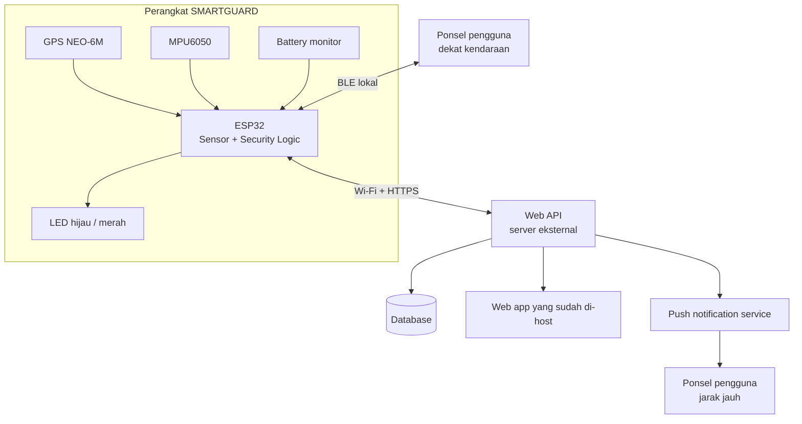
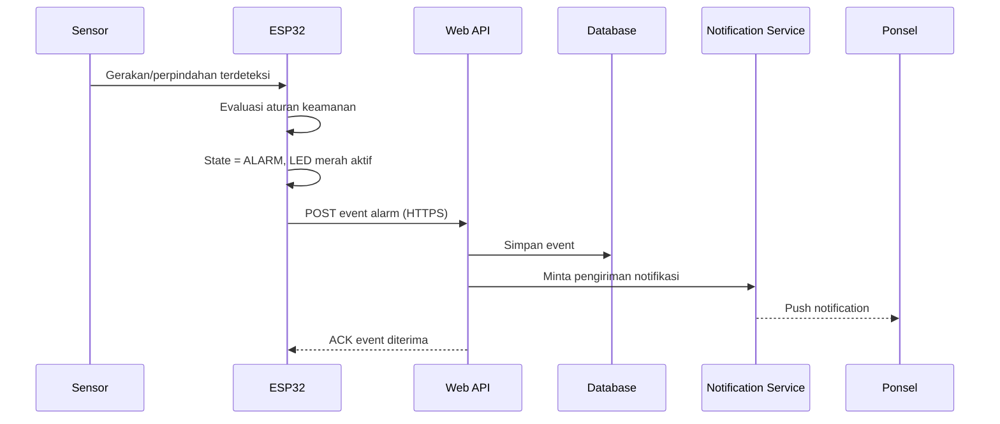
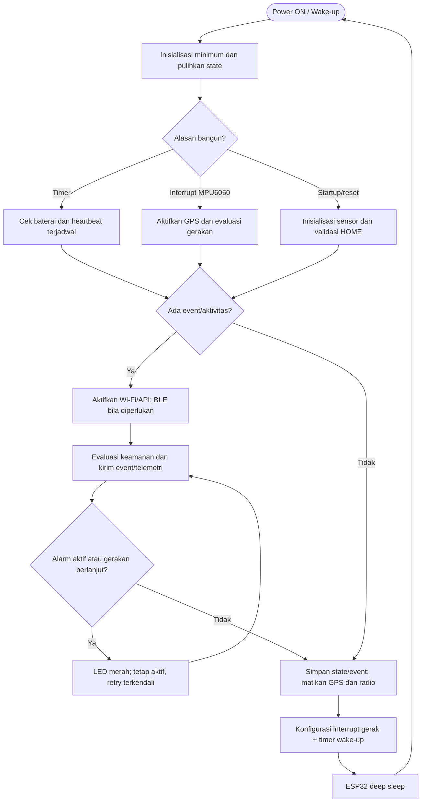
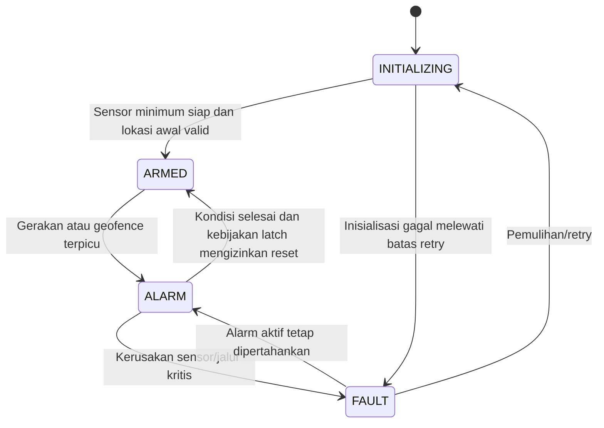
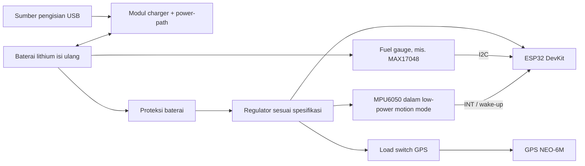

# SMARTGUARD — Master Development Document

**Versi 5.1 · Self-Hosted Web API + BLE + Remote Alert + Battery Monitoring + Adaptive Low-Power Mode**  
**Jenis sistem:** Smart Anti-Theft GPS Vehicle Tracker berbasis ESP32

> **Status dokumen:** spesifikasi rancangan untuk implementasi. Rangkaian, firmware, integrasi API, BLE, notifikasi, dan pembacaan baterai tetap perlu diuji pada hardware sebenarnya sebelum digunakan pada kendaraan.

| Properti | Spesifikasi |
|---|---|
| Mikrokontroler | ESP32 DevKit V1 |
| Sensor lokasi | GPS NEO-6M |
| Sensor gerak | MPU6050 / GY-521 |
| Indikator | LED hijau dan LED merah |
| Alarm | Notifikasi ke ponsel; buzzer dihilangkan |
| Kontrol fisik | Push button dihilangkan |
| Konektivitas lokal | Bluetooth Low Energy (BLE) |
| Konektivitas jarak jauh | Wi-Fi/internet dari ESP32 ke Web API eksternal |
| Web app | Web app milik proyek yang sudah di-host pada server eksternal |
| Catu daya | Baterai lithium isi ulang dengan modul charging, proteksi, dan regulator yang sesuai |
| Monitoring baterai | Tegangan dan estimasi kapasitas baterai |
| Perilaku saat startup | Mulai otomatis dan masuk ke mode pemantauan tanpa perlu tombol |
| Manajemen daya | Adaptive power mode: deep sleep saat idle, wake-up melalui interrupt gerak dan timer |

---

## 0. Cara Membaca Dokumen Ini

### 0.1 Ringkasan

SMARTGUARD adalah perangkat anti-pencurian kendaraan yang memantau perubahan gerakan dan lokasi kendaraan. ESP32 membaca GPS NEO-6M dan MPU6050, menentukan status keamanan, mengirim status/event ke Web API, serta menyediakan akses lokal melalui BLE.

Ketika perangkat mendeteksi gerakan mencurigakan atau kendaraan berpindah lebih jauh dari batas geofence yang ditetapkan, perangkat masuk ke status `ALARM`, menyalakan LED merah, dan mengirim event alarm ke server. Server kemudian meneruskan notifikasi ke ponsel melalui mekanisme notifikasi yang dikonfigurasi pada web app. Untuk menghemat baterai, firmware menggunakan **adaptive power management**: MPU6050 tetap berada pada mode deteksi gerak berdaya rendah, sedangkan ESP32 masuk ke deep sleep saat kendaraan diam; Wi-Fi, BLE, dan GPS diaktifkan hanya saat dibutuhkan.

Perangkat tidak memiliki tombol fisik untuk mematikan atau mengubah mode. Setelah mendapat daya, perangkat melakukan inisialisasi lalu otomatis memulai pemantauan. Tidak adanya tombol **bukan** berarti perangkat tetap bekerja ketika baterai habis, kabel terputus, atau hardware rusak; kondisi-kondisi tersebut tetap harus ditampilkan sebagai offline atau fault pada web app.

### 0.2 Aturan desain utama

| # | Aturan | Dampak implementasi |
|--:|---|---|
| 1 | ESP32 mengambil keputusan keamanan lokal. | Sensor dan logika alarm tetap berjalan walau server sedang tidak dapat diakses. |
| 2 | BLE dan internet memiliki fungsi berbeda. | BLE untuk koneksi lokal jarak dekat; Wi-Fi/internet dari perangkat untuk mengirim data ke server dari jarak jauh. |
| 3 | Tidak ada data bukan berarti aman. | Data lama, perangkat offline, baterai kritis, atau sensor gagal harus ditampilkan secara eksplisit. |
| 4 | Tidak ada buzzer dan push button. | Alarm diinformasikan melalui LED dan notifikasi digital; pemantauan dimulai otomatis. |
| 5 | Tidak ada perintah mematikan perangkat dari web. | API tidak menyediakan perintah `power_off`. Perangkat harus tetap memantau selama masih mendapat daya. |
| 6 | Server eksternal adalah backend aplikasi. | ESP32 mengirim telemetri/event ke Web API; web app membaca data dan mengelola notifikasi melalui backend. |
| 7 | Kredensial tidak ditaruh pada browser. | API key/device secret disimpan pada perangkat dan server, bukan di kode JavaScript yang dikirim ke pengguna. |
| 8 | Status alarm tidak boleh hilang diam-diam. | Event alarm disimpan lokal sementara jika jaringan putus dan dikirim ulang saat koneksi pulih. |
| 9 | Daya dihemat dengan mode adaptif. | Deep sleep digunakan saat idle; MPU6050 membangunkan perangkat saat ada gerakan. Wi-Fi, BLE, dan GPS tidak dibiarkan aktif terus-menerus. |

### 0.3 Batas penting konektivitas

**Bluetooth saja tidak dapat mengirim alarm ke server eksternal saat ponsel tidak berada di dekat perangkat.** BLE adalah koneksi jarak dekat, bukan koneksi internet.

Agar notifikasi jarak jauh tetap berfungsi ketika pengguna jauh dari kendaraan, setidaknya satu jalur berikut harus tersedia:

1. ESP32 terhubung ke Wi-Fi yang memiliki akses internet, misalnya hotspot ponsel atau jaringan di lokasi kendaraan; atau
2. perangkat memakai modem seluler yang menyediakan internet; atau
3. ponsel berada dekat perangkat, terhubung ke BLE, dan menjalankan aplikasi/layanan relay yang meneruskan event ke internet.

Untuk versi ini, desain utama adalah **ESP32 → Wi-Fi/internet → Web API eksternal**. BLE tetap disediakan untuk melihat status dan melakukan diagnostik lokal. BLE melalui browser bergantung pada dukungan Web Bluetooth di browser dan perangkat pengguna; siapkan aplikasi pendamping bila dukungan lintas perangkat wajib.

### 0.4 Peta dokumen

| Bagian | Cakupan |
|--:|---|
| 1 | Ruang lingkup fitur v5 |
| 2 | Arsitektur sistem dan aliran data |
| 3 | Komponen, pin, wiring, dan daya |
| 4 | State machine serta aturan alarm |
| 5 | Firmware dan tugas utama |
| 6 | Baterai isi ulang dan monitoring |
| 7 | Kontrak data dan event |
| 8 | Kontrak Web API |
| 9 | Bluetooth LE (BLE) |
| 10 | Web app dan notifikasi ponsel |
| 11 | Keamanan, retry, dan kondisi offline |
| 12 | Instalasi dan konfigurasi |
| 13 | Rencana pengujian |
| 14 | Troubleshooting |
| 15 | Roadmap implementasi |
| 16 | Lampiran dan changelog |

---

## 1. Ruang Lingkup Versi 5

### 1.1 Fitur perangkat

| Fitur | Status rancangan | Keterangan |
|---|---|---|
| Membaca koordinat GPS | Termasuk | Latitude, longitude, speed, jumlah satelit, dan status GPS fix. |
| Membaca gerakan | Termasuk | Menggunakan MPU6050. Ambang batas harus dikalibrasi pada hardware. |
| Menetapkan lokasi awal | Termasuk | `HOME` ditetapkan otomatis ketika posisi GPS sudah valid. |
| Geofence | Termasuk | Jarak awal 30 meter; dapat dikonfigurasi sesuai hasil pengujian. |
| Alarm lokal | Termasuk | LED merah; tidak ada buzzer. |
| Notifikasi jarak jauh | Termasuk | Event dikirim ke Web API, kemudian backend mengirim notifikasi ke ponsel. |
| BLE untuk status/diagnostik | Termasuk | Akses lokal jarak dekat. |
| Wi-Fi ke Web API | Termasuk | Diperlukan untuk sinkronisasi jarak jauh tanpa relay ponsel. |
| Pemantauan baterai | Termasuk | Persentase merupakan estimasi; gunakan fuel gauge untuk hasil lebih baik. |
| Deep sleep adaptif | Termasuk | ESP32 tidur saat idle; MPU6050 membangunkan perangkat ketika mendeteksi gerakan. |
| Pemadaman GPS saat idle | Disarankan | GPS diputus melalui load switch atau mode power-save yang sudah diverifikasi. |
| Wi-Fi/BLE on-demand | Termasuk | Radio dimatikan saat deep sleep, lalu dinyalakan pada event, sinkronisasi, atau jendela BLE. |
| Tombol fisik | Dihilangkan | Tidak ada input push button. |
| Buzzer | Dihilangkan | Notifikasi digital menggantikan alarm bunyi. |
| Dashboard web lokal pada ESP32 | Dihilangkan | Web app berjalan di server yang sudah dimiliki. |
| Integrasi Blynk | Dihilangkan | Digantikan oleh Web API milik proyek. |
| Perintah mematikan perangkat | Tidak disediakan | Tidak boleh ada `power_off` melalui API. |

### 1.2 Fitur web app

Web app yang sudah di-host harus menampilkan status perangkat, lokasi pada peta, status alarm, waktu update terakhir, status jaringan, kualitas GPS, status sensor, baterai, serta riwayat event. Pengiriman notifikasi ketika browser tertutup memerlukan implementasi push notification/service worker dan layanan push yang sesuai; pembaruan halaman secara berkala saja tidak cukup.

### 1.3 Di luar cakupan versi ini

Fitur berikut tidak diasumsikan tersedia sebelum implementasi terpisah dilakukan:

- Relay untuk memutus atau mengunci mesin kendaraan.
- Modem seluler/SIM yang terpasang langsung di perangkat.
- Akurasi persentase baterai dengan hanya mengandalkan tegangan tanpa kalibrasi.
- Jaminan anti-pencurian ketika daya perangkat diputus secara fisik.
- Sertifikasi kendaraan, automotive-grade power protection, atau ketahanan terhadap cuaca sebelum uji dan enclosure yang sesuai.

---

## 2. Arsitektur Sistem

### 2.1 Arsitektur keseluruhan



### 2.2 Tanggung jawab tiap komponen

| Komponen | Tanggung jawab |
|---|---|
| ESP32 | Membaca sensor, menyimpan kondisi keamanan, mendeteksi gerakan/perpindahan, mengendalikan LED, menyimpan event sementara, dan mengirim data. |
| GPS NEO-6M | Menyediakan koordinat dan status fix. |
| MPU6050 | Menyediakan data percepatan/gerakan untuk mendeteksi gangguan. |
| Battery monitor | Mengukur/menaksir tegangan dan kapasitas baterai. |
| BLE | Menyediakan status dan diagnostik lokal serta dapat menjadi jalur relay bila aplikasi pendamping diimplementasikan. |
| Web API | Autentikasi perangkat, menerima telemetri/event, menyimpan data, menyediakan endpoint bagi web app, dan memicu notifikasi. |
| Database | Menyimpan status terakhir, riwayat lokasi, event keamanan, dan informasi perangkat. |
| Web app | Menyajikan dashboard, peta, status online/offline, baterai, riwayat, dan preferensi notifikasi. |
| Push notification service | Mengirim notifikasi pada ponsel setelah event diproses backend. |

### 2.3 Aliran data alarm



Jika internet mati, ESP32 tetap masuk `ALARM` dan menyimpan event pada antrean lokal. Event dikirim ulang setelah jaringan pulih. Notifikasi jarak jauh tidak dapat dijamin terkirim selama tidak ada jalur internet ke backend.

### 2.4 Alur loop perangkat

Loop aktif firmware sebaiknya tidak memakai `delay()` panjang. Saat perangkat sedang bangun, baca sensor, evaluasi keamanan, kelola BLE/Wi-Fi, dan kirim event dengan jadwal non-blocking berbasis `millis()`. Saat tidak ada gerakan, event, atau pekerjaan jaringan yang tertunda, matikan radio dan GPS lalu masuk ke deep sleep. MPU6050 harus tetap diberi daya dan dikonfigurasi agar pin interrupt dapat membangunkan ESP32. Deep sleep mematikan radio Wi-Fi/Bluetooth; koneksi tidak bertahan selama tidur, sehingga sistem perlu reconnect setelah bangun. [dokumentasi mode sleep Espressif](https://docs.espressif.com/projects/esp-idf/en/latest/esp32/api-reference/system/sleep_modes.html)



---

## 3. Hardware

### 3.1 Daftar komponen

| No. | Komponen | Qty | Fungsi/catatan |
|--:|---|--:|---|
| 1 | ESP32 DevKit V1 | 1 | Mikrokontroler utama. |
| 2 | GPS NEO-6M | 1 | Posisi kendaraan. Pastikan kompatibilitas tegangan modul. |
| 3 | MPU6050 / GY-521 | 1 | Sensor gerakan melalui I2C. |
| 4 | LED hijau | 1 | Indikator perangkat aktif/pemantauan normal. |
| 5 | LED merah | 1 | Indikator alarm atau fault sesuai pola yang ditetapkan. |
| 6 | Resistor 220–330 Ω | 2 | Pembatas arus LED. |
| 7 | Baterai lithium isi ulang | 1 set | Misalnya sel Li-ion 1S yang sesuai kebutuhan arus dan kapasitas. |
| 8 | Modul charger + proteksi | 1 | Mengelola pengisian dan perlindungan baterai. |
| 9 | Regulator/boost converter | 1 | Menyediakan tegangan stabil sesuai input board ESP32. |
| 10 | Fuel gauge baterai, misalnya MAX17048 | 1 (disarankan) | Estimasi state of charge melalui I2C. |
| 11 | Kabel, konektor, PCB/enclosure | 1 set | Mengamankan sambungan untuk pemakaian nyata. |
| 12 | Load switch/high-side MOSFET untuk GPS (disarankan) | 1 | Memutus suplai GPS saat idle; jangan memberi daya GPS langsung dari GPIO. |

> **Catatan daya:** jangan menghubungkan sel Li-ion 1S langsung ke pin `VIN/5V` ESP32 tanpa regulator yang sesuai, dan jangan pernah menghubungkan baterai ke pin `3V3` secara langsung. Pilih modul dengan proteksi arus/tegangan yang memadai dan output yang sanggup menangani lonjakan arus ESP32 saat Wi-Fi aktif. Periksa spesifikasi board dan modul sebelum merakit.

### 3.2 Pin mapping yang disarankan

| Perangkat | Sinyal | GPIO ESP32 | Catatan |
|---|---|--:|---|
| GPS NEO-6M | TX GPS → RX ESP32 | 16 | UART2 RX. |
| GPS NEO-6M | RX GPS ← TX ESP32 | 17 | UART2 TX; sesuaikan level logika modul. |
| MPU6050 | SDA | 21 | Bus I2C. |
| MPU6050 | SCL | 22 | Bus I2C. |
| MPU6050 | INT | 33 | Interrupt gerak untuk wake-up deep sleep; konfigurasi level/polaritas interrupt harus cocok dengan firmware. GPIO33 mendukung RTC wake-up pada ESP32 klasik. |
| GPS power switch (opsional) | EN/control | 26 | Mengendalikan load switch suplai GPS; bukan untuk memasok arus GPS secara langsung. |
| LED hijau | Anoda melalui resistor | 32 | Aktif HIGH pada rangkaian yang disarankan. |
| LED merah | Anoda melalui resistor | 25 | Aktif HIGH pada rangkaian yang disarankan. |
| Battery monitor ADC (opsional) | Output pembagi tegangan | 34 | Pin input-only; gunakan ADC1 dan proteksi tegangan. |
| MAX17048 (opsional) | SDA/SCL | 21/22 | Berbagi I2C dengan MPU6050 jika alamat berbeda dan bus stabil. |

GPIO yang dipakai harus diverifikasi terhadap board dan versi firmware yang digunakan. Pin 34 hanya input dan tidak dapat dipakai sebagai output. GPIO33 dipilih untuk interrupt MPU6050 karena termasuk RTC GPIO pada ESP32 klasik; tetap pastikan board benar-benar memakai ESP32 klasik, bukan ESP32-C3/S3 atau varian lain. Jika memakai MAX17048, ADC pembagi tegangan GPIO34 tidak wajib; pilih satu pendekatan monitoring sesuai kebutuhan. GPS power gating bersifat opsional dan harus menggunakan load switch/MOSFET yang sesuai, bukan GPIO sebagai sumber daya.

### 3.3 Wiring sensor dan LED

```text
GPS NEO-6M                    ESP32 DevKit V1
  TX   ─────────────────────► GPIO16 (RX2)
  RX   ◄───────────────────── GPIO17 (TX2)
  GND  ─────────────────────► GND
  VCC  ─────────────────────► sesuai spesifikasi modul

MPU6050                       ESP32 DevKit V1
  VCC  ─────────────────────► 3V3 (umumnya untuk breakout GY-521)
  GND  ─────────────────────► GND
  SDA  ─────────────────────► GPIO21
  SCL  ─────────────────────► GPIO22
  INT  ─────────────────────► GPIO33 (wake-up interrupt)

GPS power gating (opsional):
ESP32 GPIO26 ──────────────► EN load switch/high-side MOSFET
Suplai regulator ── load switch ──► VCC GPS
Jangan menyuplai VCC GPS langsung dari GPIO26.

GPIO32 ──[220–330 Ω]──►|── GND    LED HIJAU
GPIO25 ──[220–330 Ω]──►|── GND    LED MERAH

Battery monitor ADC (opsional):
Baterai + ──[R atas]──┬── GPIO34
                     └──[R bawah]── GND
Baterai - ──────────────────────── GND ESP32
```

Jika menggunakan pembagi tegangan, hitung nilai resistor berdasarkan tegangan baterai maksimum dan karakteristik ADC. Tegangan pada GPIO tidak boleh melewati batas input ESP32. Gunakan nilai resistor yang mengurangi konsumsi diam, namun jangan terlalu tinggi hingga pengukuran menjadi tidak stabil. Kalibrasi hasil ADC dengan multimeter.

### 3.4 LED status

| LED/pola | Arti |
|---|---|
| Hijau menyala stabil | Perangkat hidup dan pemantauan aktif; indikator ini tidak menjamin server sedang online. |
| Hijau berkedip pelan | Pemantauan aktif, tetapi koneksi server belum tersedia (opsional, implementasikan konsisten). |
| Merah berkedip | Alarm keamanan aktif. |
| Merah menyala stabil | Kondisi fault kritis, jika pola ini diimplementasikan. |
| Semua LED berkedip saat startup | Inisialisasi; pola dan durasi harus ditentukan pada firmware. |

Jangan menggunakan LED sebagai satu-satunya bukti bahwa alarm sudah sampai ke ponsel. Status pengiriman event harus dibedakan antara `pending`, `sent`, dan `acknowledged` pada data/status perangkat.

---

## 4. Logika Sistem

### 4.1 State machine

State inti yang disarankan:

- `INITIALIZING`: perangkat baru menyala dan menyiapkan sensor/jaringan.
- `ARMED`: sistem pemantauan aktif.
- `ALARM`: satu atau lebih aturan keamanan terpicu; LED merah aktif dan event dibuat.
- `FAULT`: satu atau lebih fungsi penting gagal, misalnya sensor tidak tersedia. Firmware tetap mencoba pulih; keadaan ini tidak boleh ditampilkan sebagai aman.

`FAULT` adalah kondisi kesehatan perangkat, sedangkan alarm keamanan adalah kejadian keamanan. Dalam implementasi yang lebih matang, status kesehatan dan status keamanan sebaiknya dipisahkan menjadi dua field agar kerusakan sensor tidak menimpa informasi alarm yang sudah terjadi. `ARMED_SLEEP` adalah **mode daya**, bukan security state baru: keamanan tetap berstatus `ARMED`, sementara ESP32 sedang deep sleep dan menunggu interrupt/timer.



### 4.2 Pemantauan otomatis

1. Setelah daya tersedia, ESP32 melakukan inisialisasi tanpa menunggu tombol.
2. ESP32 membaca GPS sampai mendapat fix yang valid. Koordinat `HOME` tidak boleh ditetapkan dari nilai default atau koordinat nol.
3. Setelah `HOME` valid dan sensor gerak siap, sistem masuk ke `ARMED` secara otomatis.
4. Selama pemantauan, gerakan yang melewati ambang atau jarak lebih dari batas geofence memicu `ALARM`.
5. Saat alarm terpicu, perangkat langsung memperbarui LED, membuat ID event unik, dan menyimpan event ke antrean.
6. Jika internet tersedia, event dikirim ke Web API. Jika tidak, event ditahan di antrean dan dicoba ulang dengan backoff.
7. Sistem tetap memantau ketika alarm sedang aktif. Pengiriman event berulang harus diberi rate limit agar tidak membanjiri server/notifikasi.

### 4.3 Nilai awal untuk prototipe

| Parameter | Nilai awal | Catatan |
|---|---:|---|
| Radius geofence | 30 m | Harus disesuaikan dengan noise GPS dan lingkungan penggunaan. |
| Masa tenang setelah `ARMED` | 3 detik | Mengurangi alarm akibat getaran sesaat ketika perangkat baru mulai memantau. |
| Interval status API saat perangkat aktif | 15–60 detik | Hanya saat mode aktif; tidak digunakan sebagai polling konstan selama idle. |
| Heartbeat ketika idle/deep-sleep cycle | 10–15 menit | Perangkat bangun, kirim status, lalu tidur lagi; sesuaikan dengan target baterai. |
| Interval pembacaan baterai saat aktif | 30–60 detik | Boleh berbeda dari interval kirim status. |
| Pembacaan baterai saat idle | Saat timer wake atau alert fuel gauge | Hindari membangunkan ESP32 terlalu sering hanya untuk telemetry non-esensial. |
| Batas pengiriman ulang | Exponential backoff + jitter | Hindari retry agresif saat server/jaringan bermasalah. |
| Batas minimum kapasitas | Ditentukan setelah pengujian | Kirim event `battery_low` sebelum perangkat mati, jika masih ada daya. |

Nilai di atas adalah nilai awal rancangan, bukan hasil kalibrasi. Jangan menganggap ambang MPU6050 dan persentase baterai sudah akurat sebelum diuji pada perangkat terakit.

### 4.4 Perhitungan jarak Haversine

Rumus jarak antara koordinat awal dan koordinat saat ini:

```text
a = sin²(Δφ / 2) + cos(φ1) × cos(φ2) × sin²(Δλ / 2)
c = 2 × atan2(√a, √(1 − a))
d = R × c
```

Keterangan: `φ` = latitude dalam radian, `λ` = longitude dalam radian, `R ≈ 6.371.000 m`, dan `d` = jarak meter. Pastikan GPS fix valid sebelum menghitung geofence.

### 4.5 Kebijakan alarm dan reset

- Tidak ada tombol fisik untuk mematikan perangkat atau menonaktifkan pemantauan.
- API tidak boleh menyediakan perintah `power_off`.
- Event alarm harus disimpan dengan `event_id` unik agar retry tidak menghasilkan event duplikat.
- Pengakuan notifikasi (`acknowledge`) hanya berarti pengguna sudah melihat/mengakui event; bukan berarti perangkat dimatikan.
- Jika alarm dilatch sampai diakui, proses acknowledge tidak boleh menonaktifkan pembacaan sensor. Bila kondisi mencurigakan masih berlangsung, perangkat harus dapat menghasilkan event baru setelah cooldown.
- Perilaku reset state `ALARM` ke `ARMED` harus diimplementasikan eksplisit dan diuji. Jangan menghapus event hanya karena status saat ini kembali normal.

---

### 4.6 Strategi manajemen daya adaptif

**Rekomendasi utama: gunakan deep sleep berbasis interrupt gerak, bukan membiarkan ESP32, GPS, Wi-Fi, dan BLE aktif sepanjang waktu.** Ini cocok untuk tracker yang sebagian besar waktunya diam. MPU6050 tetap menyala pada konfigurasi deteksi gerak berdaya rendah, lalu pin `INT` membangunkan ESP32 ketika ada gerakan. ESP32 klasik mendukung wake-up dari deep sleep melalui pin RTC GPIO; GPIO33 dapat digunakan untuk tujuan tersebut pada ESP32 DevKit V1 yang memakai ESP32 klasik. Pastikan jenis chip dan pin board sebelum menerapkan konfigurasi wake-up. [dokumentasi mode sleep Espressif](https://docs.espressif.com/projects/esp-idf/en/latest/esp32/api-reference/system/sleep_modes.html)

#### Mode operasi

| Mode | Komponen aktif | Kapan digunakan | Kebijakan daya |
|---|---|---|---|
| `BOOT/INITIALIZING` | ESP32, MPU6050, GPS sementara, battery monitor | Startup atau setelah wake-up yang membutuhkan lokasi | Inisialisasi seperlunya; jangan melakukan koneksi Wi-Fi berulang tanpa timeout. |
| `ARMED_SLEEP` | MPU6050 pada motion interrupt low-power, RTC/timer, fuel gauge; ESP32 deep sleep | Kendaraan diam dan tidak ada event pending | Wi-Fi, BLE, dan GPS dimatikan; LED indikator normal dimatikan. |
| `WAKE_CHECK` | ESP32, MPU6050; GPS dinyalakan bila perlu | Interrupt gerak atau timer | Ambil beberapa sampel untuk menapis getaran palsu sebelum mengaktifkan radio. |
| `SYNC` | ESP32 + Wi-Fi + HTTPS; BLE opsional | Event alarm, heartbeat terjadwal, atau ada event antrean | Sambungkan, kirim data yang diprioritaskan, lalu putuskan radio setelah selesai/timeout. |
| `ALARM_ACTIVE` | Sensor gerak, GPS, ESP32, Wi-Fi saat retry, LED merah berkedip | Gerakan berlanjut atau kondisi alarm masih aktif | Tetap aktif selama periode investigasi; GPS update dan retry API diberi interval/backoff. |
| `LOW_BATTERY` | Sensor gerak dan kontrol minimum; radio hanya untuk alert penting | Kapasitas melewati ambang rendah/kritis | Kurangi heartbeat dan telemetri non-esensial; prioritaskan alarm keamanan dan baterai kritis. |

#### Siklus tidur yang direkomendasikan

1. Setelah startup, dapatkan lokasi `HOME` yang valid dan simpan konfigurasi penting serta state alarm ke penyimpanan persisten. Jangan menulis ke flash pada setiap sampel; simpan saat terjadi perubahan state atau event penting.
2. Konfigurasikan MPU6050 untuk mendeteksi gerakan dengan interrupt. Hubungkan `INT` ke GPIO33 dan cocokkan polaritas/level interrupt dengan wake-up yang dipakai firmware. Uji interrupt pada kondisi nyata karena getaran jalan, hujan, atau pemasangan sensor dapat memicu false positive.
3. Saat kendaraan stabil, hentikan Wi-Fi dan BLE, matikan GPS melalui load switch atau mode power-save yang benar-benar didukung modul, matikan LED hijau, lalu jadwalkan wake-up timer dan masuk ke `deep sleep`.
4. Ketika bangun karena gerakan, validasi trigger dengan beberapa sampel MPU6050. Jika gerakan mencurigakan berlanjut, aktifkan GPS, tunggu fix dengan timeout, perbarui lokasi bila tersedia, buat event, lalu nyalakan Wi-Fi untuk mengirim event ke API.
5. Ketika bangun karena timer, periksa baterai dan kirim heartbeat/telemetri sesuai interval hemat daya. Interval awal yang disarankan adalah 10–15 menit, lalu sesuaikan berdasarkan kebutuhan status online dan hasil pengukuran konsumsi. Alarm harus dikirim segera ketika terpicu, tidak menunggu heartbeat.
6. Setelah kondisi tenang, antrean terkirim atau disimpan dengan aman, dan batas waktu koneksi habis, matikan radio/GPS dan kembali ke deep sleep.
7. Bila jaringan tidak tersedia, simpan event secara persisten dan lakukan retry terjadwal dengan exponential backoff. Jangan terus menyalakan Wi-Fi tanpa batas karena kondisi tersebut dapat menguras baterai.

#### Trade-off yang wajib dipahami

- **Deep sleep mematikan Wi-Fi dan Bluetooth.** ESP32 tidak dapat terus menjaga koneksi BLE atau Wi-Fi selama deep sleep; koneksi harus dimulai ulang setelah bangun. Jika BLE harus selalu dapat ditemukan/terhubung, gunakan modem-sleep/automatic light sleep atau mode aktif dengan konsumsi lebih tinggi. [dokumentasi mode sleep Espressif](https://docs.espressif.com/projects/esp-idf/en/latest/esp32/api-reference/system/sleep_modes.html)
- **BLE tidak bisa membangunkan ESP32 melalui radio ketika BLE dimatikan.** Untuk mengakses BLE dengan mode hemat daya, jadwalkan *BLE advertising window* setelah timer bangun (misalnya 20–30 detik), setelah event gerak, atau gunakan mode yang menjaga radio tetap aktif. Jendela periodik berarti aplikasi tidak selalu dapat menemukan perangkat setiap saat.
- **GPS tidak harus hidup terus-menerus.** Matikan suplai GPS saat kendaraan diam jika modul dan rangkaian mendukungnya. GPS NEO-6 memiliki fitur Power Save Mode pada varian tertentu, tetapi dukungan dan perilakunya harus diperiksa terhadap modul/firmware yang benar-benar digunakan. Waktu mendapatkan fix setelah GPS dinyalakan kembali bervariasi; jangan menganggap koordinat langsung tersedia. [datasheet NEO-6](https://content.u-blox.com/sites/default/files/products/documents/NEO-6_DataSheet_%28GPS.G6-HW-09005%29.pdf)
- **Alarm berbasis gerakan harus tetap lokal.** ESP32 bangun dan menandai alarm terlebih dahulu; koneksi internet dilakukan sesudahnya. Jika tidak ada Wi-Fi/internet dan ponsel tidak berada di dekat kendaraan, notifikasi jarak jauh memang tidak dapat sampai saat itu.
- **ESP32 DevKit V1 bukan papan ultra-low-power secara otomatis.** Regulator, USB-to-serial bridge, power LED, dan komponen papan dapat meningkatkan arus tidur. Ukur arus pada baterai dengan perangkat terakit. Jika arus deep sleep papan terlalu tinggi, pertimbangkan papan/modul ESP32 yang dirancang untuk low-power atau PCB khusus.

#### Parameter daya awal

| Parameter | Nilai awal rancangan | Catatan |
|---|---:|---|
| Heartbeat saat idle | 10–15 menit | Heartbeat lebih sering berarti Wi-Fi lebih sering menyala; tuning berdasarkan kebutuhan. |
| BLE advertising window | 20–30 detik setelah timer/event wake | Tidak menjamin BLE tersedia sepanjang waktu. Bisa dimatikan sepenuhnya untuk hemat maksimum. |
| Validasi gerak setelah wake | 1–3 detik sampel, lalu kalibrasi | Nilai awal saja; atur berdasarkan false positive dan waktu respons. |
| Timeout koneksi API | 5–10 detik sebagai titik awal | Hindari loop koneksi tanpa batas. |
| Periode tetap aktif setelah alarm | 30–120 detik sebagai titik awal | Sesuaikan dengan strategi tracking, retry, dan konsumsi baterai. Alarm yang berlanjut dapat memperpanjang mode aktif. |
| LED normal saat idle | OFF | Nyalakan hanya selama startup, status penting, atau alarm. |
| GPS saat idle | OFF atau mode power-save teruji | Jangan memutus suplai tanpa mempertimbangkan kebutuhan backup/retensi data modul. |

Angka pada tabel adalah parameter awal untuk pengujian, bukan jaminan masa pakai baterai. Konsumsi ditentukan oleh board, regulator, kualitas sinyal Wi-Fi, waktu fix GPS, frekuensi event, dan modul charging.

---

## 5. Firmware ESP32

### 5.1 Tanggung jawab firmware

Firmware v5 perlu menggantikan implementasi v4 yang masih bergantung pada tombol, buzzer, dashboard lokal, dan Blynk.

| Modul | Tanggung jawab |
|---|---|
| `GpsService` | Membaca UART GPS, memvalidasi fix, dan menyediakan koordinat/speed/satelit. |
| `MotionService` | Membaca MPU6050 serta menghasilkan indikator gerakan yang sudah difilter. |
| `BatteryService` | Membaca fuel gauge atau tegangan baterai, lalu menghasilkan nilai estimasi dan status baterai. |
| `SecurityManager` | Mengelola `HOME`, geofence, aturan gerakan, state, dan pembuatan event. |
| `LedController` | Mengatur pola LED sesuai state keamanan dan kesehatan perangkat. |
| `BleService` | Menyediakan status dan diagnostik lokal. |
| `NetworkService` | Mengelola Wi-Fi, status koneksi, retry jaringan, dan mematikan radio setelah pekerjaan selesai. |
| `PowerManager` | Memutuskan kapan perangkat tetap aktif atau masuk deep sleep, mengatur timer/GPIO wake-up, dan menonaktifkan periferal yang tidak dibutuhkan. |
| `GpsPowerController` | Mengendalikan load switch GPS bila tersedia; GPIO hanya mengontrol EN switch, bukan memberi arus ke modul GPS. |
| `ApiClient` | Mengirim heartbeat, telemetry, dan event ke Web API menggunakan HTTPS. |
| `EventQueue` | Menyimpan event yang belum berhasil dikirim dan mengirim ulang saat koneksi pulih. |

Nama modul di atas adalah usulan pemisahan tanggung jawab. Implementasi dapat berupa kelas C++ atau fungsi terpisah, asalkan tiap tanggung jawab dan penanganan error jelas.

### 5.2 Urutan inisialisasi

1. Baca alasan wake-up dan pulihkan state penting dari RTC memory/NVS/event queue.
2. Inisialisasi GPIO interrupt, I2C, MPU6050, serta battery monitor.
3. Baca konfigurasi perangkat (Device ID, Wi-Fi, API base URL, credential, dan parameter sleep).
4. Pada startup pertama, atau saat `HOME` belum valid, aktifkan GPS dan tunggu fix dengan timeout. Jangan menunggu GPS selamanya; laporkan `gps.fix = false` bila timeout.
5. Simpan `HOME`/konfigurasi saat valid dan mulai pemantauan otomatis.
6. Untuk event gerak, nyalakan GPS jika dibutuhkan, validasi gerak, dan kirim alarm melalui Wi-Fi/API dengan timeout.
7. Nyalakan BLE hanya pada kebutuhan lokal atau jendela advertising terjadwal; jangan menganggap BLE tetap aktif selama deep sleep.
8. Saat idle, matikan LED normal, hentikan Wi-Fi/BLE, matikan GPS melalui rangkaian yang sesuai, atur wake-up interrupt MPU6050 dan timer, lalu masuk deep sleep.

Jika GPS belum mendapatkan fix, perangkat harus tetap menyala dan melaporkan `gps.fix = false`. Sistem tidak boleh membuat lokasi `HOME` palsu. Kebijakan sementara ketika GPS belum fix harus ditetapkan dengan hati-hati; sekurangnya deteksi gerakan dari MPU6050 tetap dapat berjalan, sementara geofence ditandai tidak tersedia.

### 5.3 Pseudocode loop

```cpp
void loop() {
    // Pseudocode: sistem hanya berada di loop aktif selama dibutuhkan.
    motionService.update();
    batteryService.updateIfDue();

    if (motionService.suspiciousMotionDetected()) {
        gpsPowerController.enable();
        gpsService.acquireFixWithTimeout();
        securityManager.evaluate(gpsService.currentFix(), true);
        ledController.setAlarmPattern();
        eventQueue.addIfNew(securityManager.buildAlarmEvent());
    }

    if (powerManager.shouldSyncNow() || eventQueue.hasPending()) {
        networkService.connectWithTimeout();
        if (networkService.isConnected()) {
            apiClient.sendPendingEvents(eventQueue);
            apiClient.publishTelemetryIfDue(buildStatusPayload());
        }
    }

    if (powerManager.shouldOpenBleWindow()) {
        bleService.advertiseForConfiguredWindow();
    }

    eventQueue.persistIfNeeded();

    if (powerManager.canSleep(securityManager, eventQueue)) {
        networkService.stop();
        bleService.stop();
        gpsPowerController.disable();
        ledController.turnOffNormalIndicator();
        powerManager.configureMotionWakeupAndTimer();
        powerManager.enterDeepSleep(); // Calls esp_deep_sleep_start(); does not return.
    }
}
```

Pseudocode di atas menggambarkan urutan tanggung jawab, bukan kode siap kompilasi. Fungsi, tipe data, sinkronisasi, penyimpanan antrean, timeout, dan penanganan exception perlu diimplementasikan sesuai library yang dipilih. Untuk ESP32 klasik dengan Arduino-ESP32, implementasi umumnya memakai API `esp_sleep_enable_ext0_wakeup()` atau sumber wake-up RTC yang sesuai dan `esp_deep_sleep_start()`. Cocokkan level trigger dengan konfigurasi pin `INT` MPU6050. Deep sleep akan memulai ulang eksekusi dari proses boot saat bangun, sehingga state yang wajib bertahan harus disimpan di RTC memory/NVS atau event queue persisten; jangan mengandalkan variabel RAM biasa. Periksa API yang tersedia pada versi core/SoC yang dipakai sebelum menyalin kode final.

### 5.4 Strategi antrean event

Setiap event minimal menyimpan `event_id`, `device_id`, `event_type`, `occurred_at`, `payload`, dan status pengiriman. Jika server mengembalikan sukses, event ditandai terkirim dan boleh dihapus sesuai kebijakan retensi. Jika gagal, simpan event dan ulangi dengan exponential backoff. Gunakan penyimpanan tahan restart seperti Preferences/NVS atau LittleFS sesuai kebutuhan kapasitas dan frekuensi tulis.

Batas ukuran antrean harus ditetapkan. Jika antrean penuh, prioritaskan event keamanan dan status baterai kritis; jangan menghapus event alarm terbaru secara diam-diam. Laporkan jumlah event yang dibuang bila kebijakan overflow memang diperlukan.

### 5.5 Library yang mungkin digunakan

| Library/komponen | Kegunaan |
|---|---|
| `WiFi.h` | Koneksi Wi-Fi. |
| `HTTPClient.h` atau klien HTTP yang sesuai | Permintaan ke Web API. |
| `WiFiClientSecure.h` | HTTPS/TLS; konfigurasi sertifikat harus benar. |
| `Wire.h` | I2C untuk MPU6050 dan fuel gauge. |
| `TinyGPSPlus` | Parsing data GPS NMEA. |
| `Adafruit_MPU6050` + `Adafruit_Sensor` | Pembacaan MPU6050. |
| `NimBLE-Arduino` atau BLE stack ESP32 yang sesuai | BLE GATT. |
| `Preferences.h` / `LittleFS.h` | Konfigurasi dan antrean event persisten. |

Pilih versi library yang kompatibel dengan versi Arduino-ESP32 yang digunakan. Jangan menggunakan kredensial produksi atau menonaktifkan validasi TLS untuk mengatasi error sertifikat.

---

## 6. Baterai Lithium Isi Ulang dan Monitoring

### 6.1 Konsep daya

Rancangan dasar adalah baterai lithium isi ulang, rangkaian charging dan proteksi, lalu regulator/boost converter yang menghasilkan tegangan sesuai kebutuhan ESP32 dan periferal.



Pilih modul yang sesuai dengan jumlah sel baterai. Desain di atas menggambarkan fungsi, bukan skema elektrik final untuk modul tertentu.

### 6.2 Persyaratan modul baterai

- Gunakan sel lithium yang sesuai, berkualitas, dan memiliki spesifikasi arus yang mencukupi.
- Pastikan ada perlindungan terhadap overcharge, over-discharge, overcurrent, dan short circuit. Verifikasi apakah proteksi sudah terdapat pada sel/modul atau perlu ditambahkan.
- Gunakan regulator dengan output stabil dan kapasitas arus yang mencukupi untuk lonjakan saat Wi-Fi mengirim data.
- Pilih modul yang mendukung penggunaan perangkat saat baterai sedang diisi (*power-path/load sharing*) bila perangkat harus selalu menyala ketika kabel charger disambungkan.
- Jangan mengasumsikan semua modul TP4056 memiliki power-path yang tepat. Sebagian rangkaian sederhana tidak dirancang untuk mengelola beban sistem dan pengisian secara bersamaan dengan benar.
- Pasang baterai dalam enclosure yang aman, hindari panas berlebih, tekanan, tusukan, dan sambungan terbuka.
- Tentukan kapasitas baterai setelah mengukur konsumsi rata-rata dan puncak perangkat. GPS dan Wi-Fi akan memengaruhi waktu pakai.

### 6.3 Metode monitoring

**Metode yang disarankan: fuel gauge I2C**, misalnya MAX17048, yang dapat berbagi jalur I2C dengan MPU6050 jika alamat dan wiring sesuai. Fuel gauge menghasilkan estimasi state of charge yang umumnya lebih berguna daripada mengubah tegangan mentah menjadi persentase secara langsung.

**Metode alternatif: pembagi tegangan ke ADC.** ESP32 mengukur tegangan baterai yang sudah diturunkan melalui pembagi tegangan. Firmware perlu mengalikan hasil pengukuran dengan rasio pembagi, melakukan kalibrasi, dan memetakan tegangan ke estimasi kapasitas berdasarkan karakteristik kimia sel. Persentase dari tegangan saja bersifat perkiraan karena dipengaruhi beban, suhu, dan kurva discharge.

### 6.4 Field baterai

| Field | Tipe | Keterangan |
|---|---|---|
| `battery.voltage_v` | number/null | Tegangan baterai dalam volt. |
| `battery.soc_percent` | number/null | Estimasi state of charge 0–100%. |
| `battery.status` | string | `normal`, `low`, `critical`, `charging`, `unknown`. Status charging hanya dapat diisi jika hardware menyediakan sinyal/telemetri charging. |
| `battery.charging` | boolean/null | `true` bila ada sumber pengisian dan statusnya diketahui; selain itu `null`. |
| `battery.updated_at` | ISO 8601 string | Waktu pengukuran terakhir. |

Contoh visual pada web app harus memakai data asli. Jangan menampilkan persentase contoh sebagai status baterai aktual.

### 6.5 Kebijakan baterai rendah

Ambang `low` dan `critical` ditentukan setelah melihat spesifikasi sel, regulator, dan karakteristik beban. Ketika status menjadi rendah, kirim event `battery_low`; saat kritis, kirim `battery_critical` jika masih ada daya dan jalur komunikasi tersedia. Tambahkan hysteresis agar status tidak bolak-balik karena fluktuasi tegangan kecil.

---

## 7. Kontrak Data Perangkat

### 7.1 Prinsip payload

- Semua payload memakai JSON UTF-8.
- Timestamp disimpan dalam ISO 8601 UTC, misalnya `2026-10-27T12:30:00Z`.
- Koordinat dan nilai pengukuran boleh `null` jika tidak tersedia; jangan mengganti nilai yang hilang dengan `0`.
- `device_id` harus stabil dan unik.
- Setiap event memiliki `event_id` untuk deduplikasi.
- Field baru ditambahkan secara kompatibel dan `schema_version` dinaikkan ketika ada perubahan yang tidak kompatibel.
- Tambahkan `power.mode` dan `power.next_heartbeat_due_at` agar backend dapat membedakan perangkat yang sengaja tidur dari perangkat yang kemungkinan terputus; penetapan offline tetap berdasarkan waktu laporan terakhir.

### 7.2 Contoh status perangkat

```json
{
  "schema_version": 1,
  "device_id": "sg-device-001",
  "reported_at": "2026-10-27T12:30:00Z",
  "power": {
    "mode": "ARMED_SLEEP",
    "last_wake_reason": "motion_or_timer",
    "next_heartbeat_due_at": "2026-10-27T12:40:00Z"
  },
  "security": {
    "state": "ARMED",
    "alarm_active": false,
    "home": {
      "latitude": -7.797,
      "longitude": 110.370
    },
    "geofence_radius_m": 30,
    "distance_from_home_m": 4.8
  },
  "gps": {
    "fix": true,
    "latitude": -7.7971,
    "longitude": 110.3702,
    "speed_kmh": 0.2,
    "satellites": 8,
    "updated_at": "2026-10-27T12:29:58Z"
  },
  "motion": {
    "available": true,
    "detected": false,
    "acceleration_mps2": 0.14,
    "updated_at": "2026-10-27T12:29:59Z"
  },
  "battery": {
    "voltage_v": 3.91,
    "soc_percent": 72,
    "status": "normal",
    "charging": null,
    "updated_at": "2026-10-27T12:29:55Z"
  },
  "connectivity": {
    "wifi_connected": true,
    "api_reachable": true,
    "ble_available": true,
    "last_successful_sync_at": "2026-10-27T12:30:00Z"
  },
  "health": {
    "gps": "ok",
    "motion_sensor": "ok",
    "battery_monitor": "ok",
    "event_queue_size": 0
  }
}
```

> Semua nilai pada contoh payload adalah ilustrasi format, bukan pengukuran dari hardware sebenarnya.

### 7.3 Contoh event alarm

```json
{
  "schema_version": 1,
  "event_id": "01J-SAMPLE-UNIQUE-ID",
  "device_id": "sg-device-001",
  "event_type": "security_alarm",
  "severity": "high",
  "occurred_at": "2026-10-27T12:31:10Z",
  "reason": ["motion_detected", "geofence_exceeded"],
  "location": {
    "latitude": -7.7975,
    "longitude": 110.3711,
    "gps_fix": true
  },
  "distance_from_home_m": 46.2,
  "battery": {
    "soc_percent": 71,
    "voltage_v": 3.89
  }
}
```

### 7.4 Jenis event

| `event_type` | Severity awal | Keterangan |
|---|---|---|
| `security_alarm` | `high` | Gerakan atau perpindahan mencurigakan. |
| `battery_low` | `medium` | Kapasitas baterai rendah. |
| `battery_critical` | `high` | Kapasitas baterai kritis. |
| `device_started` | `info` | Perangkat mulai menyala. |
| `sensor_fault` | `high` | Sensor penting gagal. |
| `connectivity_restored` | `info` | Koneksi server pulih setelah offline. |
| `event_queue_overflow` | `high` | Antrean event mendekati/pada batas penuh. |

### 7.5 Aturan waktu dan lokasi

GPS dapat belum fix di dalam ruangan atau segera setelah startup. Dalam kondisi tersebut, koordinat dikirim sebagai `null`, `gps.fix` adalah `false`, dan web app menampilkan waktu fix terakhir jika tersedia. Bedakan waktu pengukuran (`updated_at`/`occurred_at`) dengan waktu penerimaan di server (`received_at`).

---

## 8. Kontrak Web API

Endpoint berikut adalah rancangan awal yang perlu diselaraskan dengan routing, autentikasi, dan stack server yang telah dipakai oleh web app. Sesuaikan prefix, format respons, dan nama field tanpa mengubah prinsip idempotensi dan keamanan.

### 8.1 Endpoint perangkat

| Method | Endpoint | Pengguna | Tujuan |
|---|---|---|---|
| `POST` | `/api/v1/devices/{device_id}/heartbeat` | ESP32 | Melaporkan perangkat hidup dan status koneksi. |
| `POST` | `/api/v1/devices/{device_id}/telemetry` | ESP32 | Mengirim payload status berkala. |
| `POST` | `/api/v1/devices/{device_id}/events` | ESP32 | Mengirim event keamanan dan kesehatan. |
| `GET` | `/api/v1/devices/{device_id}/status` | Web app | Mengambil status terakhir perangkat. |
| `GET` | `/api/v1/devices/{device_id}/location` | Web app | Mengambil lokasi terakhir yang valid. |
| `GET` | `/api/v1/devices/{device_id}/events` | Web app | Mengambil riwayat event dengan pagination. |
| `POST` | `/api/v1/devices/{device_id}/events/{event_id}/acknowledge` | Web app | Menandai event telah diakui oleh pengguna. |
| `GET` | `/api/v1/devices/{device_id}/battery` | Web app | Mengambil status baterai terakhir. |

**Tidak disediakan:** endpoint untuk `power_off`, mematikan sensor, atau menonaktifkan pemantauan permanen. Bila di kemudian hari dibutuhkan mode servis, implementasikan sebagai fitur terbatas dengan autentikasi, audit log, timeout, dan aturan keselamatan yang jelas.

### 8.2 Contoh permintaan telemetri

```http
POST /api/v1/devices/sg-device-001/telemetry HTTP/1.1
Host: api.example.com
Content-Type: application/json
Authorization: Bearer <device-token>
Idempotency-Key: telemetry-sg-device-001-20261027T123000Z
```

Body menggunakan struktur JSON dari Bagian 7.2. `api.example.com` dan token pada contoh adalah placeholder; ganti dengan host dan mekanisme autentikasi server milik proyek.

### 8.3 Contoh respons sukses

```json
{
  "ok": true,
  "data": {
    "device_id": "sg-device-001",
    "received_at": "2026-10-27T12:30:00Z",
    "next_heartbeat_seconds": 30
  },
  "error": null
}
```

### 8.4 Contoh pengiriman event

```http
POST /api/v1/devices/sg-device-001/events HTTP/1.1
Host: api.example.com
Content-Type: application/json
Authorization: Bearer <device-token>
Idempotency-Key: 01J-SAMPLE-UNIQUE-ID
```

Body menggunakan struktur event dari Bagian 7.3. Backend harus menyimpan `event_id` sebagai kunci deduplikasi. Jika ESP32 mengirim ulang karena respons sebelumnya hilang, server tidak boleh membuat event/notifikasi baru untuk event yang sama.

### 8.5 Status HTTP yang diharapkan

| Status | Arti | Perilaku ESP32/web app |
|--:|---|---|
| `200` / `201` | Berhasil | Tandai request/event diterima. |
| `400` | Payload tidak valid | Catat error, jangan retry terus-menerus tanpa memperbaiki payload. |
| `401` / `403` | Kredensial tidak valid/tidak memiliki akses | Tampilkan masalah autentikasi; jangan menampilkan perangkat aman. |
| `404` | Device atau endpoint tidak ditemukan | Periksa konfigurasi `device_id` dan versi API. |
| `409` | Konflik/deduplikasi | Server mengembalikan hasil event yang telah ada jika sesuai kontrak. |
| `429` | Rate limit | Ikuti `Retry-After` bila tersedia dan gunakan backoff. |
| `5xx` | Kesalahan server | Simpan event, retry dengan backoff, dan jaga loop sensor tetap berjalan. |
| Timeout/network error | Tidak menerima respons | Anggap status pengiriman belum pasti; retry dengan ID event yang sama. |

### 8.6 Endpoint web app

Web app sebaiknya memakai backend yang sama sebagai BFF/API layer. Jangan menaruh device token atau secret pada frontend. Endpoint perangkat dan endpoint pengguna dapat dipisah agar autentikasi perangkat tidak bercampur dengan sesi pengguna web.

Rancangan endpoint pengguna (contoh):

| Method | Endpoint | Tujuan |
|---|---|---|
| `GET` | `/api/v1/me/devices` | Daftar perangkat milik pengguna. |
| `GET` | `/api/v1/me/devices/{device_id}/status` | Status perangkat yang sudah diotorisasi. |
| `GET` | `/api/v1/me/devices/{device_id}/events` | Riwayat event yang sudah diotorisasi. |
| `POST` | `/api/v1/me/events/{event_id}/acknowledge` | Mengakui/membaca event. |
| `PUT` | `/api/v1/me/notification-preferences` | Preferensi notifikasi pengguna. |

Endpoint di atas bersifat contoh dan tidak harus diterapkan identik bila server yang sudah ada memakai pola routing lain. Otorisasi harus memastikan pengguna hanya bisa melihat perangkat miliknya.

---

## 9. Bluetooth Low Energy (BLE)

### 9.1 Tujuan BLE

BLE dipakai sebagai jalur akses lokal antara ESP32 dan ponsel. Fungsi awal yang disarankan adalah:

- Membaca status keamanan, status GPS, baterai, sensor, dan konektivitas.
- Membaca diagnosa terakhir dan versi firmware.
- Melakukan setup awal Wi-Fi/API secara aman bila fungsi provisioning dikembangkan.
- Mengambil data status ketika internet ESP32 tidak tersedia.

BLE bukan pengganti Web API untuk notifikasi jarak jauh. Ketika pengguna jauh dari kendaraan, koneksi BLE biasanya tidak tersedia.

### 9.2 Rancangan GATT service

Gunakan UUID buatan proyek yang unik. UUID berikut hanya placeholder; buat dan catat UUID final pada source code dan dokumen.

| Characteristic | Properti | Isi |
|---|---|---|
| `STATUS_UUID` | `READ`, `NOTIFY` | JSON ringkas status perangkat. |
| `DIAGNOSTICS_UUID` | `READ`, `NOTIFY` | Status sensor, versi firmware, antrean event, dan error terakhir. |
| `CONFIG_UUID` | `READ`, `WRITE` terbatas | Konfigurasi non-sensitif atau provisioning yang dilindungi autentikasi. |
| `TIME_UUID` (opsional) | `WRITE` terbatas | Sinkronisasi waktu dari aplikasi pendamping jika diperlukan. |

Jangan mengizinkan BLE menonaktifkan pemantauan atau mematikan perangkat. Jika BLE menerima penulisan konfigurasi, validasi nilai dan lakukan autentikasi/pairing sesuai threat model. Jangan mengirim Wi-Fi password atau token rahasia sebagai plaintext melalui characteristic tanpa mekanisme proteksi yang memadai.

### 9.3 Contoh payload status BLE

```json
{
  "device_id": "sg-device-001",
  "security_state": "ARMED",
  "alarm_active": false,
  "gps_fix": true,
  "battery_soc_percent": 72,
  "wifi_connected": false,
  "api_reachable": false,
  "pending_events": 2,
  "firmware_version": "5.1.0"
}
```

Payload BLE boleh ringkas dan tidak harus identik dengan payload API. Tetapkan `schema_version` bila format BLE dikonsumsi aplikasi secara permanen.

### 9.4 Web Bluetooth vs aplikasi pendamping

Web Bluetooth memungkinkan sebagian browser mengakses BLE, tetapi dukungannya tidak seragam pada semua browser, sistem operasi, dan konteks halaman. Jika aplikasi harus berjalan di berbagai perangkat, validasi matriks browser/OS terlebih dahulu. Alternatifnya adalah membuat aplikasi pendamping mobile yang menggunakan BLE dan, saat ponsel memiliki internet, meneruskan data ke API.

---

## 10. Web App dan Notifikasi Ponsel

### 10.1 Informasi pada dashboard

Saat `ARMED_SLEEP`, ESP32 tidak mengirim update terus-menerus. Web app harus menampilkan **waktu laporan terakhir** dan estimasi heartbeat berikutnya, bukan langsung menandai perangkat rusak hanya karena radio sedang mati. Jika waktu heartbeat terlewati melewati grace period yang ditetapkan, tampilkan status `stale/offline`. Ketika alarm aktif, notifikasi dikirim segera setelah jalur jaringan tersedia.

| Area | Konten |
|---|---|
| Status keamanan | `ARMED`, `ALARM`, atau status transisi yang relevan. |
| Kesehatan perangkat | `online`, `offline`, `degraded`, `unknown`. |
| Lokasi | Koordinat terakhir yang valid, waktu update, dan peta. |
| Gerakan | Status deteksi terakhir dan timestamp. |
| GPS | Fix/no fix, satelit, dan umur data lokasi. |
| Baterai | Estimasi kapasitas, tegangan, status baterai, waktu pengukuran. |
| Jaringan | Wi-Fi, API reachable, waktu sinkronisasi terakhir. |
| Event | Daftar alarm, baterai rendah, sensor fault, dan konektivitas pulih. |
| Notifikasi | Status izin, preferensi pengguna, dan status delivery jika disediakan layanan. |

### 10.2 Model status koneksi

Web app harus menghitung status online berdasarkan `last_seen_at`/heartbeat dan kebijakan timeout server, bukan hanya berdasarkan boolean terakhir yang dikirim perangkat.

| Status tampilan | Kondisi umum | Label yang disarankan |
|---|---|---|
| `online` | Heartbeat masih dalam interval yang diizinkan. | Online — status diperbarui. |
| `offline` | Heartbeat melewati timeout. | Offline — status terbaru belum tersedia. |
| `degraded` | Online tetapi satu/lebih sensor atau layanan bermasalah. | Ada gangguan — periksa detail. |
| `unknown` | Belum ada data/status valid. | Belum ada informasi. |

Aturan utama: jangan pernah mengubah `offline` menjadi `ARMED/aman` hanya karena status terakhir yang tersimpan adalah `ARMED`. Tampilkan status terakhir beserta umur datanya.

### 10.3 Notifikasi alarm

Alur yang disarankan:

1. ESP32 mengirim event ke API.
2. Backend memvalidasi autentikasi dan payload, lalu menyimpan event secara idempotent.
3. Backend memasukkan pekerjaan notifikasi ke antrean/job queue atau memprosesnya dengan mekanisme yang setara.
4. Layanan push mengirim notifikasi ke perangkat pengguna yang terdaftar.
5. Web app menyajikan riwayat dan status event.

Format notifikasi contoh:

```text
Judul: SMARTGUARD — Alarm kendaraan
Pesan: Gerakan/perpindahan mencurigakan terdeteksi. Lokasi terakhir: [tautan peta].
```

Hindari menaruh token, informasi autentikasi, atau data sensitif yang tidak diperlukan pada isi notifikasi. Tautan menuju dashboard harus meminta autentikasi yang sesuai.

### 10.4 Push notification berbeda dari notifikasi saat halaman terbuka

Polling API atau WebSocket saat halaman sedang terbuka tidak otomatis memberi notifikasi ketika browser ditutup. Untuk notifikasi latar belakang, implementasikan mekanisme seperti Web Push dengan service worker atau integrasi push mobile yang sesuai. Pengguna perlu memberikan izin notifikasi, dan server perlu mengelola subscription/token serta menghapus subscription yang tidak valid.

### 10.5 Web app tidak boleh melakukan

- Menyimpan device secret atau API token perangkat pada JavaScript publik.
- Menafsirkan perangkat offline sebagai aman.
- Mengizinkan pengguna membaca perangkat milik pengguna lain.
- Menghilangkan event alarm ketika pengguna hanya menutup banner/notifikasi.
- Mengirim perintah untuk mematikan ESP32 atau menonaktifkan pemantauan.
- Menampilkan lokasi GPS dengan fix tidak valid sebagai posisi aktual terkini.

---

## 11. Keamanan, Retry, dan Mode Offline

### 11.1 Autentikasi

- Gunakan HTTPS/TLS untuk komunikasi perangkat ke server.
- Setiap perangkat harus memiliki kredensial sendiri; jangan gunakan satu token yang dibagikan ke semua perangkat produksi.
- Simpan kredensial pada penyimpanan perangkat yang sesuai dan hindari mencetak secret ke serial log.
- Backend harus dapat mencabut atau mengganti kredensial perangkat.
- Endpoint pengguna harus menggunakan autentikasi sesi/token pengguna dan otorisasi berbasis kepemilikan perangkat.
- Validasi payload, batas ukuran, jenis event, rentang angka, dan timestamp di server.

### 11.2 TLS pada ESP32

Jangan mengatasi kegagalan HTTPS dengan menonaktifkan verifikasi sertifikat secara permanen. Gunakan root CA/certificate bundle yang sesuai dengan lingkungan server dan siapkan prosedur pembaruan sertifikat. Perhatikan ketersediaan waktu sistem ketika validasi sertifikat memerlukannya; waktu dapat disinkronkan melalui sumber waktu yang tepercaya saat jaringan tersedia.

### 11.3 Retry dan offline mode

- Loop sensor dan deteksi alarm harus tetap responsif ketika API timeout.
- Terapkan timeout request agar koneksi jaringan tidak menahan seluruh firmware terlalu lama.
- Gunakan exponential backoff dan jitter saat gagal terhubung.
- Beri prioritas event alarm dan baterai kritis dibanding telemetry reguler.
- Gunakan `event_id` stabil untuk seluruh retry satu event.
- Ketika koneksi pulih, kirim event yang tertunda lalu perbarui heartbeat/status terbaru.
- Kirim `connectivity_restored` bila berguna, tetapi hindari membuat event berulang pada setiap siklus reconnect.

### 11.4 Retensi dan privasi

Riwayat lokasi dapat mengungkap kebiasaan pengguna. Tentukan retensi data, hak akses, penghapusan akun/perangkat, dan kebijakan log sebelum dipakai sungguhan. Simpan data lokasi hanya selama diperlukan oleh kebutuhan produk.

### 11.5 Batas keselamatan

SMARTGUARD versi prototipe bukan sistem keamanan tersertifikasi. Jika dipasang di kendaraan sungguhan, gunakan enclosure, konektor, proteksi lonjakan tegangan, perlindungan terhadap getaran/air, dan desain daya yang sesuai lingkungan otomotif. Jangan menghubungkan rangkaian prototipe langsung ke sistem kelistrikan kendaraan tanpa rekayasa proteksi yang tepat.

---

## 12. Instalasi dan Konfigurasi

### 12.1 Persiapan hardware

1. Rakit GPS, MPU6050, LED, dan battery monitor sesuai pin mapping.
2. Ukur output regulator dengan multimeter sebelum dihubungkan ke ESP32.
3. Pastikan common ground dan polaritas baterai benar.
4. Uji daya dari sumber bench/USB terlebih dahulu sebelum memakai baterai.
5. Pastikan perangkat tidak panas abnormal dan tegangan stabil saat Wi-Fi aktif.

### 12.2 Konfigurasi firmware

Konfigurasi minimal:

| Konfigurasi | Contoh placeholder | Keterangan |
|---|---|---|
| `DEVICE_ID` | `sg-device-001` | ID unik perangkat. |
| `API_BASE_URL` | `https://api.example.com` | Ganti dengan host Web API proyek. |
| `DEVICE_TOKEN` | `<secret>` | Jangan commit token sungguhan ke repository publik. |
| `WIFI_SSID` | `<ssid>` | Nama jaringan/hotspot yang menyediakan internet. |
| `WIFI_PASSWORD` | `<secret>` | Simpan sebagai secret/config, bukan nilai publik. |
| `GEOFENCE_RADIUS_M` | `30` | Radius geofence awal. |
| `FIRMWARE_VERSION` | `5.0.0` | Versi firmware. |

Cara provisioning kredensial belum ditentukan dalam dokumen ini. Untuk prototipe, gunakan file konfigurasi lokal yang tidak di-commit. Untuk produk yang lebih matang, gunakan proses provisioning yang terautentikasi dan mekanisme rotasi kredensial.

### 12.3 Upload dan pemeriksaan awal

1. Pilih board dan COM port ESP32 DevKit V1 pada IDE.
2. Install library yang dipilih dengan versi kompatibel.
3. Upload firmware dan buka Serial Monitor untuk diagnosis awal.
4. Pastikan GPS, MPU6050, dan battery monitor terdeteksi.
5. Pastikan pemantauan otomatis dimulai tanpa tombol.
6. Pastikan perangkat dapat tersambung ke Wi-Fi dan endpoint API.
7. Periksa status perangkat muncul pada web app.
8. Uji BLE dari ponsel dekat perangkat.
9. Uji alarm tanpa membahayakan kendaraan atau orang sekitar.

Jangan mencantumkan token produksi di screenshot, log, atau repository.

---

## 13. Rencana Pengujian

### 13.1 Uji perangkat dasar

| ID | Skenario | Hasil yang diharapkan |
|---|---|---|
| HW-01 | Power-on normal | Perangkat inisialisasi otomatis tanpa tombol. |
| HW-02 | GPS belum fix | `gps.fix = false`; tidak menetapkan `HOME` dari koordinat invalid. |
| HW-03 | GPS mendapat fix | `HOME` ditetapkan dari koordinat valid sesuai kebijakan. |
| HW-04 | MPU6050 tidak tersambung | Status sensor fault/degraded ditampilkan; sistem tidak mengklaim semua fungsi sehat. |
| HW-05 | Gerakan melewati ambang | LED merah aktif dan event alarm dibuat. |
| HW-06 | Kendaraan simulasi berpindah melewati radius | Geofence memicu alarm setelah kondisi valid. |
| HW-07 | MPU6050 memicu interrupt saat ESP32 deep sleep | ESP32 bangun dan menilai gerakan tanpa tombol fisik. |
| HW-08 | Idle selama beberapa jam | Arus sleep diukur pada sisi baterai dan tidak ada wake-up palsu berlebihan. |
| HW-09 | Wake-up timer + pengiriman API | Heartbeat terkirim sesuai jadwal lalu perangkat kembali tidur. |
| HW-10 | GPS power gating | GPS benar-benar tidak mengambil daya yang besar saat idle dan memperoleh fix kembali dengan timeout. |
| HW-11 | BLE window | Perangkat dapat ditemukan pada jendela yang dikonfigurasi dan tidak diasumsikan tersedia selama deep sleep. |
| HW-07 | Koneksi API mati | Deteksi tetap berjalan dan event masuk antrean. |
| HW-08 | Koneksi API pulih | Event tertunda dikirim ulang tanpa duplikasi di server. |
| HW-09 | Baterai turun | Telemetri dan event baterai rendah dikirim saat masih memungkinkan. |
| HW-10 | BLE tersambung | Ponsel dapat membaca status dan diagnosa. |
| HW-11 | Tidak ada tombol/buzzer | Firmware tidak bergantung pada kedua komponen tersebut. |
| HW-12 | Restart ketika alarm aktif | Kebijakan persistensi alarm/event diuji dan hasilnya konsisten. |

### 13.2 Uji Web API

| ID | Skenario | Hasil yang diharapkan |
|---|---|---|
| API-01 | Payload valid | Server menerima telemetri dan memperbarui status terakhir. |
| API-02 | Token perangkat invalid | Server menolak dengan `401/403`. |
| API-03 | Event dengan `event_id` sama dikirim ulang | Tidak membuat event/notifikasi duplikat. |
| API-04 | Payload rusak | Server menolak dengan error yang terstruktur. |
| API-05 | Rate limit | ESP32 menunggu sesuai kebijakan retry. |
| API-06 | Server merespons `5xx` | Event tidak hilang dan dicoba ulang. |
| API-07 | Pengguna mencoba membuka perangkat orang lain | Server menolak akses. |
| API-08 | Device offline | Web app menyatakan offline dan menunjukkan waktu data terakhir. |

### 13.3 Uji notifikasi

| ID | Skenario | Hasil yang diharapkan |
|---|---|---|
| NOTIF-01 | Alarm masuk saat web app terbuka | Event tampil dan notifikasi in-app dapat ditampilkan. |
| NOTIF-02 | Alarm masuk saat halaman tidak terbuka | Push notification berfungsi bila Web Push/mobile push telah dikonfigurasi dan izin diberikan. |
| NOTIF-03 | Izin notifikasi tidak diberikan | Event tetap tersimpan dan tampil di riwayat web app. |
| NOTIF-04 | Push service gagal | Event tetap tersimpan; kegagalan delivery tercatat dan mekanisme retry sesuai rancangan. |
| NOTIF-05 | Pengguna mengakui event | Hanya status acknowledge yang berubah; pemantauan perangkat tetap berjalan. |

### 13.4 Uji baterai

- Bandingkan pembacaan tegangan dengan multimeter.
- Bandingkan state of charge fuel gauge dengan kondisi baterai pada beberapa level pengisian.
- Ukur konsumsi arus saat idle, GPS mencari fix, Wi-Fi mengirim data, BLE aktif, dan semua fungsi berjalan.
- Uji startup/reconnect ketika tegangan baterai mendekati batas kerja.
- Uji pemakaian sambil mengisi daya bila modul mendukung power-path.
- Ukur arus pada baterai dalam mode `BOOT`, `ARMED_SLEEP`, `SYNC`, `ALARM_ACTIVE`, dan `LOW_BATTERY`; catat hasil aktual, bukan perkiraan dari datasheet saja.
- Hitung runtime dari kapasitas baterai dan konsumsi rata-rata terukur; ulangi uji dengan sinyal Wi-Fi buruk karena durasi koneksi dapat meningkat.
- Pastikan MPU6050 dapat membangunkan ESP32 dari deep sleep dan false positive tidak terlalu sering.
- Verifikasi status `low` dan `critical` tidak berosilasi berulang pada ambang batas.

---

## 14. Troubleshooting

| Gejala | Kemungkinan penyebab | Pemeriksaan/perbaikan |
|---|---|---|
| ESP32 restart saat Wi-Fi aktif | Regulator atau baterai tidak sanggup menangani lonjakan arus; kabel buruk | Ukur tegangan saat transmit, periksa rating arus regulator, konektor, dan baterai. |
| GPS tidak mendapat fix | Antena tertutup, lokasi indoor, suplai atau UART salah | Uji dekat area terbuka, periksa TX/RX, baud rate, dan suplai modul. |
| GPS menunjukkan posisi lama | Tidak ada fix baru | Tampilkan timestamp dan umur data; jangan anggap koordinat lama sebagai lokasi real-time. |
| Alarm terlalu sensitif | Ambang MPU6050 terlalu rendah, noise, mounting longgar | Kalibrasi pada tempat pemasangan sebenarnya, tambahkan filter/debounce dan uji berbagai skenario. |
| Alarm geofence palsu | Noise GPS atau `HOME` invalid | Wajibkan fix valid, gunakan smoothing/hysteresis, sesuaikan radius geofence. |
| API selalu gagal | URL, Wi-Fi, DNS, TLS, token, atau endpoint salah | Periksa log tanpa membocorkan secret, status HTTP, waktu sistem, dan konfigurasi CA. |
| Notifikasi tidak masuk ponsel | Push belum dikonfigurasi, izin ditolak, token/subscription kedaluwarsa | Uji endpoint push, izin pengguna, subscription, dan log delivery backend. |
| Data web app stale | Heartbeat berhenti atau polling/cache bermasalah | Tampilkan waktu sinkronisasi terakhir dan status offline secara eksplisit. |
| BLE tidak terdeteksi | BLE belum advertising, izin OS, browser tidak mendukung | Uji dengan BLE scanner dan ponsel lain; verifikasi dukungan platform. |
| Persentase baterai tidak akurat | ADC belum dikalibrasi atau hanya memakai tegangan mentah | Kalibrasi terhadap multimeter; pertimbangkan fuel gauge. |
| Baterai cepat habis | Interval Wi-Fi terlalu sering, sinyal lemah, regulator boros, GPS aktif terus | Ukur arus per mode, sesuaikan interval dan desain daya tanpa melemahkan kebutuhan keamanan. |
| Event muncul ganda | Retry tidak idempotent | Pastikan `event_id` stabil dan server memiliki unique constraint/deduplication. |

---

## 15. Roadmap Implementasi

### 15.1 Tahap perangkat

| Tahap | Pekerjaan | Kriteria selesai |
|---|---|---|
| P1 — Core sensor | GPS, MPU6050, LED, validasi fix | Sensor terbaca dan error dapat didiagnosis. |
| P2 — Security logic | `HOME`, geofence, ambang gerakan, state machine | Alarm dapat direproduksi pada uji terkontrol. |
| P3 — Baterai | Modul isi ulang, regulator, fuel gauge/ADC | Tegangan stabil dan hasil ukur dikalibrasi. |
| P4 — BLE | GATT status/diagnostik | Ponsel dapat membaca data lokal. |
| P5 — Wi-Fi/API | Heartbeat, telemetri, autentikasi HTTPS | Status tampil pada server. |
| P6 — Event queue | Simpan dan kirim ulang event | Uji disconnect/reconnect tidak menghilangkan event. |
| P7 — Power management | MPU6050 low-power interrupt, deep sleep, timer wake-up, GPS power gating, radio on-demand | Wake-up gerak and timer teruji; arus tiap mode terukur. |
| P8 — Hardening | Restart, gangguan sensor, keamanan kredensial, dan regresi setelah optimasi daya | Pengujian regresi dasar lulus tanpa kehilangan event. |

### 15.2 Tahap Web API dan web app

| Tahap | Pekerjaan | Kriteria selesai |
|---|---|---|
| W1 — API contract | Tetapkan payload, autentikasi, dan respons | API terdokumentasi serta bisa diuji dengan fixture. |
| W2 — Device ingestion | Heartbeat, telemetry, events, idempotency | Data perangkat tersimpan dengan benar. |
| W3 — Dashboard | Status, timestamp, lokasi, baterai, riwayat event | Data stale/offline ditampilkan dengan benar. |
| W4 — Push notification | Service worker/push provider atau integrasi mobile | Alarm bisa diterima dalam skenario pengujian. |
| W5 — Security | Auth pengguna, authorization device, rate limit, audit log | Pengguna tidak dapat mengakses device yang bukan miliknya. |
| W6 — Integration test | Mock device, device nyata, kegagalan jaringan | Alur end-to-end lulus. |

### 15.3 Urutan implementasi yang disarankan

Mulai dengan API contract dan mock payload agar web app dapat dikembangkan tanpa menunggu firmware. Secara paralel, selesaikan pembacaan sensor serta estimasi baterai pada ESP32. Integrasikan BLE setelah status perangkat stabil, kemudian integrasikan pengiriman HTTPS dan antrean event. Implementasikan push notification setelah event sudah disimpan dengan benar di backend.

---

## 16. Lampiran

### Lampiran A — Konfigurasi yang dapat disesuaikan

| Parameter | Nilai awal/contoh | Catatan |
|---|---|---|
| Geofence | `30 m` | Kalibrasi terhadap akurasi GPS. |
| Masa tenang startup armed | `3 s` | Mengurangi trigger saat inisialisasi. |
| Heartbeat saat aktif | `30–60 s` | Hanya selama mode aktif bila memang dibutuhkan. |
| Heartbeat idle | `10–15 menit` | Timer membangunkan perangkat untuk sinkronisasi singkat lalu tidur lagi. |
| Telemetry aktif | `15–60 s` | Boleh berbeda dari heartbeat; hindari interval rapat selama idle. |
| Battery sampling | Saat timer wake / `30–60 s` selama mode aktif | Ukur sesuai fuel gauge/ADC dan kebutuhan. |
| BLE advertising window | `20–30 s` setelah wake | Optional; BLE tidak selalu tersedia selama deep sleep. |
| Power mode | `ARMED_SLEEP` secara default | Keluar dari sleep oleh interrupt gerak atau timer. |
| API timeout | `5–10 s` sebagai awal | Harus cukup singkat agar loop sensor tidak tertahan. |
| Retry | Exponential backoff + jitter | Tetapkan batas dan strategi pemulihan. |
| Event queue limit | Ditentukan setelah estimasi storage | Alarm diprioritaskan. |
| Firmware version | `5.1.0` | Ubah mengikuti rilis nyata. |
| Power mode idle | `ARMED_SLEEP` | Deep sleep + motion interrupt; perangkat harus diuji untuk wake-up palsu. |
| Timer wake idle | `10–15 menit` | Heartbeat/battery check; sesuaikan target online. |
| BLE availability | `Windowed` | BLE tidak tersedia terus-menerus selama deep sleep. |

### Lampiran B — Glosarium

| Istilah | Arti |
|---|---|
| `ARMED` | Pemantauan keamanan berjalan. |
| `ALARM` | Kondisi keamanan terpicu. |
| `FAULT` | Satu atau lebih komponen/fungsi penting bermasalah. |
| `HOME` | Lokasi awal referensi geofence yang valid. |
| Geofence | Batas radius geografis dari `HOME`. |
| Telemetry | Data status perangkat yang dikirim berkala. |
| Heartbeat | Pesan berkala untuk menunjukkan perangkat masih aktif. |
| BLE | Bluetooth Low Energy, koneksi lokal berdaya rendah. |
| GATT | Model service/characteristic untuk BLE. |
| Web API | Antarmuka HTTP/HTTPS antara perangkat/backend/web app. |
| Idempotency | Pengulangan request tidak menggandakan efek. |
| Fuel gauge | IC yang mengestimasi state of charge baterai. |
| Push notification | Pesan yang dikirim melalui layanan push, termasuk saat halaman tidak terbuka bila platform mendukung dan dikonfigurasi. |
| Event queue | Antrean lokal event yang belum berhasil dikirim ke server. |

### Lampiran C — Keputusan teknis yang harus dicatat sebelum rilis

| Topik | Keputusan yang dibutuhkan |
|---|---|
| Jalur internet kendaraan | Wi-Fi yang tersedia, hotspot ponsel, modem seluler, atau relay ponsel melalui BLE. |
| Stack Web API | Framework, autentikasi perangkat, autentikasi pengguna, dan database yang dipakai server yang sudah ada. |
| Metode baterai | Fuel gauge I2C atau pembagi tegangan ADC. |
| Modul charging | Model charger/proteksi/regulator dan dukungan power-path saat perangkat hidup. |
| Reset alarm | Kriteria kembali ke `ARMED`, perilaku acknowledge, dan cooldown event. |
| Notifikasi | Web Push, layanan push mobile, atau kombinasi; termasuk izin dan retensi subscription. |
| BLE | Web Bluetooth atau aplikasi pendamping; UUID final dan aturan pairing. |
| Penyimpanan event lokal | Preferences/NVS atau LittleFS, batas antrean, dan kebijakan overflow. |
| Ambang gerakan | Parameter yang dihasilkan dari pengujian hardware dan cara pemasangan. |
| Waktu retensi data | Retensi telemetry, lokasi, dan event keamanan di server. |

### Lampiran D — Changelog

| Versi | Perubahan |
|---|---|
| 4.0 | Core + Blynk Cloud + web app; kontrol tombol/dashboard; buzzer; monitoring baterai masih berupa roadmap. |
| 5.0 | Blynk dan dashboard lokal ESP32 digantikan rancangan Web API milik proyek; BLE ditambahkan untuk akses lokal; buzzer dan push button dihapus; pemantauan otomatis setelah startup; ditambahkan baterai lithium isi ulang dan monitoring baterai; event alarm dikirim ke backend untuk notifikasi ponsel; ditambahkan penanganan status offline, retry, dan idempotency. |
| 5.1 | Ditambahkan adaptive power management: MPU6050 motion-interrupt, deep sleep saat idle, timer wake-up untuk heartbeat/battery check, GPS power gating opsional, BLE advertising window, serta prosedur pengukuran arus pada tiap mode. |

### Lampiran E — Catatan implementasi

Dokumen ini merupakan spesifikasi rancangan v5, bukan bukti bahwa semua fitur sudah diimplementasikan atau lolos uji. Firmware v4 tidak dapat dianggap kompatibel langsung dengan rancangan v5 karena bagian tombol, buzzer, dashboard lokal, Blynk, network flow, payload, dan status baterai harus diubah. Lakukan integrasi bertahap dan jalankan semua pengujian pada Bagian 13 sebelum perangkat dipakai sebagai sistem keamanan kendaraan.


### Lampiran F — Referensi teknis manajemen daya

1. Espressif, *ESP32 Sleep Modes* — penjelasan light sleep, deep sleep, wake-up sources, dan perilaku Wi-Fi/Bluetooth selama sleep: <https://docs.espressif.com/projects/esp-idf/en/latest/esp32/api-reference/system/sleep_modes.html>.
2. u-blox, *NEO-6 Data Sheet* — spesifikasi receiver dan Power Save Mode; pastikan varian modul yang digunakan mendukung fitur serta konfigurasi yang diperlukan: <https://content.u-blox.com/sites/default/files/products/documents/NEO-6_DataSheet_%28GPS.G6-HW-09005%29.pdf>.

> **Catatan desain:** fitur low-power belum dianggap selesai hanya karena API deep sleep sudah dipanggil. Kriteria penerimaan adalah arus idle terukur, wake-up gerak yang konsisten, alarm tidak hilang, dan batas waktu pengiriman event yang sesuai kebutuhan.
