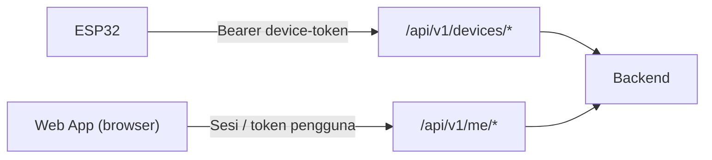
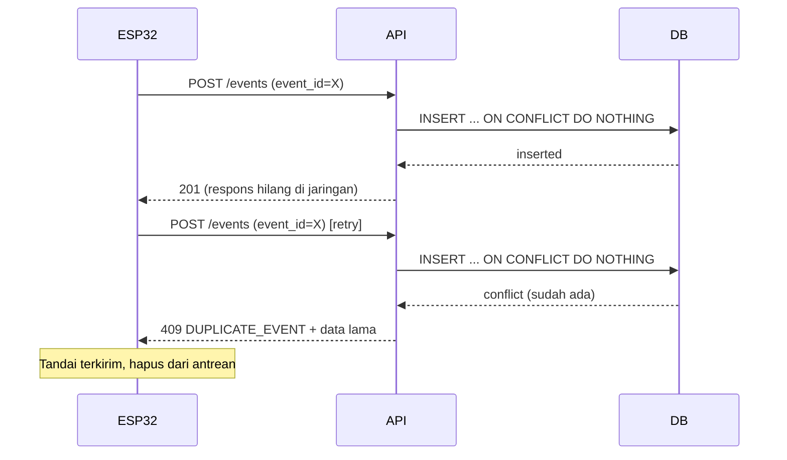
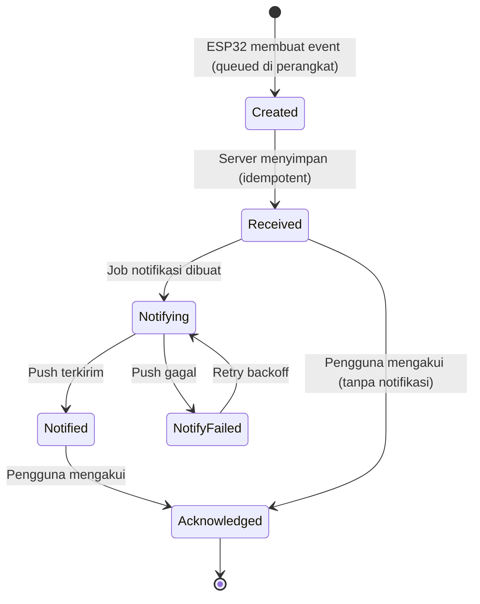
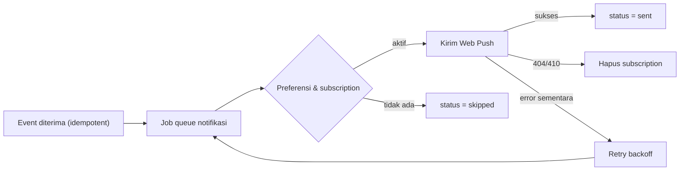
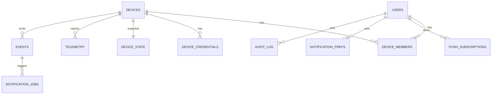

# 🌐 SMARTGUARD — Web Development Contract Pack

**Kumpulan kontrak untuk membangun Web API + Web App SMARTGUARD**

  

> [!IMPORTANT]
> Dokumen ini adalah **usulan kontrak** yang diturunkan dari _SMARTGUARD Core v5.1_. Poin bertanda 🔒 adalah **invarian** dari dokumen inti dan tidak boleh dilanggar. Poin bertanda 💡 adalah **usulan tambahan** yang boleh disesuaikan dengan stack server yang sudah ada. Semua host, token, dan ID di contoh hanyalah placeholder.

---

## 📑 Indeks Kontrak

|                                           # | Kontrak                 | Menjawab pertanyaan                            |
| ------------------------------------------: | ----------------------- | ---------------------------------------------- |
|                    [C1](#c1--konvensi-umum) | Konvensi umum           | Format data, waktu, ID, versi, penamaan        |
|   [C2](#c2--kontrak-autentikasi--otorisasi) | Autentikasi & otorisasi | Siapa boleh akses apa                          |
|          [C3](#c3--kontrak-response--error) | Response & error        | Bentuk respons dan kode error                  |
|     [C4](#c4--kontrak-device-ingestion-api) | Device Ingestion API    | Apa yang dikirim ESP32                         |
|        [C5](#c5--kontrak-user--web-app-api) | User / Web App API      | Apa yang dibaca/ditulis web app                |
| [C6](#c6--kontrak-idempotency--deduplikasi) | Idempotency & dedup     | Retry aman tanpa duplikat                      |
|               [C7](#c7--kontrak-skema-data) | Skema data              | Tipe data & enum                               |
| [C8](#c8--kontrak-status-koneksi-perangkat) | Status koneksi          | Online / offline / degraded dihitung bagaimana |
|       [C9](#c9--kontrak-siklus-hidup-event) | Siklus hidup event      | received → notified → acknowledged             |
|             [C10](#c10--kontrak-notifikasi) | Notifikasi              | Web Push, payload, preferensi                  |
|      [C11](#c11--kontrak-realtime--polling) | Realtime / polling      | Cara web app tetap mutakhir                    |
|     [C12](#c12--kontrak-ble--web-bluetooth) | BLE / Web Bluetooth     | Akses lokal dari browser                       |
|                 [C13](#c13--kontrak-ui--ux) | UI / UX                 | Apa yang tampil, apa yang dilarang             |
|               [C14](#c14--kontrak-keamanan) | Keamanan                | Header, CORS, rate limit, secret               |
|               [C15](#c15--kontrak-database) | Database                | Tabel, constraint, indeks                      |
|       [C16](#c16--kontrak-retensi--privasi) | Retensi & privasi       | Berapa lama data disimpan                      |
|       [C17](#c17--kontrak-testing--fixture) | Testing & fixture       | Mock data dan acceptance test                  |
|  [C18](#c18--kontrak-versioning--perubahan) | Versioning              | Cara mengubah kontrak dengan aman              |
|          [C19](#c19--kontrak-observability) | Observability           | Log, metrik, audit                             |
|   [C20](#c20--keputusan-yang-masih-terbuka) | Keputusan terbuka       | Hal yang harus diputuskan tim                  |

---

## 🔒 Invarian Sistem (berlaku untuk semua kontrak)

Aturan berikut berasal dari dokumen inti dan **tidak boleh dilanggar oleh backend maupun frontend**:

|    # | Invarian                                                                                                                               |
| ---: | -------------------------------------------------------------------------------------------------------------------------------------- |
|  I-1 | **Tidak ada `power_off`.** Tidak ada endpoint API, perintah BLE, atau tombol UI yang mematikan perangkat atau menonaktifkan pemantauan |
|  I-2 | **Offline ≠ aman.** Status terakhir `ARMED` tidak boleh ditampilkan sebagai "aman" bila perangkat offline                              |
|  I-3 | **Event alarm tidak boleh hilang diam-diam.** `acknowledge` hanya mengubah status baca, bukan menghapus event                          |
|  I-4 | **Retry tidak boleh menggandakan event/notifikasi** (idempotent lewat `event_id`)                                                      |
|  I-5 | **Secret tidak ada di browser.** Device token dan kredensial tidak boleh masuk bundle JavaScript                                       |
|  I-6 | **Nilai hilang = `null`, bukan `0`.** Koordinat `0,0` tidak boleh dianggap lokasi valid                                                |
|  I-7 | **GPS tanpa fix tidak ditampilkan sebagai posisi aktual.** Tampilkan "terakhir diketahui" + umur data                                  |
|  I-8 | **Pengguna hanya melihat perangkat miliknya**                                                                                          |
|  I-9 | **Persentase baterai = estimasi.** Hanya tampilkan data asli, bukan angka contoh                                                       |
| I-10 | **Tidur sengaja ≠ rusak.** Perangkat `ARMED_SLEEP` jangan langsung ditandai offline sebelum melewati grace period                      |

---

## C1 · Konvensi Umum

| Aspek           | Aturan                                                                                                                  |
| --------------- | ----------------------------------------------------------------------------------------------------------------------- |
| Format          | JSON UTF-8, `Content-Type: application/json`                                                                            |
| Waktu           | ISO 8601 **UTC** dengan akhiran `Z`, mis. `2026-10-27T12:30:00Z`. Konversi ke zona waktu pengguna hanya di frontend     |
| Penamaan field  | `snake_case`                                                                                                            |
| Nilai kosong    | `null` (🔒 I-6)                                                                                                         |
| Satuan          | Disertakan di nama field: `_m`, `_kmh`, `_v`, `_percent`, `_mps2`, `_seconds`                                           |
| `device_id`     | String stabil & unik, mis. `sg-device-001`                                                                              |
| `event_id`      | String unik global (disarankan ULID/UUIDv7), dibuat **di perangkat**, stabil di semua retry                             |
| Dua jenis waktu | `occurred_at`/`updated_at`/`reported_at` = waktu di perangkat; `received_at` = waktu server menerima. **Jangan campur** |
| Versi skema     | Field `schema_version` (integer) pada payload perangkat                                                                 |
| Versi API       | Prefix path `/api/v1`                                                                                                   |
| Koordinat       | Desimal derajat (WGS84); latitude −90…90, longitude −180…180                                                            |

💡 **Catatan jam perangkat:** ESP32 tidak punya RTC baterai, sehingga setelah deep sleep waktunya bisa melenceng. Server sebaiknya menyimpan `received_at` dan menandai `clock_skew_seconds` bila selisih dengan `reported_at` besar (mis. > 5 menit).

---

## C2 · Kontrak Autentikasi & Otorisasi

### C2.1 Dua jalur autentikasi terpisah 🔒



| Aspek      | Jalur perangkat                        | Jalur pengguna                                               |
| ---------- | -------------------------------------- | ------------------------------------------------------------ |
| Prefix     | `/api/v1/devices/{device_id}/…`        | `/api/v1/me/…`                                               |
| Kredensial | `Authorization: Bearer <device-token>` | Cookie sesi `HttpOnly; Secure; SameSite` atau token pengguna |
| Siapa      | Satu token **per perangkat** 🔒        | Akun pengguna                                                |
| Scope      | Hanya `device_id` miliknya             | Hanya perangkat yang dimiliki/dibagikan                      |
| Dicabut    | Backend dapat revoke/rotate 🔒         | Logout / revoke sesi                                         |

### C2.2 Aturan otorisasi

| Aturan                                        | Detail                                                                                                                                                         |
| --------------------------------------------- | -------------------------------------------------------------------------------------------------------------------------------------------------------------- |
| Token perangkat ↔ `device_id`                 | Token valid **hanya** untuk `device_id` pada path. Mismatch → `403`                                                                                            |
| Kepemilikan                                   | Setiap request pengguna memeriksa relasi `user ↔ device`. Bukan pemilik → `404` atau `403` (pilih satu dan konsisten agar tidak membocorkan keberadaan device) |
| Endpoint perangkat tidak dipakai browser      | Browser tidak boleh punya device token (🔒 I-5)                                                                                                                |
| Endpoint pengguna tidak menerima device token | Pisahkan middleware auth                                                                                                                                       |
| Penyimpanan token                             | Server menyimpan **hash** token perangkat, bukan plaintext 💡                                                                                                  |
| Rotasi                                        | Mendukung 2 token aktif bersamaan sementara waktu agar rotasi tidak memutus perangkat 💡                                                                       |

### C2.3 Peran pengguna 💡

| Peran    | Lihat status | Akui event | Ubah preferensi notifikasi | Kelola perangkat/anggota |
| -------- | :----------: | :--------: | :------------------------: | :----------------------: |
| `owner`  |      ✅      |     ✅     |             ✅             |            ✅            |
| `member` |      ✅      |     ✅     |     ✅ (milik sendiri)     |            ❌            |
| `viewer` |      ✅      |     ❌     |     ✅ (milik sendiri)     |            ❌            |

> Tidak ada peran yang boleh mengirim perintah mematikan perangkat (🔒 I-1).

---

## C3 · Kontrak Response & Error

### C3.1 Envelope

Semua respons memakai bentuk yang sama:

```json
{
	"ok": true,
	"data": {},
	"error": null,
	"meta": { "request_id": "req_01J..." }
}
```

```json
{
	"ok": false,
	"data": null,
	"error": {
		"code": "VALIDATION_ERROR",
		"message": "Field battery.soc_percent harus 0–100",
		"details": [
			{ "field": "battery.soc_percent", "issue": "out_of_range", "value": 130 }
		]
	},
	"meta": { "request_id": "req_01J..." }
}
```

### C3.2 Kode error 💡

|        HTTP | `error.code`                     | Kapan                                 | Perilaku klien                                          |
| ----------: | -------------------------------- | ------------------------------------- | ------------------------------------------------------- |
|       `400` | `VALIDATION_ERROR`               | Payload/parameter tidak valid         | Perbaiki payload; **jangan retry buta**                 |
|       `400` | `PAYLOAD_TOO_LARGE`              | Ukuran melebihi batas (atau `413`)    | Kecilkan payload                                        |
|       `401` | `UNAUTHENTICATED`                | Token/sesi tidak ada atau kedaluwarsa | Tampilkan masalah auth; jangan tampilkan perangkat aman |
|       `403` | `FORBIDDEN`                      | Tidak berhak atas resource            | Hentikan; periksa konfigurasi                           |
|       `404` | `NOT_FOUND`                      | Device/event/endpoint tidak ada       | Periksa `device_id` & versi API                         |
|       `409` | `DUPLICATE_EVENT`                | `event_id` sudah pernah diterima      | **Perlakukan sebagai sukses** (lihat C6)                |
|       `429` | `RATE_LIMITED`                   | Terlalu banyak request                | Hormati `Retry-After`, gunakan backoff                  |
| `500`/`503` | `INTERNAL_ERROR` / `UNAVAILABLE` | Gangguan server                       | Simpan event, retry dengan backoff                      |

### C3.3 Aturan perilaku klien (perangkat) 🔒

| Status          | Tindakan ESP32                                                                                           |
| --------------- | -------------------------------------------------------------------------------------------------------- |
| `200`/`201`     | Tandai request/event terkirim                                                                            |
| `400`           | Catat error; jangan retry tanpa memperbaiki payload                                                      |
| `401`/`403`     | Laporkan masalah auth; **event tetap di antrean**                                                        |
| `404`           | Periksa konfigurasi `device_id`                                                                          |
| `409`           | Anggap event sudah diterima                                                                              |
| `429`           | Tunggu `Retry-After`, lalu backoff                                                                       |
| `5xx` / timeout | Simpan event, retry dengan backoff + jitter, **dengan `event_id` yang sama**; loop sensor tetap berjalan |

---

## C4 · Kontrak Device Ingestion API

> Dipakai **hanya oleh ESP32**. Semua endpoint wajib HTTPS.

### C4.1 Daftar endpoint

| Method | Endpoint                                | Tujuan                               | Idempotency-Key          |
| :----: | --------------------------------------- | ------------------------------------ | ------------------------ |
| `POST` | `/api/v1/devices/{device_id}/heartbeat` | Lapor hidup + status koneksi ringkas | Opsional                 |
| `POST` | `/api/v1/devices/{device_id}/telemetry` | Status lengkap berkala               | Disarankan               |
| `POST` | `/api/v1/devices/{device_id}/events`    | Event keamanan & kesehatan           | **Wajib** (= `event_id`) |

### C4.2 Header request

| Header               |   Wajib   | Nilai                                                      |
| -------------------- | :-------: | ---------------------------------------------------------- |
| `Authorization`      |    ✅     | `Bearer <device-token>`                                    |
| `Content-Type`       |    ✅     | `application/json`                                         |
| `Idempotency-Key`    | Event: ✅ | Sama dengan `event_id` (event) atau kunci unik (telemetri) |
| `X-Firmware-Version` |    💡     | mis. `5.1.0`                                               |

### C4.3 Heartbeat

Ringan, untuk menandai perangkat masih hidup (terutama saat siklus deep sleep).

```json
{
	"schema_version": 1,
	"device_id": "sg-device-001",
	"reported_at": "2026-10-27T12:30:00Z",
	"power": {
		"mode": "ARMED_SLEEP",
		"last_wake_reason": "timer",
		"next_heartbeat_due_at": "2026-10-27T12:40:00Z"
	},
	"security": { "state": "ARMED", "alarm_active": false },
	"battery": { "soc_percent": 72, "status": "normal" },
	"health": { "event_queue_size": 0 }
}
```

### C4.4 Telemetri

Payload lengkap mengikuti **[C7.1 DeviceStatus](#c71-devicestatus)**.

### C4.5 Event

Payload mengikuti **[C7.2 DeviceEvent](#c72-deviceevent)**.

### C4.6 Respons sukses (perangkat)

```json
{
	"ok": true,
	"data": {
		"device_id": "sg-device-001",
		"received_at": "2026-10-27T12:30:00Z",
		"next_heartbeat_seconds": 30
	},
	"error": null,
	"meta": { "request_id": "req_01J..." }
}
```

| Field                    | Arti                                                                                                                                                                                   |
| ------------------------ | -------------------------------------------------------------------------------------------------------------------------------------------------------------------------------------- |
| `received_at`            | Waktu server menerima (sumber kebenaran waktu server)                                                                                                                                  |
| `next_heartbeat_seconds` | **Saran** jeda berikutnya. Bersifat advisory: saat deep sleep, perangkat memakai interval daya sendiri (10–15 menit) dan **tidak boleh** dipaksa lebih rapat sehingga menguras baterai |

### C4.7 Aturan server saat menerima data perangkat

1. Autentikasi token → cocokkan dengan `device_id` path (C2.2).
2. Validasi skema, rentang angka, ukuran, dan `event_type` (daftar tertutup, lihat C7.3).
3. Event: simpan **idempotent** (C6), lalu buat job notifikasi (C9/C10).
4. Perbarui `last_seen_at` pada **setiap** request perangkat yang valid, bukan hanya heartbeat.
5. Telemetri: perbarui snapshot status terakhir dan simpan riwayat sesuai retensi (C16).
6. Jangan menolak event hanya karena `occurred_at` lama — event yang tertunda di antrean wajib diterima.

---

## C5 · Kontrak User / Web App API

> Dipakai **hanya oleh web app** (frontend → backend/BFF). Semua endpoint wajib terautentikasi dan otorisasi kepemilikan (C2).

### C5.1 Daftar endpoint

|  Method  | Endpoint                                              | Tujuan                                             |
| :------: | ----------------------------------------------------- | -------------------------------------------------- |
|  `GET`   | `/api/v1/me/devices`                                  | Daftar perangkat milik pengguna + ringkasan status |
|  `GET`   | `/api/v1/me/devices/{device_id}/status`               | Snapshot status terakhir + status koneksi turunan  |
|  `GET`   | `/api/v1/me/devices/{device_id}/location`             | Lokasi valid terakhir                              |
|  `GET`   | `/api/v1/me/devices/{device_id}/battery`              | Baterai terakhir                                   |
|  `GET`   | `/api/v1/me/devices/{device_id}/events`               | Riwayat event (paginasi)                           |
|  `GET`   | `/api/v1/me/devices/{device_id}/telemetry/history` 💡 | Riwayat lokasi/baterai untuk grafik/jejak          |
|  `POST`  | `/api/v1/me/events/{event_id}/acknowledge`            | Mengakui event                                     |
|  `GET`   | `/api/v1/me/notification-preferences` 💡              | Baca preferensi                                    |
|  `PUT`   | `/api/v1/me/notification-preferences`                 | Ubah preferensi                                    |
|  `POST`  | `/api/v1/me/push-subscriptions` 💡                    | Daftarkan subscription Web Push                    |
| `DELETE` | `/api/v1/me/push-subscriptions/{id}` 💡               | Hapus subscription                                 |

> [!NOTE]
> Alias `/api/v1/devices/{device_id}/status|location|events|battery` pada dokumen inti boleh dipertahankan, tetapi **wajib** melewati middleware otorisasi pengguna, bukan token perangkat.

**Tidak ada** endpoint: `power_off`, `disable_monitoring`, `delete_alarm_event`, `mute_device_permanently` (🔒 I-1, I-3).

### C5.2 `GET /me/devices/{id}/status` — respons

```json
{
	"ok": true,
	"data": {
		"device_id": "sg-device-001",
		"connection": {
			"status": "online",
			"last_seen_at": "2026-10-27T12:30:00Z",
			"expected_next_report_at": "2026-10-27T12:40:00Z",
			"stale_after": "2026-10-27T12:52:00Z",
			"is_sleeping": true
		},
		"snapshot": {},
		"snapshot_reported_at": "2026-10-27T12:30:00Z",
		"snapshot_age_seconds": 42
	},
	"error": null,
	"meta": { "request_id": "req_01J..." }
}
```

`snapshot` berisi struktur **DeviceStatus** (C7.1). `connection` dihitung **server** (C8), bukan dibaca dari boolean perangkat.

### C5.3 `GET /me/devices/{id}/location` — respons

```json
{
	"ok": true,
	"data": {
		"latitude": -7.7975,
		"longitude": 110.3711,
		"fix_at": "2026-10-27T12:29:58Z",
		"age_seconds": 130,
		"is_live": false,
		"satellites": 8,
		"home": { "latitude": -7.797, "longitude": 110.37 },
		"geofence_radius_m": 30
	},
	"error": null,
	"meta": { "request_id": "req_01J..." }
}
```

- `is_live = false` bila umur data melewati ambang 💡 (mis. > 2× interval laporan) → UI wajib memberi label "terakhir diketahui".
- Bila belum pernah ada fix: `latitude`/`longitude` = `null`.

### C5.4 `GET /me/devices/{id}/events` — query & paginasi 💡

| Parameter      | Tipe           | Keterangan                            |
| -------------- | -------------- | ------------------------------------- |
| `limit`        | int            | Default 25, maks 100                  |
| `cursor`       | string         | Cursor opaque dari respons sebelumnya |
| `type`         | string (multi) | Filter `event_type`                   |
| `severity`     | string (multi) | `info`/`medium`/`high`                |
| `from`, `to`   | ISO 8601       | Rentang `occurred_at`                 |
| `acknowledged` | bool           | Filter status acknowledge             |

Urutan default: `occurred_at` menurun, tiebreak `event_id`.

```json
{
	"ok": true,
	"data": {
		"items": [{ "...": "StoredEvent (C7.4)" }],
		"next_cursor": "eyJ0IjoiMjAyNi0xMC0yN1QxMjozMToxMFoifQ",
		"has_more": true
	},
	"error": null,
	"meta": { "request_id": "req_01J..." }
}
```

### C5.5 `POST /me/events/{event_id}/acknowledge`

**Request body (opsional):**

```json
{ "note": "Sudah dicek, kendaraan dipindahkan keluarga" }
```

**Efek (🔒):** hanya mengisi `acknowledged_at`, `acknowledged_by`, `note`. **Tidak** menghapus event, **tidak** menonaktifkan sensor, **tidak** mengirim perintah ke perangkat.

Idempotent: acknowledge ulang oleh pengguna yang sama mengembalikan `200` dengan data yang sudah ada.

---

## C6 · Kontrak Idempotency & Deduplikasi

| Aspek                            | Aturan                                                                                                        |
| -------------------------------- | ------------------------------------------------------------------------------------------------------------- |
| Kunci                            | `event_id` (dibuat perangkat, stabil di semua retry) 🔒                                                       |
| Header                           | `Idempotency-Key` = `event_id`                                                                                |
| Unique constraint                | `UNIQUE(device_id, event_id)` di database                                                                     |
| Pengiriman ulang event yang sama | Server **tidak** membuat event baru **dan tidak** membuat notifikasi baru 🔒                                  |
| Respons duplikat                 | `409 DUPLICATE_EVENT` dengan body event yang sudah tersimpan; perangkat menganggapnya **sukses**              |
| Payload berbeda, `event_id` sama | Abaikan payload baru, kembalikan yang lama; catat peringatan di log 💡                                        |
| Race condition                   | Gunakan `INSERT … ON CONFLICT DO NOTHING` (atau setara), bukan "cek lalu insert"                              |
| Telemetri                        | Idempotency-Key berbasis `device_id + reported_at`; duplikat ditoleransi dan tidak menggandakan baris riwayat |
| Notifikasi                       | Job notifikasi dibuat **sekali per event baru**, dikunci oleh `event_id`                                      |



---

## C7 · Kontrak Skema Data

> Ditulis dalam TypeScript sebagai referensi. Boleh diterjemahkan ke JSON Schema / OpenAPI / Zod / Pydantic.

### C7.1 DeviceStatus

```ts
type ISODateTime = string; // ISO 8601 UTC, mis. "2026-10-27T12:30:00Z"

interface DeviceStatus {
	schema_version: 1;
	device_id: string;
	reported_at: ISODateTime;
	firmware_version?: string;

	power: {
		mode: PowerMode;
		last_wake_reason: WakeReason | null;
		next_heartbeat_due_at: ISODateTime | null;
	};

	security: {
		state: SecurityState;
		alarm_active: boolean;
		home: { latitude: number; longitude: number } | null;
		geofence_radius_m: number;
		distance_from_home_m: number | null;
	};

	gps: {
		fix: boolean;
		latitude: number | null;
		longitude: number | null;
		speed_kmh: number | null;
		satellites: number | null;
		updated_at: ISODateTime | null;
	};

	motion: {
		available: boolean;
		detected: boolean | null;
		acceleration_mps2: number | null;
		updated_at: ISODateTime | null;
	};

	battery: {
		voltage_v: number | null;
		soc_percent: number | null; // 0–100, ESTIMASI
		status: BatteryStatus;
		charging: boolean | null; // null = tidak diketahui
		updated_at: ISODateTime | null;
	};

	connectivity: {
		wifi_connected: boolean;
		api_reachable: boolean;
		ble_available: boolean;
		last_successful_sync_at: ISODateTime | null;
	};

	health: {
		gps: HealthState;
		motion_sensor: HealthState;
		battery_monitor: HealthState;
		event_queue_size: number;
	};
}
```

### C7.2 DeviceEvent

```ts
interface DeviceEvent {
	schema_version: 1;
	event_id: string; // unik, stabil lintas retry
	device_id: string;
	event_type: EventType;
	severity: Severity;
	occurred_at: ISODateTime; // waktu di perangkat
	reason?: AlarmReason[]; // untuk security_alarm
	location?: {
		latitude: number | null;
		longitude: number | null;
		gps_fix: boolean;
	};
	distance_from_home_m?: number | null;
	battery?: { soc_percent: number | null; voltage_v: number | null };
	details?: Record<string, unknown>; // info tambahan (mis. jumlah event dibuang)
}
```

### C7.3 Enum (daftar tertutup)

```ts
type SecurityState = "INITIALIZING" | "ARMED" | "ALARM" | "FAULT";
type PowerMode =
	| "BOOT"
	| "ARMED_SLEEP"
	| "WAKE_CHECK"
	| "SYNC"
	| "ALARM_ACTIVE"
	| "LOW_BATTERY";
type WakeReason = "startup" | "timer" | "motion" | "motion_or_timer";
type BatteryStatus = "normal" | "low" | "critical" | "charging" | "unknown";
type HealthState = "ok" | "degraded" | "fault" | "unknown";
type Severity = "info" | "medium" | "high";
type AlarmReason = "motion_detected" | "geofence_exceeded";
type EventType =
	| "security_alarm" // high
	| "battery_low" // medium
	| "battery_critical" // high
	| "sensor_fault" // high
	| "event_queue_overflow" // high
	| "device_started" // info
	| "connectivity_restored"; // info
```

> `ARMED_SLEEP` adalah **mode daya**, bukan security state (Core §5.1). Jangan menjadikannya nilai `security.state`.

### C7.4 StoredEvent (disimpan & dikembalikan server)

```ts
interface StoredEvent extends DeviceEvent {
	received_at: ISODateTime; // diisi server
	delivery: {
		notification_status: "pending" | "sent" | "failed" | "skipped";
		attempts: number;
		last_attempt_at: ISODateTime | null;
		last_error: string | null;
	};
	acknowledged_at: ISODateTime | null;
	acknowledged_by: string | null;
	acknowledge_note: string | null;
}
```

### C7.5 Aturan validasi server

| Field                    | Aturan                                                                                                         |
| ------------------------ | -------------------------------------------------------------------------------------------------------------- |
| `latitude` / `longitude` | Dalam rentang valid; bila `gps.fix = false` maka keduanya `null`; **tolak/abaikan `0,0` sebagai lokasi valid** |
| `soc_percent`            | 0–100 atau `null`                                                                                              |
| `voltage_v`              | Rentang masuk akal sel Li-ion (mis. 2.5–4.5) atau `null` 💡                                                    |
| `satellites`             | Integer ≥ 0 atau `null`                                                                                        |
| `occurred_at`            | Format valid; boleh lampau (event tertunda). Tolak bila jauh di masa depan 💡                                  |
| `event_type`, enum lain  | Hanya nilai dari C7.3                                                                                          |
| Ukuran body              | Batas maksimum (mis. 16 KB) 💡                                                                                 |
| Field tak dikenal        | Boleh diabaikan agar kompatibel ke depan                                                                       |

---

## C8 · Kontrak Status Koneksi Perangkat

Status **dihitung server** dari `last_seen_at`, bukan dipercaya dari boolean perangkat (Core §12.2 🔒).

### C8.1 Status turunan

| Status     | Kondisi                                                        | Label UI                                |
| ---------- | -------------------------------------------------------------- | --------------------------------------- |
| `online`   | `now ≤ stale_after` dan tidak ada gangguan kesehatan           | Online — status diperbarui              |
| `degraded` | Online, tetapi `health.*` ≠ `ok` atau `security.state = FAULT` | Ada gangguan — periksa detail           |
| `offline`  | `now > stale_after`                                            | Offline — status terbaru belum tersedia |
| `unknown`  | Belum pernah ada laporan valid                                 | Belum ada informasi                     |

### C8.2 Rumus 💡

```text
expected_next_report_at = power.next_heartbeat_due_at   (jika ada)
                          selain itu: last_seen_at + interval_default

stale_after = expected_next_report_at + grace

grace (usulan awal):
   mode aktif  → 2 × interval_laporan_aktif
   ARMED_SLEEP → 0.5 × interval_heartbeat_idle + 60 detik

is_sleeping = (power.mode == "ARMED_SLEEP") dan (now ≤ stale_after)
```

> Grace period adalah parameter yang **harus dituning** setelah mengukur keandalan Wi-Fi dan interval tidur nyata. Simpan sebagai konfigurasi server, bukan hardcode.

### C8.3 Aturan wajib

| Aturan                     | Detail                                                                                                                                  |
| -------------------------- | --------------------------------------------------------------------------------------------------------------------------------------- |
| 🔒 Offline tidak jadi aman | Saat `offline`, UI **tidak boleh** menampilkan "ARMED/aman" sebagai status utama; tampilkan "terakhir `ARMED` pada …" beserta umur data |
| 🔒 Tidur ≠ offline         | `is_sleeping = true` ditampilkan sebagai "Mode hemat daya", bukan error                                                                 |
| `last_seen_at`             | Diperbarui oleh **setiap** request perangkat yang valid                                                                                 |
| Transisi → offline         | Dihitung oleh job terjadwal 💡 agar bisa memicu notifikasi "perangkat offline" bila diaktifkan pengguna                                 |
| Transisi → online          | Boleh menghasilkan `connectivity_restored`, tetapi hindari event berulang pada tiap siklus reconnect                                    |

---

## C9 · Kontrak Siklus Hidup Event



### C9.1 Status per lapisan

| Lapisan             | Status                                                | Arti                                            |
| ------------------- | ----------------------------------------------------- | ----------------------------------------------- |
| Perangkat           | `pending` → `sent` → `acknowledged` (diterima server) | Status antrean lokal; `sent` ≠ sampai ke ponsel |
| Server (notifikasi) | `pending` / `sent` / `failed` / `skipped`             | Hasil pengiriman push                           |
| Pengguna            | `acknowledged_at` terisi / kosong                     | Pengguna sudah melihat/mengakui                 |

### C9.2 Aturan

| Aturan            | Detail                                                                                                                                        |
| ----------------- | --------------------------------------------------------------------------------------------------------------------------------------------- |
| 🔒 Event permanen | Event tidak dihapus oleh acknowledge, oleh penutupan banner, atau oleh kembalinya status ke normal                                            |
| Kegagalan push    | Event **tetap tersimpan** dan tampil di riwayat; kegagalan tercatat di `delivery.last_error`                                                  |
| Retry notifikasi  | Backoff + batas percobaan; setelah batas → `failed` dan tampil di UI sebagai "notifikasi gagal terkirim" 💡                                   |
| `skipped`         | Pengguna menonaktifkan jenis notifikasi tersebut atau tidak punya subscription aktif                                                          |
| Alarm berlanjut   | Perangkat boleh menghasilkan event baru setelah cooldown; server tidak menggabungkan otomatis, tetapi UI boleh **mengelompokkan** tampilan 💡 |
| Prioritas         | `security_alarm` & `battery_critical` didahulukan di antrean notifikasi dibanding event `info`                                                |

---

## C10 · Kontrak Notifikasi

### C10.1 Pembeda penting 🔒

> Polling atau WebSocket saat halaman terbuka **bukan** push notification. Notifikasi saat browser tertutup membutuhkan **Web Push + service worker** (atau push mobile) dan izin pengguna.

### C10.2 Subscription Web Push

`POST /api/v1/me/push-subscriptions`

```json
{
	"endpoint": "https://push.example.com/...",
	"keys": { "p256dh": "<public-key>", "auth": "<auth-secret>" },
	"user_agent": "optional",
	"platform": "web"
}
```

| Aturan                             | Detail                                                                    |
| ---------------------------------- | ------------------------------------------------------------------------- |
| Satu pengguna, banyak subscription | Satu per browser/perangkat                                                |
| Subscription kedaluwarsa           | Saat push provider membalas `404/410`, **hapus** subscription tersebut 🔒 |
| Penyimpanan                        | `keys` diperlakukan sebagai data sensitif                                 |
| Izin ditolak                       | Event tetap tersimpan & tampil di riwayat (NOTIF-03)                      |
| VAPID key                          | Private key hanya di server                                               |

### C10.3 Payload notifikasi

```json
{
	"title": "SMARTGUARD — Alarm kendaraan",
	"body": "Gerakan/perpindahan mencurigakan terdeteksi.",
	"tag": "event-01J-SAMPLE-UNIQUE-ID",
	"data": {
		"event_id": "01J-SAMPLE-UNIQUE-ID",
		"device_id": "sg-device-001",
		"url": "/devices/sg-device-001/events/01J-SAMPLE-UNIQUE-ID"
	},
	"require_interaction": true
}
```

| Aturan                 | Detail                                                                               |
| ---------------------- | ------------------------------------------------------------------------------------ |
| 🔒 Tanpa data sensitif | Jangan taruh token, info autentikasi, atau data yang tidak perlu di isi notifikasi   |
| Lokasi                 | Boleh berupa tautan ke dashboard (yang meminta login), **bukan** koordinat mentah 💡 |
| `tag`                  | Berbasis `event_id` agar notifikasi duplikat menimpa, bukan menumpuk                 |
| Klik notifikasi        | Membuka detail event; tautan wajib melewati autentikasi                              |

### C10.4 Preferensi notifikasi 💡

`PUT /api/v1/me/notification-preferences`

```json
{
	"channels": { "web_push": true, "email": false },
	"by_event_type": {
		"security_alarm": { "enabled": true, "locked": true },
		"battery_low": { "enabled": true },
		"battery_critical": { "enabled": true, "locked": true },
		"sensor_fault": { "enabled": true },
		"connectivity_restored": { "enabled": false },
		"device_started": { "enabled": false }
	},
	"device_offline_alert": { "enabled": true }
}
```

> Pengguna **tidak boleh** bisa mematikan permanen notifikasi `security_alarm` dan `battery_critical` (`locked: true`) 💡. Preferensi hanya mengatur jalur & jenis notifikasi sekunder.

### C10.5 Pemrosesan di backend



---

## C11 · Kontrak Realtime & Polling 💡

Perangkat sering tidur, jadi "realtime" hanya berarti _"segera setelah server menerima data"_.

| Mekanisme                       | Kegunaan                                    | Catatan                                                                         |
| ------------------------------- | ------------------------------------------- | ------------------------------------------------------------------------------- |
| **Polling** `GET /status`       | Cara paling sederhana                       | Interval 10–30 detik saat tab aktif; jeda lebih lama saat tab di latar belakang |
| **SSE** `GET /api/v1/me/stream` | Dorong event/status baru ke halaman terbuka | Autentikasi lewat cookie sesi; kirim `heartbeat` komentar agar koneksi hidup    |
| **WebSocket**                   | Alternatif SSE                              | Hanya jika butuh dua arah; **tetap tidak ada perintah matikan perangkat**       |
| **Web Push**                    | Saat halaman/browser tertutup               | Lihat C10                                                                       |

### Event SSE

| `event:`     | `data:`                                    |
| ------------ | ------------------------------------------ |
| `status`     | Snapshot status ringkas + `connection`     |
| `alarm`      | `StoredEvent` baru dengan `security_alarm` |
| `event`      | `StoredEvent` non-alarm                    |
| `connection` | Perubahan `online/offline/degraded`        |

### Aturan UI saat koneksi realtime putus

- Tampilkan banner "Koneksi ke server terputus — data mungkin tidak terbaru" dan **umur data terakhir**.
- Fallback otomatis ke polling.
- Jangan menyembunyikan alarm yang sudah ada saat reconnect.

---

## C12 · Kontrak BLE / Web Bluetooth

> BLE hanya untuk **akses lokal jarak dekat**. Bukan pengganti Web API (🔒).

### C12.1 GATT

| Characteristic         | Properti                 | Isi                                                    |       Boleh dari browser?        |
| ---------------------- | ------------------------ | ------------------------------------------------------ | :------------------------------: |
| `STATUS_UUID`          | `READ`, `NOTIFY`         | JSON status ringkas                                    |                ✅                |
| `DIAGNOSTICS_UUID`     | `READ`, `NOTIFY`         | Sensor, firmware, antrean, error terakhir              |                ✅                |
| `CONFIG_UUID`          | `READ`, `WRITE` terbatas | Konfigurasi non-sensitif / provisioning terautentikasi |    ⚠️ Hanya jika terproteksi     |
| `TIME_UUID` (opsional) | `WRITE` terbatas         | Sinkronisasi waktu                                     | ⚠️ Hanya via aplikasi pendamping |

UUID di dokumen inti adalah placeholder; **buat UUID final unik** dan catat di firmware + frontend dalam satu sumber kebenaran.

### C12.2 Payload `STATUS_UUID`

```ts
interface BleStatus {
	schema_version?: number; // wajib bila dikonsumsi permanen
	device_id: string;
	security_state: SecurityState;
	alarm_active: boolean;
	gps_fix: boolean;
	battery_soc_percent: number | null;
	wifi_connected: boolean;
	api_reachable: boolean;
	pending_events: number;
	firmware_version: string;
}
```

### C12.3 Larangan 🔒

| Larangan                                                             | Alasan                                                                      |
| -------------------------------------------------------------------- | --------------------------------------------------------------------------- |
| Karakteristik/perintah untuk mematikan atau menonaktifkan pemantauan | Invarian I-1                                                                |
| Mengirim Wi-Fi password/token sebagai plaintext tanpa proteksi       | Keamanan                                                                    |
| Menganggap BLE selalu tersedia                                       | Deep sleep mematikan BLE; hanya tersedia di _advertising window_ (±20–30 s) |

### C12.4 Kontrak perilaku frontend

| Situasi                                     | Perilaku UI                                                                                   |
| ------------------------------------------- | --------------------------------------------------------------------------------------------- |
| Browser tidak mendukung Web Bluetooth       | Sembunyikan fitur BLE, tampilkan pesan "perlu browser/aplikasi pendamping"                    |
| Perangkat tidak ditemukan                   | Jelaskan bahwa perangkat mungkin sedang tidur; sarankan memicu gerakan ringan/menunggu window |
| BLE terhubung                               | Tampilkan data BLE dengan label **"Lokal (BLE)"** dan timestamp pembacaan                     |
| Data BLE vs data server berbeda             | Tampilkan keduanya dengan sumber & waktunya; jangan menimpa diam-diam                         |
| Web Bluetooth perlu HTTPS & gestur pengguna | Mulai pemindaian hanya dari klik tombol                                                       |

---

## C13 · Kontrak UI / UX

### C13.1 Komponen dashboard

| Komponen                  | Sumber data                            | Wajib menampilkan                                                                          |
| ------------------------- | -------------------------------------- | ------------------------------------------------------------------------------------------ |
| **Status keamanan**       | `security.state` + `connection.status` | Gabungan: bila offline, tampilkan "Offline" dominan + status terakhir + umur               |
| **Kesehatan perangkat**   | `connection`, `health`                 | `online`/`offline`/`degraded`/`unknown`                                                    |
| **Peta lokasi**           | `location`                             | Posisi, `HOME`, radius geofence, **umur data**, label "terakhir diketahui" bila tidak live |
| **Gerakan**               | `motion`                               | Deteksi terakhir + timestamp                                                               |
| **GPS**                   | `gps`                                  | Fix/no fix, satelit, umur data                                                             |
| **Baterai**               | `battery`                              | Persentase (diberi label "estimasi"), tegangan, status, waktu ukur                         |
| **Jaringan**              | `connectivity`                         | Wi-Fi, API reachable, sinkronisasi terakhir                                                |
| **Mode daya**             | `power`                                | "Hemat daya (tidur)", estimasi laporan berikutnya                                          |
| **Riwayat event**         | `events`                               | Filter, status acknowledge, status notifikasi                                              |
| **Preferensi notifikasi** | `notification-preferences`             | Izin browser, jenis notifikasi, subscription aktif                                         |

### C13.2 Matriks status → tampilan

| Kondisi                  | Warna/ikon (usulan) | Teks utama             | Teks pendukung                                     |
| ------------------------ | ------------------- | ---------------------- | -------------------------------------------------- |
| `online` + `ARMED`       | 🟢                  | Terpantau              | Diperbarui X menit lalu                            |
| `online` + `ALARM`       | 🔴 berkedip         | **ALARM**              | Waktu & lokasi alarm                               |
| `online` + `ARMED_SLEEP` | 🟢 / 🌙             | Terpantau (hemat daya) | Laporan berikutnya ±HH:MM                          |
| `degraded`               | 🟠                  | Ada gangguan           | Sensor/layanan mana yang bermasalah                |
| `FAULT`                  | 🟠/🔴               | Gangguan perangkat     | Tidak boleh tampil sebagai aman                    |
| `offline`                | ⚪/🟠               | Offline                | Terakhir terlihat X lalu; status terakhir: `ARMED` |
| `unknown`                | ⚫                  | Belum ada informasi    | Perangkat belum pernah melapor                     |
| Baterai `low`            | 🟡                  | Baterai rendah         | Estimasi ±N%                                       |
| Baterai `critical`       | 🔴                  | Baterai kritis         | Perangkat bisa segera mati                         |

### C13.3 Wajib (✅) dan dilarang (❌) 🔒

| ✅ Wajib                                                           | ❌ Dilarang                                                           |
| ------------------------------------------------------------------ | --------------------------------------------------------------------- |
| Menampilkan umur data di semua kartu status                        | Menyimpan device secret/API token di JavaScript publik                |
| Menandai "estimasi" pada persentase baterai                        | Menafsirkan perangkat offline sebagai aman                            |
| Menampilkan event alarm sampai diakui, tetap di riwayat setelahnya | Menghilangkan event alarm saat banner ditutup                         |
| Membedakan `acknowledge` dari "perangkat dimatikan"                | Menyediakan tombol/perintah matikan ESP32 atau nonaktifkan pemantauan |
| Menampilkan lokasi "terakhir diketahui" bila GPS tak fix           | Menampilkan GPS tanpa fix valid sebagai posisi terkini                |
| Memeriksa otorisasi kepemilikan di server                          | Mengandalkan pembatasan di sisi klien saja                            |
| Waktu ditampilkan di zona waktu pengguna, disimpan UTC             | Menampilkan persentase contoh/dummy sebagai data baterai asli         |

### C13.4 State halaman (loading / kosong / error)

| State                | Perilaku                                                                              |
| -------------------- | ------------------------------------------------------------------------------------- |
| Loading              | Skeleton; jangan tampilkan "aman" sebagai default saat memuat                         |
| Belum ada perangkat  | Ajakan menambahkan perangkat                                                          |
| Belum ada data       | Status `unknown` + penjelasan                                                         |
| Error API            | Tampilkan error + **data terakhir yang di-cache beserta umurnya**, bukan layar kosong |
| Tab tidak aktif lama | Saat kembali, segarkan data dan tampilkan umur data                                   |

### C13.5 Teks notifikasi & label (i18n) 💡

Simpan semua label status dalam satu kamus (mis. `id` sebagai bawaan) agar konsisten antara UI, notifikasi, dan email.

### C13.6 Aksesibilitas 💡

- Status tidak hanya dibedakan lewat warna; sertakan ikon dan teks.
- Alarm punya peran `role="alert"` untuk pembaca layar.
- Kontras warna memenuhi WCAG AA.

---

## C14 · Kontrak Keamanan

| Area                         | Aturan                                                                                                             |
| ---------------------------- | ------------------------------------------------------------------------------------------------------------------ |
| Transport                    | HTTPS/TLS wajib 🔒; HSTS aktif 💡                                                                                  |
| Cookie sesi                  | `HttpOnly`, `Secure`, `SameSite=Lax/Strict` 💡                                                                     |
| CORS                         | Hanya origin web app milik proyek; endpoint perangkat tidak perlu CORS                                             |
| CSRF                         | Proteksi pada endpoint pengguna yang mengubah data (`POST/PUT/DELETE`) bila memakai cookie                         |
| Rate limit                   | Per perangkat (ingestion) dan per pengguna (API); balas `429` + `Retry-After`                                      |
| Batas ukuran                 | Batas body maksimum; tolak lebih besar                                                                             |
| Validasi                     | Semua input divalidasi di server (skema, rentang, enum, timestamp) 🔒                                              |
| Otorisasi                    | Cek kepemilikan di **setiap** request pengguna (API-07)                                                            |
| Secret                       | Device token di-hash di DB; VAPID private key & secret hanya di server; tidak ada di repo publik/log/screenshot 🔒 |
| Log                          | Jangan mencatat token, password, atau isi `Authorization`                                                          |
| Audit log                    | Catat: login, acknowledge, perubahan preferensi, rotasi/cabut token, perubahan kepemilikan 💡                      |
| Mode servis (jika kelak ada) | Autentikasi kuat, audit log, timeout otomatis, aturan keselamatan jelas — **bukan** `power_off` permanen           |
| Header keamanan              | `Content-Security-Policy`, `X-Content-Type-Options`, `Referrer-Policy` 💡                                          |
| Tautan notifikasi            | Selalu meminta autentikasi                                                                                         |

---

## C15 · Kontrak Database

### C15.1 Tabel inti 💡



| Tabel                | Kolom penting                                                                                                                                             | Constraint / indeks                                                                                     |
| -------------------- | --------------------------------------------------------------------------------------------------------------------------------------------------------- | ------------------------------------------------------------------------------------------------------- |
| `devices`            | `device_id` (PK), `name`, `created_at`, `home_lat`, `home_lon`, `geofence_radius_m`                                                                       | `PK(device_id)`                                                                                         |
| `device_credentials` | `id`, `device_id`, `token_hash`, `created_at`, `revoked_at`                                                                                               | Indeks `(device_id)`; token plaintext **tidak** disimpan                                                |
| `device_members`     | `user_id`, `device_id`, `role`                                                                                                                            | `UNIQUE(user_id, device_id)`                                                                            |
| `device_state`       | `device_id`, `snapshot_json`, `reported_at`, `last_seen_at`, `security_state`, `power_mode`, `next_expected_at`                                           | `PK(device_id)`; ini sumber C8                                                                          |
| `telemetry`          | `id`, `device_id`, `reported_at`, `received_at`, `payload_json`, `lat`, `lon`, `soc_percent`                                                              | Indeks `(device_id, reported_at DESC)`; unik `(device_id, reported_at)`                                 |
| `events`             | `event_id`, `device_id`, `event_type`, `severity`, `occurred_at`, `received_at`, `payload_json`, `acknowledged_at`, `acknowledged_by`, `acknowledge_note` | **`UNIQUE(device_id, event_id)`** 🔒; indeks `(device_id, occurred_at DESC)`, `(device_id, event_type)` |
| `notification_jobs`  | `id`, `event_id`, `user_id`, `channel`, `status`, `attempts`, `last_error`, `next_attempt_at`                                                             | `UNIQUE(event_id, user_id, channel)` agar tidak dobel                                                   |
| `push_subscriptions` | `id`, `user_id`, `endpoint`, `p256dh`, `auth`, `created_at`, `last_success_at`                                                                            | `UNIQUE(endpoint)`                                                                                      |
| `notification_prefs` | `user_id`, `prefs_json`                                                                                                                                   | `PK(user_id)`                                                                                           |
| `audit_log`          | `id`, `actor_id`, `action`, `target`, `at`, `meta_json`                                                                                                   | Indeks `(actor_id, at)`                                                                                 |

### C15.2 Aturan data

| Aturan                                              | Detail                                                                                                                               |
| --------------------------------------------------- | ------------------------------------------------------------------------------------------------------------------------------------ |
| 🔒 Event tidak di-`DELETE` oleh aksi pengguna biasa | Hanya kebijakan retensi (C16) atau penghapusan akun/perangkat                                                                        |
| Timestamp                                           | Kolom bertipe waktu dengan zona UTC                                                                                                  |
| Snapshot vs riwayat                                 | `device_state` = nilai terakhir (cepat dibaca); `telemetry` = riwayat                                                                |
| Penulisan snapshot                                  | Jangan menimpa snapshot dengan laporan yang `reported_at`-nya **lebih lama** dari yang tersimpan (laporan datang tidak berurutan) 💡 |
| Transaksi                                           | Insert event + pembuatan job notifikasi dalam satu transaksi (atau outbox pattern) 💡                                                |

---

## C16 · Kontrak Retensi & Privasi

> Riwayat lokasi dapat mengungkap kebiasaan pengguna (Core §13.4). **Angka di bawah adalah usulan** — tim wajib memutuskan.

| Data                     | Retensi usulan 💡                    | Catatan                                       |
| ------------------------ | ------------------------------------ | --------------------------------------------- |
| Snapshot status terakhir | Selama perangkat terdaftar           |                                               |
| Telemetri/riwayat lokasi | 30–90 hari, lalu agregasi atau hapus | Pertimbangkan kurangi presisi untuk data lama |
| Event keamanan           | Lebih panjang (mis. 12 bulan)        | Bernilai untuk laporan kehilangan             |
| Event `info`             | Lebih pendek (mis. 30 hari)          |                                               |
| Log notifikasi           | 30–90 hari                           |                                               |
| Audit log                | ≥ 12 bulan                           |                                               |
| Log server               | Tanpa secret; retensi singkat        |                                               |

| Hak & proses               | Detail                                                                          |
| -------------------------- | ------------------------------------------------------------------------------- |
| Penghapusan perangkat/akun | Hapus snapshot, telemetri, event, subscription terkait; dokumentasikan prosedur |
| Ekspor data pengguna 💡    | Sediakan ekspor event & lokasi miliknya                                         |
| Berbagi akses              | Hanya via `device_members` dengan peran jelas                                   |
| Akses staf/admin           | Dibatasi dan tercatat di audit log                                              |

---

## C17 · Kontrak Testing & Fixture

### C17.1 Fixture wajib (untuk mock device)

Tim web bisa bekerja **tanpa menunggu firmware** dengan fixture berikut:

| Fixture                        | Isi                                                               |
| ------------------------------ | ----------------------------------------------------------------- |
| `status_armed_sleep.json`      | Status normal, `ARMED_SLEEP`, `next_heartbeat_due_at` +10 menit   |
| `status_alarm.json`            | `security.state = ALARM`, `alarm_active = true`, LED merah        |
| `status_gps_nofix.json`        | `gps.fix = false`, koordinat `null`                               |
| `status_sensor_fault.json`     | `health.motion_sensor = "fault"`, `security.state = FAULT`        |
| `status_low_battery.json`      | `battery.status = "low"`, SoC rendah                              |
| `status_battery_critical.json` | `battery.status = "critical"`                                     |
| `event_security_alarm.json`    | `reason: [motion_detected, geofence_exceeded]`                    |
| `event_battery_low.json`       | `event_type = battery_low`                                        |
| `event_duplicate.json`         | `event_id` sama dengan fixture sebelumnya (uji dedup)             |
| `event_delayed.json`           | `occurred_at` lama, `received_at` baru (uji event tertunda)       |
| `status_offline.json`          | `last_seen_at` lampau melewati `stale_after` (uji status offline) |
| `payload_invalid_*.json`       | Rentang salah, enum salah, `0,0` sebagai koordinat                |

### C17.2 Acceptance test — Web API

| ID     | Skenario                                      | Hasil yang diharapkan                                       |
| ------ | --------------------------------------------- | ----------------------------------------------------------- |
| API-01 | Payload valid                                 | Telemetri diterima, status terakhir diperbarui              |
| API-02 | Token perangkat invalid                       | `401/403`                                                   |
| API-03 | `event_id` sama dikirim ulang                 | Tidak ada event/notifikasi ganda; respons `409` + data lama |
| API-04 | Payload rusak                                 | Ditolak dengan error terstruktur (`VALIDATION_ERROR`)       |
| API-05 | Rate limit terlampaui                         | `429` + `Retry-After`                                       |
| API-06 | Server `5xx` di tengah proses                 | Event tidak hilang, dapat dikirim ulang                     |
| API-07 | Pengguna membuka perangkat orang lain         | Ditolak                                                     |
| API-08 | Perangkat melewati `stale_after`              | Status `offline` + waktu data terakhir                      |
| API-09 | Token perangkat A dipakai untuk `device_id` B | `403`                                                       |
| API-10 | Event tertunda (`occurred_at` lama)           | Diterima dan tersimpan benar                                |
| API-11 | Laporan datang tidak berurutan                | Snapshot tidak ditimpa data lebih lama                      |
| API-12 | Acknowledge dua kali                          | Idempotent, tidak error                                     |
| API-13 | Request ke endpoint `power_off`               | `404` (endpoint tidak ada)                                  |

### C17.3 Acceptance test — Notifikasi

| ID       | Skenario                    | Hasil yang diharapkan                                     |
| -------- | --------------------------- | --------------------------------------------------------- |
| NOTIF-01 | Alarm saat web app terbuka  | Event tampil + notifikasi in-app                          |
| NOTIF-02 | Alarm saat halaman tertutup | Web Push diterima (izin diberikan & push terkonfigurasi)  |
| NOTIF-03 | Izin ditolak                | Event tetap tersimpan dan tampil di riwayat               |
| NOTIF-04 | Push provider gagal         | Event tersimpan; kegagalan tercatat; retry sesuai kontrak |
| NOTIF-05 | Pengguna mengakui event     | Hanya status acknowledge berubah                          |
| NOTIF-06 | Subscription `410 Gone`     | Subscription dihapus                                      |
| NOTIF-07 | Retry event yang sama       | Hanya satu notifikasi terkirim                            |

### C17.4 Acceptance test — UI

| ID    | Skenario                                   | Hasil yang diharapkan                           |
| ----- | ------------------------------------------ | ----------------------------------------------- |
| UI-01 | Perangkat offline, status terakhir `ARMED` | Tidak tampil "aman"; tampil offline + umur data |
| UI-02 | GPS tanpa fix                              | Label "terakhir diketahui", bukan posisi live   |
| UI-03 | `ARMED_SLEEP` dalam grace period           | Tampil "hemat daya", bukan error                |
| UI-04 | Banner alarm ditutup                       | Event tetap ada di riwayat                      |
| UI-05 | Baterai                                    | Ada label "estimasi" dan waktu ukur             |
| UI-06 | Tidak ada kontrol matikan perangkat        | Tidak ditemukan di UI/route manapun             |
| UI-07 | API error                                  | Menampilkan data cache + umurnya                |
| UI-08 | Browser tanpa Web Bluetooth                | Fitur BLE tersembunyi dengan penjelasan         |

### C17.5 Pengujian integrasi (end-to-end)

1. Mock device → API → DB → notifikasi → UI (tanpa hardware).
2. Device nyata → API (hasil uji HW-13/HW-14 pada dokumen inti).
3. Skenario kegagalan jaringan: putus-sambung, timeout, respons hilang (verifikasi dedup).

---

## C18 · Kontrak Versioning & Perubahan

| Aturan                     | Detail                                                                                                 |
| -------------------------- | ------------------------------------------------------------------------------------------------------ |
| Perubahan kompatibel       | Menambah field opsional baru → tidak menaikkan versi skema; klien lama mengabaikan field asing         |
| Perubahan tidak kompatibel | Naikkan `schema_version`; server mendukung versi lama selama masa transisi                             |
| Versi API                  | Perubahan breaking → `/api/v2`; `v1` tetap hidup sampai semua perangkat diperbarui                     |
| Firmware & server          | Server tidak boleh mengasumsikan semua perangkat memakai firmware terbaru                              |
| Enum baru                  | Server menerima enum tak dikenal sebagai `unknown` (jangan menolak event keamanan karena tipe baru) 💡 |
| Deprecation                | Umumkan, beri tanggal, sertakan header `Deprecation`/`Sunset` 💡                                       |
| Dokumen                    | Setiap perubahan kontrak dicatat di changelog dan di-review frontend + backend + firmware              |
| Sumber kebenaran           | Simpan spesifikasi sebagai OpenAPI + JSON Schema di repo, hasilkan tipe dari sana 💡                   |

---

## C19 · Kontrak Observability 💡

| Aspek               | Usulan                                                                                                       |
| ------------------- | ------------------------------------------------------------------------------------------------------------ |
| `request_id`        | Dibuat server, dikembalikan di `meta.request_id`, dicatat di semua log                                       |
| Metrik              | Jumlah event diterima, latensi ingestion, rasio `409`, rasio `5xx`, antrean notifikasi, rasio push gagal     |
| Alert operasional   | Notifikasi push gagal berturut-turut, backlog job notifikasi, lonjakan perangkat offline, lonjakan `401/403` |
| Kesehatan perangkat | Dasbor internal: perangkat offline terlama, versi firmware, `event_queue_size` tinggi, baterai kritis        |
| Health endpoint     | `GET /healthz` (liveness) dan `GET /readyz` (DB & queue siap)                                                |
| Kebersihan log      | Tanpa token/secret/isi `Authorization` 🔒                                                                    |

---

## C20 · Keputusan yang Masih Terbuka

Daftar ini berasal dari Lampiran Keputusan Teknis pada dokumen inti. **Setiap kontrak di atas bergantung pada keputusan berikut.**

|   # | Keputusan                                                                        | Mempengaruhi |
| --: | -------------------------------------------------------------------------------- | ------------ |
|   1 | Stack Web API (framework, DB)                                                    | C2, C3, C15  |
|   2 | Mekanisme auth perangkat (bearer statis, JWT, mTLS) & auth pengguna (sesi/OAuth) | C2, C14      |
|   3 | Grace period offline & interval heartbeat final                                  | C8, C13      |
|   4 | Kriteria reset `ALARM → ARMED`, perilaku acknowledge, cooldown event             | C9, C13      |
|   5 | Web Push, push mobile, atau kombinasi; retensi subscription                      | C10          |
|   6 | Web Bluetooth atau aplikasi pendamping; UUID final; aturan pairing               | C12          |
|   7 | Retensi telemetri, lokasi, dan event                                             | C16          |
|   8 | Realtime: polling saja, SSE, atau WebSocket                                      | C11          |
|   9 | Berbagi perangkat antar pengguna (peran)                                         | C2, C15      |
|  10 | Kebijakan penolakan vs `404` untuk perangkat milik orang lain                    | C2           |
|  11 | Ambang `low` & `critical` baterai (dari hasil uji)                               | C7, C13      |
|  12 | Kanal notifikasi tambahan (email/Telegram/WhatsApp)                              | C10          |

---

## ✅ Checklist Ringkas untuk Tim Web

**Backend**

- [ ] Dua jalur auth terpisah (perangkat vs pengguna) dan token di-hash
- [ ] `UNIQUE(device_id, event_id)` + `ON CONFLICT DO NOTHING`
- [ ] `409` diperlakukan sukses oleh perangkat; notifikasi tidak ganda
- [ ] `last_seen_at` diperbarui di setiap request valid
- [ ] Status koneksi dihitung server (bukan dari boolean perangkat)
- [ ] Event tertunda diterima; snapshot tidak ditimpa data lebih lama
- [ ] Tidak ada endpoint `power_off` / nonaktifkan pemantauan
- [ ] Rate limit, batas ukuran, validasi enum & rentang
- [ ] Hapus subscription push `404/410`

**Frontend**

- [ ] Offline tidak pernah tampil sebagai aman
- [ ] Umur data tampil di semua kartu; baterai berlabel "estimasi"
- [ ] GPS tanpa fix → "terakhir diketahui"
- [ ] Alarm tetap di riwayat setelah banner ditutup/di-acknowledge
- [ ] Tidak ada secret di bundle JavaScript
- [ ] Service worker + izin notifikasi; fallback bila izin ditolak
- [ ] BLE hanya fitur opsional dengan deteksi dukungan browser

**Bersama**

- [ ] Fixture mock tersedia (C17.1) sehingga web bisa dibangun tanpa firmware
- [ ] OpenAPI + JSON Schema disimpan di repo sebagai sumber kebenaran
- [ ] Keputusan terbuka (C20) dicatat dan ditutup sebelum rilis
