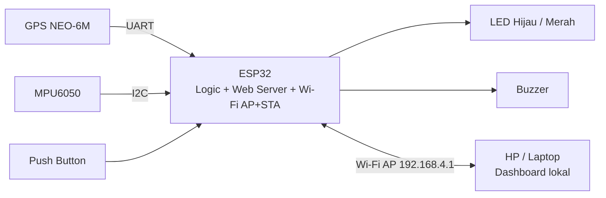
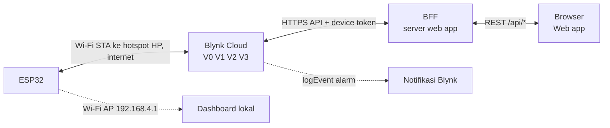
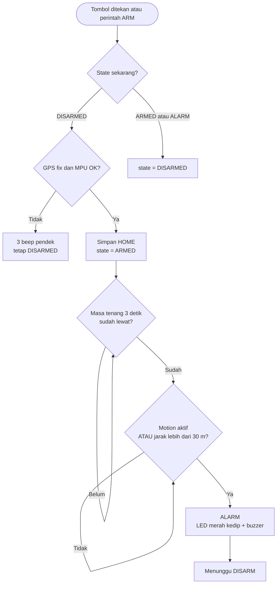
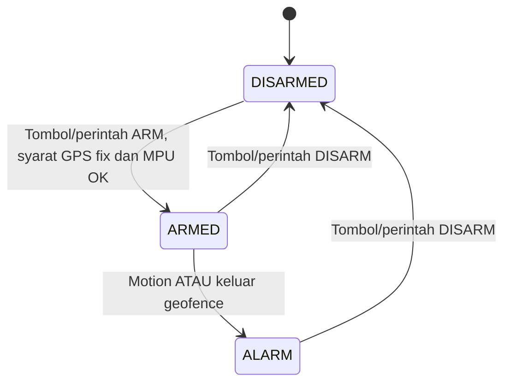

# SMARTGUARD — Presentasi Progres 1

**Smart Anti-Theft GPS Vehicle Tracker** · Proyek Akhir IoT

---

## 1. Identitas Proyek

| | |
|---|---|
| **Nama proyek** | SMARTGUARD |
| **Tema yang diberikan** | [isi tema yang diberikan] |
| **Kelompok** | [nomor/nama kelompok] |
| **Anggota** | [Nama anggota 1] · [Nama anggota 2] · [Nama anggota 3] |

---

## 2. Permasalahan dan Tujuan

**Masalah**
Kendaraan yang diparkir tanpa pengawasan rentan dicuri. Alarm biasa hanya terdengar di lokasi, tidak memberi tahu pemilik, dan tidak menunjukkan posisi kendaraan.

**Tujuan sistem**
Mendeteksi guncangan atau perpindahan kendaraan yang tidak sah, membunyikan alarm, serta memungkinkan pemilik memantau dan mengaktifkan/menonaktifkan penjagaan dari jarak jauh.

**Hasil yang diharapkan**
Prototipe alat dengan tiga state (`DISARMED`, `ARMED`, `ALARM`), dashboard lokal, dan web app untuk status live, peta, serta ARM/DISARM.

---

## 3. Konsep Solusi

**Gambaran solusi.** Saat di-**ARM**, alat menyimpan posisi saat itu sebagai `HOME`. Jika alat berguncang atau berpindah lebih dari 30 m dari `HOME`, alat masuk **ALARM** (LED merah berkedip + buzzer) dan terus berbunyi sampai di-**DISARM**.

**Fungsi utama**

- ARM menyimpan posisi saat itu sebagai `HOME`.
- Alarm aktif jika alat berguncang (motion) atau keluar dari geofence 30 m.
- ARM/DISARM dapat dilakukan lewat tombol fisik, dashboard lokal (`192.168.4.1`), dan web app.
- Alarm bertahan sampai di-DISARM.

**Batasan ruang lingkup**

- Prototipe; tidak dipasang ke kelistrikan kendaraan sungguhan.
- ESP32 adalah satu-satunya pengambil keputusan keamanan. Web app hanya menampilkan data dan mengirim permintaan, sehingga jika web atau internet mati alat tetap menjaga kendaraan.
- Ditunda ke tahap berikutnya: relay engine lock, state `WARNING`, debounce geofence, security score, event log, monitor baterai, dan hemat daya.

---

## 4. Cara Kerja Sistem

| Tahap | Penjelasan |
|---|---|
| **1. Input** | GPS NEO-6M (posisi, kecepatan, satelit), MPU6050 (gerakan), push button (ARM/DISARM). |
| **2. Proses** | ESP32 membaca tombol, GPS, dan gerakan, lalu menghitung jarak ke `HOME` dengan rumus Haversine. Satu siklus program ±20 ms. |
| **3. Keputusan** | Motion (selisih magnitude percepatan terhadap 9,81 m/s² lebih dari 2,0) **atau** jarak dari `HOME` lebih dari 30 m mengubah `ARMED` menjadi `ALARM`. |
| **4. Output** | LED merah berkedip cepat dan buzzer berbunyi; status dikirim ke dashboard lokal dan web app. |

**Aturan penting**

- ARM ditolak (3 beep pendek, tetap `DISARMED`) jika GPS belum fix atau MPU6050 tidak terdeteksi.
- Ada masa tenang 3 detik setelah ARM agar getaran saat menekan tombol tidak memicu alarm.
- `ALARM` tidak keluar otomatis; hanya DISARM yang mengakhirinya.

**Indikator**

| State | LED hijau | LED merah | Buzzer |
|---|---|---|---|
| `DISARMED` | Nyala terus | Mati | Mati |
| `ARMED` | Kedip singkat tiap 2 detik | Mati | Mati |
| `ALARM` | Mati | Kedip cepat (5 Hz) | Beep |

**Interaksi pengguna.** Lewat tombol fisik, dashboard lokal `192.168.4.1` (Wi-Fi AP milik ESP32), atau web app dari jarak jauh. Notifikasi alarm dikirim lewat `Blynk.logEvent` sehingga tetap sampai walau web app tidak dibuka.

---

## 5. Rancangan Awal Sistem

### 5.1 Diagram blok

### 5.2 Alur komunikasi: perangkat, internet, platform IoT, pengguna

### 5.3 Flowchart skenario kerja utama

### 5.4 State machine

---

## 6. Kebutuhan Hardware

| No | Komponen | Qty | Fungsi | Alasan pemilihan |
|--:|---|--:|---|---|
| 1 | ESP32 DevKit V1 | 1 | Mikrokontroler, pengambil keputusan | Wi-Fi bawaan (mode AP dan STA), GPIO cukup untuk semua sensor |
| 2 | GPS NEO-6M | 1 | Posisi dan kecepatan | Dasar geofence 30 m; antarmuka UART |
| 3 | MPU6050 / GY-521 | 1 | Deteksi gerakan | Mendeteksi guncangan lewat I2C |
| 4 | LED hijau + LED merah | 1 + 1 | Indikator state | Status terlihat langsung tanpa jaringan |
| 5 | Resistor 220 Ω | 2 | Pembatas arus LED | Melindungi LED dan GPIO |
| 6 | Active buzzer | 1 | Suara alarm | Cukup satu pin untuk membunyikan |
| 7 | Push button | 1 | ARM / DISARM | Kontrol fisik saat tanpa internet |
| 8 | Breadboard, jumper, kabel USB | 1 set | Perakitan dan daya | Mudah dibongkar pasang untuk prototipe |

**Pin mapping**

| Perangkat | Sinyal | GPIO |
|---|---|--:|
| GPS | TX GPS → RX ESP32 | 16 |
| GPS | RX GPS ← TX ESP32 | 17 |
| MPU6050 | SDA | 21 |
| MPU6050 | SCL | 22 |
| LED hijau (via 220 Ω) | Signal | 32 |
| LED merah (via 220 Ω) | Signal | 25 |
| Buzzer | Signal | 27 |
| Push button | Signal ke GND (`INPUT_PULLUP`) | 33 |

**Perkiraan biaya:** ± Rp115.000 – Rp300.000 (tergantung toko dan komponen yang sudah dimiliki).

**Ketersediaan dan kelayakan komponen:** [isi status pemeriksaan kelompok].

---

## 7. Kebutuhan Software dan IoT

**Bahasa dan perangkat pengembangan**

- Firmware ESP32 dalam C++ (Arduino framework).
- Web app: browser dan backend ringan (BFF) yang menyimpan token Blynk.

**Library**

| Library | Fungsi |
|---|---|
| `TinyGPSPlus` | Membaca data GPS |
| `Adafruit MPU6050` + `Adafruit Unified Sensor` | Membaca sensor gerak |
| `WiFi`, `WebServer`, `Wire` | Bawaan ESP32: Wi-Fi, dashboard lokal, I2C |
| `Blynk` | Koneksi ke Blynk Cloud |

**Platform IoT:** Blynk Cloud. ESP32 memakai mode Wi-Fi AP+STA: AP lokal tetap hidup, sementara STA tersambung ke hotspot HP untuk akses internet.

**Data yang dikirim lewat internet**

| Pin | Nama | Arah | Isi | Tujuan |
|---|---|---|---|---|
| `V2` | `status` | ESP32 → Web | JSON status (state, posisi, jarak, motion) | Pemantauan live dan peta |
| `V1` | `state` | ESP32 → Web | 0 DISARMED, 1 ARMED, 2 ALARM | Cek cepat dan notifikasi |
| `V0` | `cmd` | Web → ESP32 | Perintah `ARM` / `DISARM` dengan ID unik | Kendali jarak jauh |
| `V3` | `ack` | ESP32 → Web | Jawaban perintah terakhir | Konfirmasi hasil perintah ke UI |

**Fitur pemantauan dan kendali jarak jauh**

- Status live dan peta posisi.
- ARM/DISARM dari web app, dengan konfirmasi (ack).
- Notifikasi alarm lewat `Blynk.logEvent`.
- Jika data lama atau perangkat offline, web app menampilkan "tidak diketahui", bukan "aman".

> **Keamanan:** token Blynk hanya disimpan di server (BFF), tidak pernah sampai ke browser.
